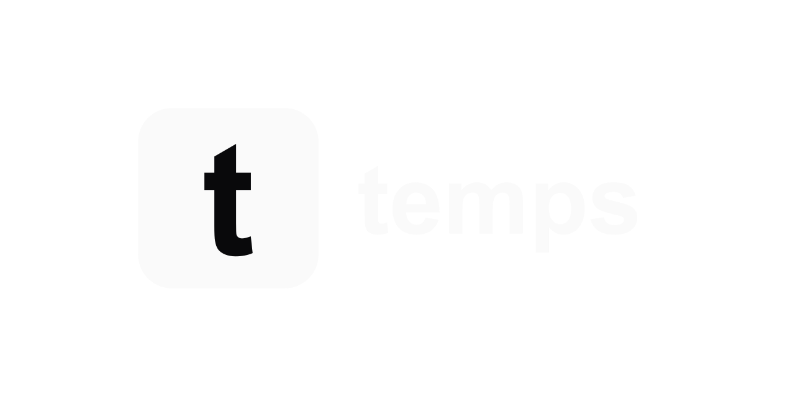
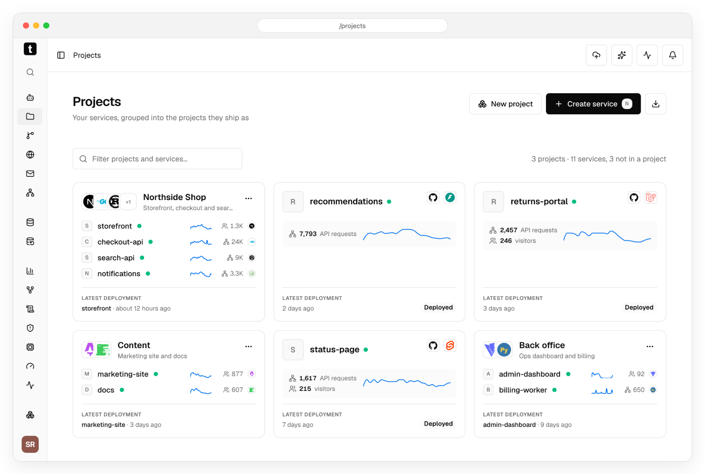
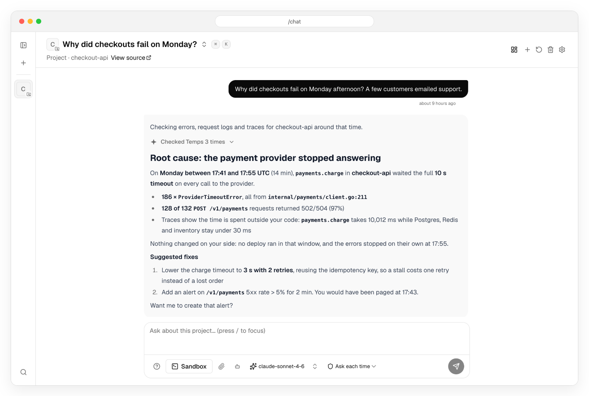
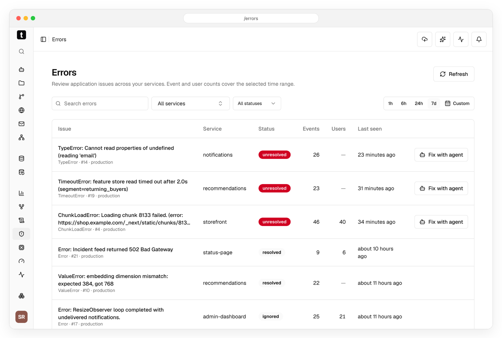
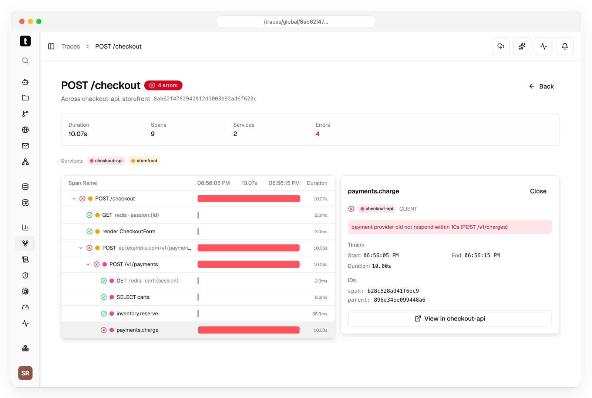
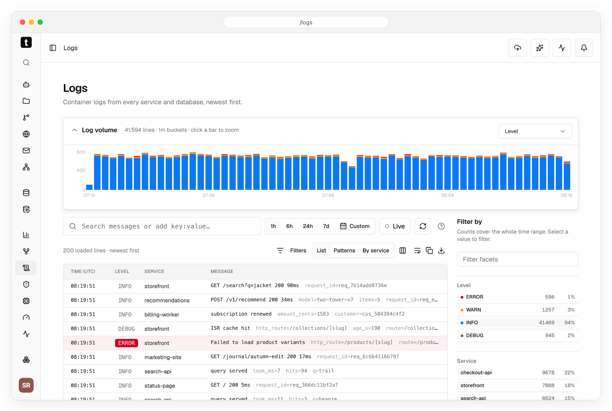
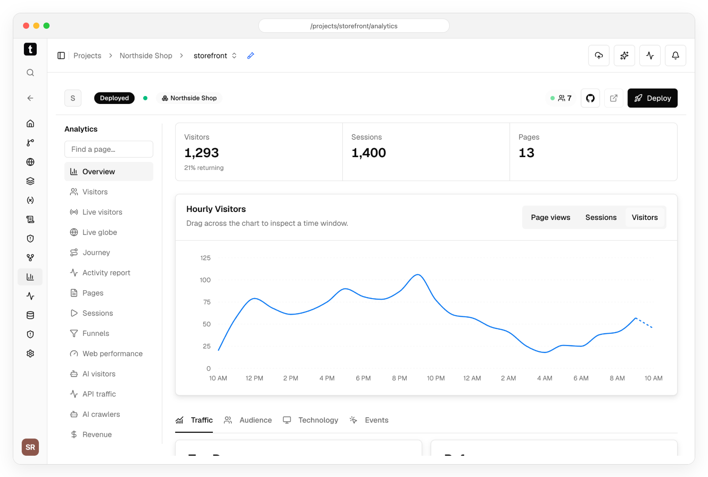
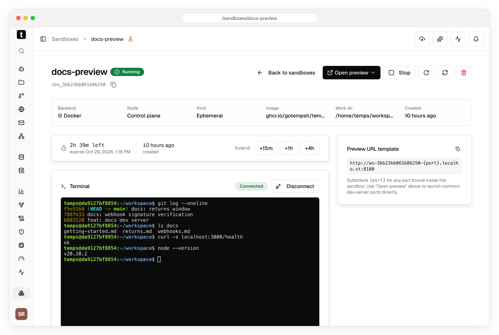

<div align="center">

<picture>
  <source media="(prefers-color-scheme: dark)" srcset="web/public/logo/temps-logo-dark.png">
  <source media="(prefers-color-scheme: light)" srcset="web/public/logo/temps-logo-light.png">
  
</picture>

**Vercel、Sentry、PostHog、Pingdom、Resend、E2B、Datadog のオープンソース代替を、セルフホストの単一バイナリで。**

[ウェブサイト](https://temps.sh/?utm_source=github&utm_medium=repo&utm_content=header_ja) · [ドキュメント](https://temps.sh/docs?utm_source=github&utm_medium=repo&utm_content=header_ja) · [ディスカッション](https://github.com/gotempsh/temps/discussions)

</div>

---

Temps は、アプリをデプロイし、その周りのすべて（データベース、アナリティクス、エラートラッキング、トレース、ログ、稼働監視、メール、AI サンドボックス、AI ゲートウェイ）を動かす、セルフホストの単一バイナリです。オープンソースで、あなた自身のサーバーで動きます。

## VPS へのインストール

```bash
curl -fsSL https://temps.sh/deploy.sh | bash
```

新しい Ubuntu 24.04 または 22.04 サーバーで実行してください。Docker がなければインストールし、PostgreSQL を起動し、自動 HTTPS 付きのサービスとして Temps をセットアップして、コンソールの URL と管理者パスワードを表示します。まだドメインがない場合は `quick` モードを選ぶと `https://console.<サーバーIP>.sslip.io` が使えます。

[クイックスタート](https://temps.sh/docs/quickstart?utm_source=github&utm_medium=repo&utm_content=install_ja) · [サーバーの選び方](https://temps.sh/docs/choosing-a-server?utm_source=github&utm_medium=repo&utm_content=install_ja) · サーバーを運用したくない場合は [Temps Cloud](https://temps.sh/pricing?utm_source=github&utm_medium=repo&utm_content=cloud_cta_ja)

<picture>
  <source media="(prefers-color-scheme: dark)" srcset="assets/screenshots/dashboard-dark.png">
  
</picture>

## 機能

- **Git push でデプロイ** — どの言語でもプレビュー URL とダウンタイムなしのロールアウト。自動検出、または Dockerfile や Docker Compose ファイルから。 [ドキュメント](https://temps.sh/docs/deployments)
- **マネージドデータベース** — PostgreSQL、Redis、MongoDB、MariaDB、S3 互換ストレージをバックアップ付きで。 [ドキュメント](https://temps.sh/docs/set-up-managed-services)
- **ドメインと TLS** — 独自ドメインと Let's Encrypt 証明書の自動発行。 [ドキュメント](https://temps.sh/docs/domains-ssl)
- **Web アナリティクスとセッションリプレイ** — 訪問者、ページ、ファネル、リプレイを自分のサーバーで収集。 [ドキュメント](https://temps.sh/docs/analytics)
- **エラートラッキング** — Sentry 互換。既存の Sentry SDK の送信先を Temps に向けるだけ。 [ドキュメント](https://temps.sh/docs/error-tracking)
- **トレース、メトリクス、ログ** — OpenTelemetry の取り込み、サービスをまたぐトレース、検索できるコンテナログとリクエストログ。 [ドキュメント](https://temps.sh/docs/opentelemetry)
- **稼働監視とアラート** — ヘルスチェック、ステータスページ、アラートルール。 [ドキュメント](https://temps.sh/docs/monitoring)
- **トランザクションメール** — SMTP または SES から DKIM 付きで送信。 [ドキュメント](https://temps.sh/docs/transactional-email)
- **AI サンドボックス** — コードを実行するための分離された Docker / Firecracker サンドボックス。ターミナルとプレビュー URL 付き。 [ドキュメント](https://temps.sh/docs/sandboxes)
- **AI ゲートウェイ** — 自分のプロバイダーキー用の OpenAI 互換エンドポイント。モデルごとの使用量とコスト付き。 [ドキュメント](https://temps.sh/docs/ai-gateway)
- **AI チャット** — プロジェクトについて質問すると、そのプロジェクト自身のエラー、ログ、トレースから答えます。変更を許可しない限り読み取り専用です。
- **インポート** — Vercel、Netlify、Railway、Render、Fly.io、Coolify、Dokploy、CapRover、Portainer、Kamal、Kubernetes から、アプリ、データごとのデータベース、ドメイン、環境変数を移行。 [ドキュメント](https://temps.sh/docs/import-existing-platform)

<table>
  <tr>
    <td width="50%">
      <picture>
        <source media="(prefers-color-scheme: dark)" srcset="assets/screenshots/ai-chat-dark.png">
        
      </picture>
    </td>
    <td width="50%">
      <picture>
        <source media="(prefers-color-scheme: dark)" srcset="assets/screenshots/errors-dark.png">
        
      </picture>
    </td>
  </tr>
  <tr>
    <td width="50%">
      <picture>
        <source media="(prefers-color-scheme: dark)" srcset="assets/screenshots/traces-dark.png">
        
      </picture>
    </td>
    <td width="50%">
      <picture>
        <source media="(prefers-color-scheme: dark)" srcset="assets/screenshots/logs-dark.png">
        
      </picture>
    </td>
  </tr>
  <tr>
    <td width="50%">
      <picture>
        <source media="(prefers-color-scheme: dark)" srcset="assets/screenshots/analytics-dark.png">
        
      </picture>
    </td>
    <td width="50%">
      <picture>
        <source media="(prefers-color-scheme: dark)" srcset="assets/screenshots/sandbox-detail-dark.png">
        
      </picture>
    </td>
  </tr>
</table>

## AI で始める

コンソールのすべての操作は CLI コマンドとしても使えます。Temps には、コーディングエージェント（Claude Code、Codex、Cursor、OpenCode など）にその使い方を教えるスキルが付属しています。エージェントを接続して、セットアップを任せましょう：

```bash
bunx skills add gotempsh/temps --skill temps
bunx @temps-sdk/cli login https://console.your-server.example
```

次に、エージェントにこう頼みます：

> Use the Temps skill to verify my connection and list the services on this instance. Do not make any changes.

> Use the Temps skill to deploy this repository to Temps and tell me its URL when it is live.

無人で動かすエージェントには、コンソールの **Connect your coding agent**（`/setup/ai`）を開いてください。専用の API キーを作成し、エージェントの最初のリクエストが届いたかを確認します。

[スキル](https://temps.sh/docs/skills) · [CLI](https://temps.sh/docs/cli) · [MCP サーバー](https://temps.sh/docs/mcp-servers)

## ドキュメント

そのほかのすべてはドキュメントにあります： **[temps.sh/docs](https://temps.sh/docs?utm_source=github&utm_medium=repo&utm_content=docs_ja)**:

- [はじめてのデプロイ](https://temps.sh/docs/your-first-deployment)
- [ほかのプラットフォームからのインポート](https://temps.sh/docs/import-existing-platform)
- [SDK](https://temps.sh/docs/sdks) —— アナリティクス、エラートラッキング、KV、Blob ストレージ
- [本番運用チェックリスト](https://temps.sh/docs/production-checklist) と [アップグレード](https://temps.sh/docs/upgrade-temps)
- [Temps と他サービスの比較](https://temps.sh/compare?utm_source=github&utm_medium=repo&utm_content=compare_ja) （Vercel、Coolify、Dokploy など）

## テレメトリ

Temps は、セルフホスト環境が正しく動いているかをメンテナーが把握できるよう、匿名の利用イベント（ランダムなインスタンス ID、`deploy_succeeded` などのイベント名、件数）を送信します。メールアドレス、IP、リポジトリ名、ドメイン、入力内容は一切送信せず、アプリケーションのデータがサーバーの外に出ることはありません。**Settings › Telemetry** で無効にするか、ホスト全体では `TEMPS_TELEMETRY=0` を設定してください。 [詳細](https://temps.sh/docs/data-ownership-and-privacy#anonymous-telemetry)

## コミュニティと貢献

質問やアイデアは [Discussions](https://github.com/gotempsh/temps/discussions) へ、バグは [Issues](https://github.com/gotempsh/temps/issues) へ。貢献を歓迎します：[CONTRIBUTING.md](CONTRIBUTING.md) をご覧ください。

## ライセンス

[MIT](LICENSE-MIT) または [Apache 2.0](LICENSE) のデュアルライセンスです。フォークや派生物は、名称を変えたものや商用の配布も含めて歓迎します。ただし、選んだライセンスが求める著作権表示、ライセンス表示、帰属表示は残してください。[NOTICE](NOTICE) を参照してください。

---

<div align="center">

[temps.sh](https://temps.sh/?utm_source=github&utm_medium=repo&utm_content=footer_ja) | [ドキュメント](https://temps.sh/docs?utm_source=github&utm_medium=repo&utm_content=footer_ja) | [GitHub](https://github.com/gotempsh/temps)

[English](README.md) | [简体中文](README.zh-CN.md) | [Español](README.es.md) | [Français](README.fr.md) | [Deutsch](README.de.md) | 日本語 | [Português](README.pt-BR.md)

</div>
