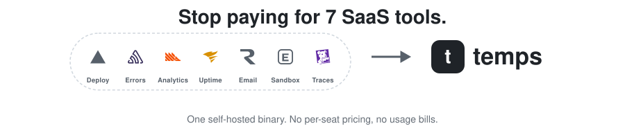

<div align="center">

<picture>
  <source media="(prefers-color-scheme: dark)" srcset="assets/hero/stop-paying-dark.svg">
  
</picture>

[Website](https://temps.sh/?utm_source=github&utm_medium=repo&utm_content=header_en) · [Docs](https://temps.sh/docs?utm_source=github&utm_medium=repo&utm_content=header_en) · [Discussions](https://github.com/gotempsh/temps/discussions)

</div>

---

Temps is one self-hosted binary that deploys your apps and runs everything around them: databases, analytics, error tracking, traces, logs, uptime, email, AI sandboxes and an AI gateway. Open source, on your own server.

## Install on a VPS

```bash
curl -fsSL https://temps.sh/deploy.sh | bash
```

Run it on a fresh Ubuntu 24.04 or 22.04 server. It installs Docker if it is missing, runs PostgreSQL, sets Temps up as a service with automatic HTTPS, and prints your console URL and admin password. No domain yet? Pick `quick` mode and you get `https://console.<server-ip>.sslip.io`.

[Quickstart](https://temps.sh/docs/quickstart?utm_source=github&utm_medium=repo&utm_content=install_en) · [Choosing a server](https://temps.sh/docs/choosing-a-server?utm_source=github&utm_medium=repo&utm_content=install_en) · Rather not run a server? [Temps Cloud](https://temps.sh/pricing?utm_source=github&utm_medium=repo&utm_content=cloud_cta_en)

<picture>
  <source media="(prefers-color-scheme: dark)" srcset="assets/screenshots/dashboard-dark.png">
  
</picture>

## Features

<table>
  <tr>
    <td width="50%" valign="top">
      <b>Git push to deploy</b><br>
      Preview URLs and zero-downtime rollouts for any language, auto-detected or from your Dockerfile or Docker Compose file. <a href="https://temps.sh/docs/deployments">Docs</a><br><br>
      <picture>
        <source media="(prefers-color-scheme: dark)" srcset="assets/screenshots/deployments-dark.png">
        
      </picture>
    </td>
    <td width="50%" valign="top">
      <b>Managed databases</b><br>
      PostgreSQL, Redis, MongoDB, MariaDB and S3-compatible storage, with backups. <a href="https://temps.sh/docs/set-up-managed-services">Docs</a><br><br>
      <picture>
        <source media="(prefers-color-scheme: dark)" srcset="assets/screenshots/databases-dark.png">
        
      </picture>
    </td>
  </tr>
  <tr>
    <td width="50%" valign="top">
      <b>Domains & TLS</b><br>
      Custom and wildcard domains with automatic Let's Encrypt certificates. <a href="https://temps.sh/docs/domains-ssl">Docs</a><br><br>
      <picture>
        <source media="(prefers-color-scheme: dark)" srcset="assets/screenshots/domains-dark.png">
        
      </picture>
    </td>
    <td width="50%" valign="top">
      <b>Web analytics</b><br>
      Visitors, pages, sources, funnels and web performance, collected by your own server. <a href="https://temps.sh/docs/analytics">Docs</a><br><br>
      <picture>
        <source media="(prefers-color-scheme: dark)" srcset="assets/screenshots/analytics-dark.png">
        
      </picture>
    </td>
  </tr>
  <tr>
    <td width="50%" valign="top">
      <b>Session replay</b><br>
      Watch a visit as it happened, with form inputs masked by default. <a href="https://temps.sh/docs/session-replay">Docs</a><br><br>
      <picture>
        <source media="(prefers-color-scheme: dark)" srcset="assets/screenshots/session-replay-dark.png">
        
      </picture>
    </td>
    <td width="50%" valign="top">
      <b>Error tracking</b><br>
      Sentry-compatible: point your existing Sentry SDK at Temps, then hand an issue to your coding agent. <a href="https://temps.sh/docs/error-tracking">Docs</a><br><br>
      <picture>
        <source media="(prefers-color-scheme: dark)" srcset="assets/screenshots/errors-dark.png">
        
      </picture>
    </td>
  </tr>
  <tr>
    <td width="50%" valign="top">
      <b>Distributed traces</b><br>
      OpenTelemetry ingest, with traces that follow one request across services down to the failing span. <a href="https://temps.sh/docs/opentelemetry">Docs</a><br><br>
      <picture>
        <source media="(prefers-color-scheme: dark)" srcset="assets/screenshots/traces-dark.png">
        
      </picture>
    </td>
    <td width="50%" valign="top">
      <b>Logs</b><br>
      Container and request logs from every service in one searchable view, with volume by level. <a href="https://temps.sh/docs/logs">Docs</a><br><br>
      <picture>
        <source media="(prefers-color-scheme: dark)" srcset="assets/screenshots/logs-dark.png">
        
      </picture>
    </td>
  </tr>
  <tr>
    <td width="50%" valign="top">
      <b>Uptime & alerts</b><br>
      Health checks, status pages and alert rules. <a href="https://temps.sh/docs/monitoring">Docs</a><br><br>
      <picture>
        <source media="(prefers-color-scheme: dark)" srcset="assets/screenshots/uptime-dark.png">
        
      </picture>
    </td>
    <td width="50%" valign="top">
      <b>Transactional email</b><br>
      Send through SMTP or SES with DKIM, and see every message with its delivery, opens and clicks. <a href="https://temps.sh/docs/transactional-email">Docs</a><br><br>
      <picture>
        <source media="(prefers-color-scheme: dark)" srcset="assets/screenshots/email-dark.png">
        
      </picture>
    </td>
  </tr>
  <tr>
    <td width="50%" valign="top">
      <b>AI sandboxes</b><br>
      Isolated Docker or Firecracker sandboxes for running code, with a terminal and preview URLs. <a href="https://temps.sh/docs/sandboxes">Docs</a><br><br>
      <picture>
        <source media="(prefers-color-scheme: dark)" srcset="assets/screenshots/sandbox-detail-dark.png">
        
      </picture>
    </td>
    <td width="50%" valign="top">
      <b>AI gateway</b><br>
      One OpenAI-compatible endpoint for your own provider keys, with usage and cost per model. <a href="https://temps.sh/docs/ai-gateway">Docs</a><br><br>
      <picture>
        <source media="(prefers-color-scheme: dark)" srcset="assets/screenshots/ai-usage-dark.png">
        
      </picture>
    </td>
  </tr>
  <tr>
    <td width="50%" valign="top">
      <b>AI chat</b><br>
      Ask about a project and get answers from its own errors, logs and traces. Read-only unless you allow changes.<br><br>
      <picture>
        <source media="(prefers-color-scheme: dark)" srcset="assets/screenshots/ai-chat-dark.png">
        
      </picture>
    </td>
    <td width="50%" valign="top">
      <b>Import</b><br>
      Bring apps, databases with their data, domains and environment variables from Kubernetes, Coolify, Dokploy, CapRover, Portainer, Kamal or plain Docker containers, and from Vercel with <code>temps migrate</code>. <a href="https://temps.sh/docs/import-existing-platform">Docs</a><br><br>
      <picture>
        <source media="(prefers-color-scheme: dark)" srcset="assets/screenshots/import-dark.png">
        
      </picture>
    </td>
  </tr>
</table>

## Get started with AI

Every console operation is also a CLI command, and Temps ships a skill that teaches coding agents (Claude Code, Codex, Cursor, OpenCode and others) how to use them. Connect yours and let it do the setup:

```bash
bunx skills add gotempsh/temps --skill temps
bunx @temps-sdk/cli login https://console.your-server.example
```

Then ask your agent:

> Use the Temps skill to verify my connection and list the services on this instance. Do not make any changes.

> Use the Temps skill to deploy this repository to Temps and tell me its URL when it is live.

For an agent that runs unattended, open **Connect your coding agent** in the console (`/setup/ai`): it creates a dedicated API key and checks that the agent's first request arrives.

[Skills](https://temps.sh/docs/skills) · [CLI](https://temps.sh/docs/cli) · [MCP servers](https://temps.sh/docs/mcp-servers)

## Documentation

Everything else is in the docs at **[temps.sh/docs](https://temps.sh/docs?utm_source=github&utm_medium=repo&utm_content=docs_en)**:

- [Your first deployment](https://temps.sh/docs/your-first-deployment)
- [Import from another platform](https://temps.sh/docs/import-existing-platform)
- [SDKs](https://temps.sh/docs/sdks) — analytics, error tracking, KV and blob storage
- [Production checklist](https://temps.sh/docs/production-checklist) and [upgrading](https://temps.sh/docs/upgrade-temps)
- [How Temps compares](https://temps.sh/compare?utm_source=github&utm_medium=repo&utm_content=compare_en) to Vercel, Coolify, Dokploy and others

## Telemetry

Temps sends anonymous usage events (a random instance ID, event names such as `deploy_succeeded`, and counts) so the maintainers can see whether self-hosted installs work. It never sends emails, IPs, repository names, domains or anything you typed, and your application data never leaves your server. Turn it off in **Settings › Telemetry**, or for a whole host with `TEMPS_TELEMETRY=0`. [Details](https://temps.sh/docs/data-ownership-and-privacy#anonymous-telemetry)

## Community & contributing

Questions and ideas in [Discussions](https://github.com/gotempsh/temps/discussions), bugs in [Issues](https://github.com/gotempsh/temps/issues). Contributions are welcome: see [CONTRIBUTING.md](CONTRIBUTING.md).

## License

Dual-licensed under [MIT](LICENSE-MIT) or [Apache 2.0](LICENSE). Forks and derivative works are welcome, including rebranded and commercial distributions, as long as they keep the copyright, license and attribution notices the chosen license requires. See [NOTICE](NOTICE).

---

<div align="center">

[temps.sh](https://temps.sh/?utm_source=github&utm_medium=repo&utm_content=footer_en) | [Documentation](https://temps.sh/docs?utm_source=github&utm_medium=repo&utm_content=footer_en) | [GitHub](https://github.com/gotempsh/temps)

English | [简体中文](README.zh-CN.md) | [Español](README.es.md) | [Français](README.fr.md) | [Deutsch](README.de.md) | [日本語](README.ja.md) | [Português](README.pt-BR.md)

</div>
