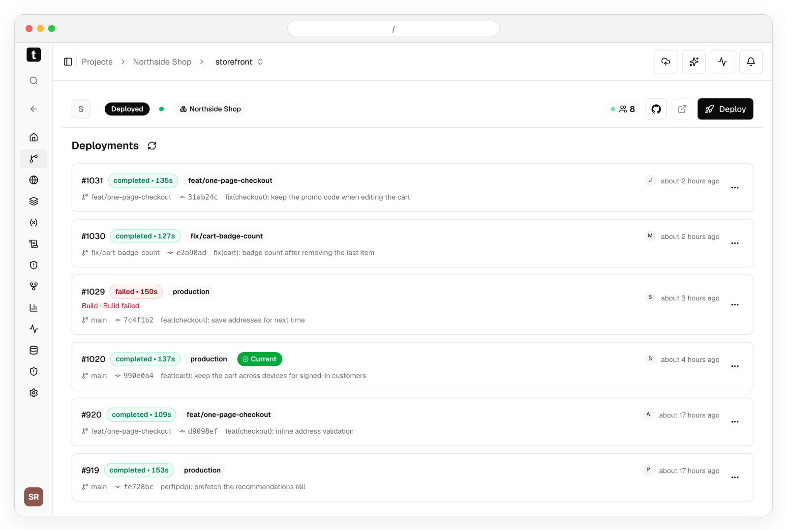
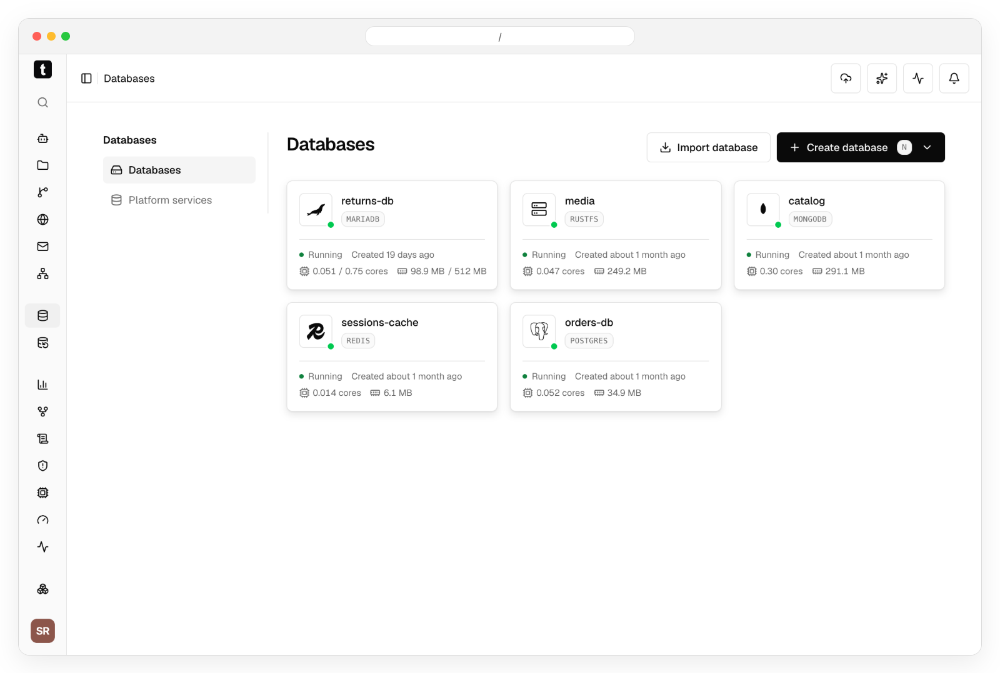
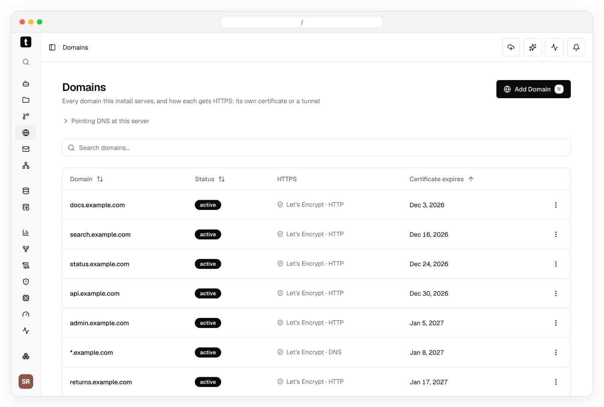
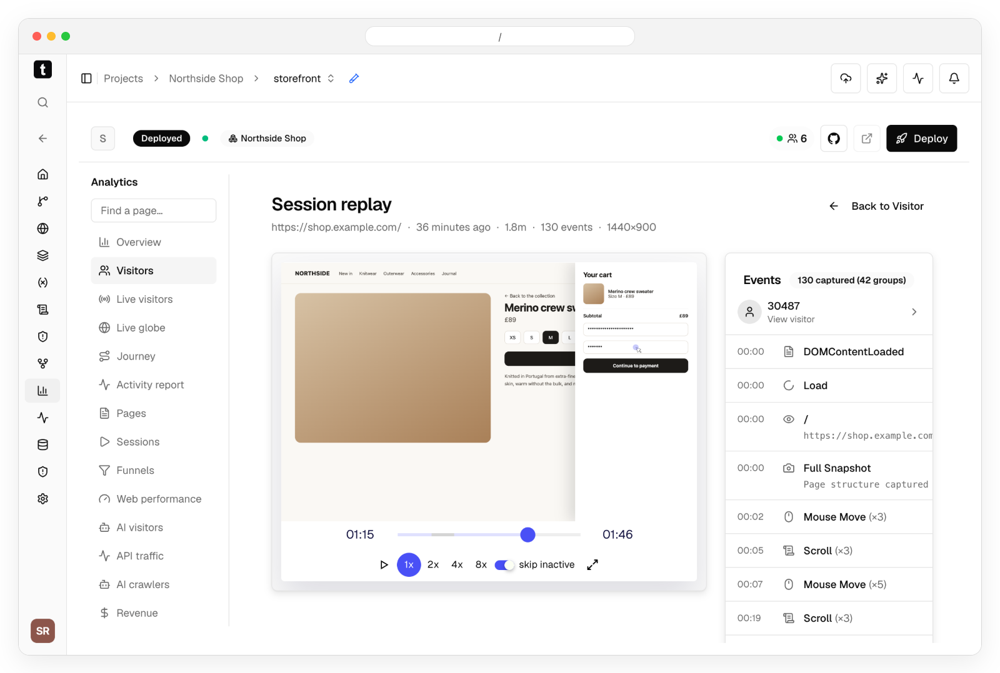
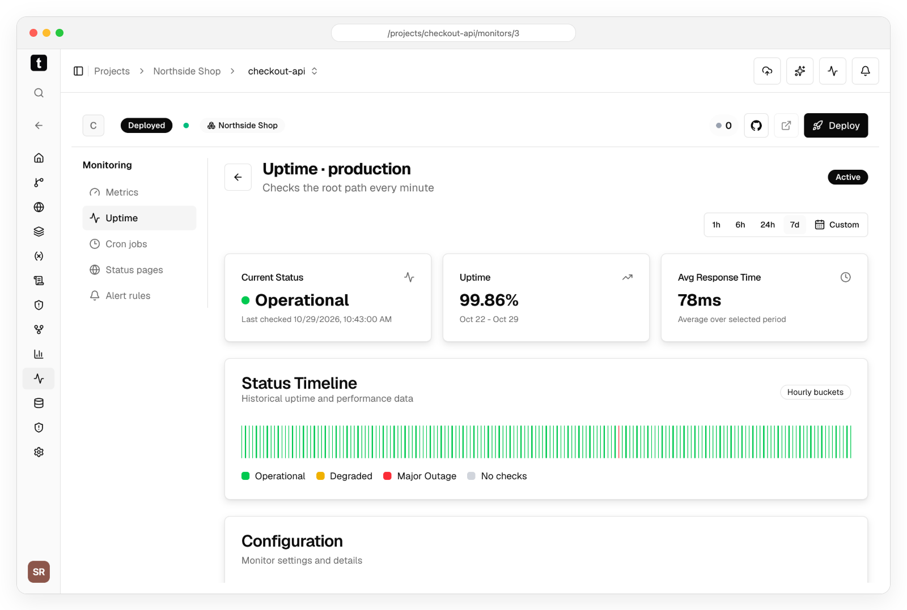
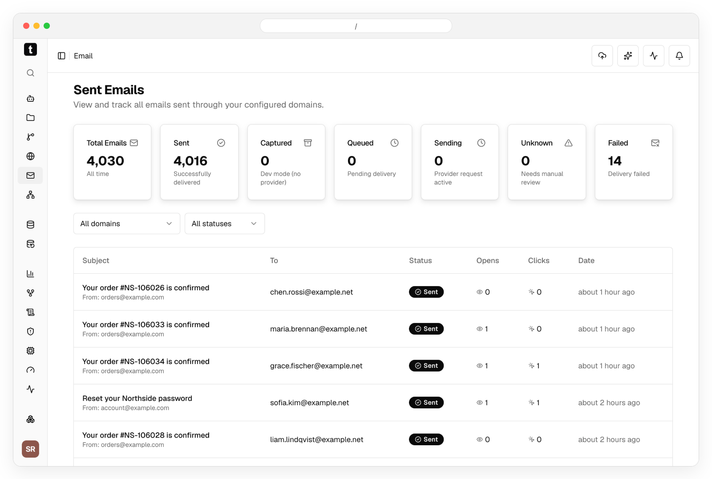
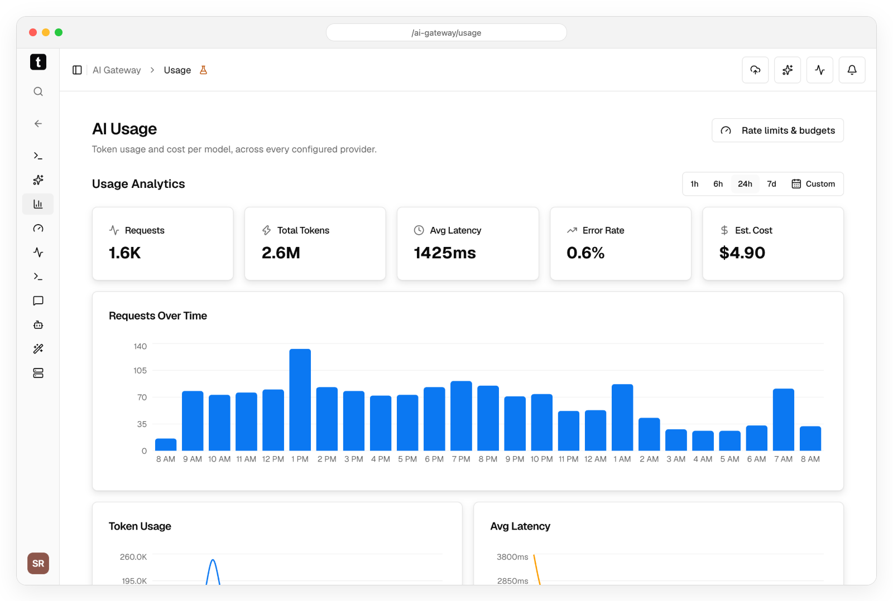
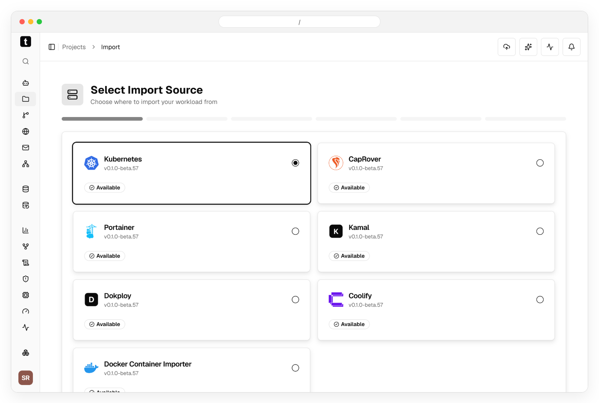

<div align="center">

<picture>
  <source media="(prefers-color-scheme: dark)" srcset="web/public/logo/temps-logo-dark.png">
  <source media="(prefers-color-scheme: light)" srcset="web/public/logo/temps-logo-light.png">
  
</picture>

**A alternativa open source ao Vercel, Sentry, PostHog, Pingdom, Resend, E2B e Datadog, em um único binário auto-hospedado.**

[Site](https://temps.sh/?utm_source=github&utm_medium=repo&utm_content=header_pt-BR) · [Documentação](https://temps.sh/docs?utm_source=github&utm_medium=repo&utm_content=header_pt-BR) · [Discussões](https://github.com/gotempsh/temps/discussions)

</div>

---

Temps é um único binário auto-hospedado que faz o deploy das suas aplicações e roda tudo o que há em volta delas: bancos de dados, analytics, rastreamento de erros, traces, logs, uptime, email, sandboxes de IA e um gateway de IA. Open source, no seu próprio servidor.

## Instalação em uma VPS

```bash
curl -fsSL https://temps.sh/deploy.sh | bash
```

Execute em um servidor Ubuntu 24.04 ou 22.04 novo. Ele instala o Docker se estiver faltando, roda o PostgreSQL, configura o Temps como serviço com HTTPS automático e mostra a URL do console e a senha de administrador. Ainda sem domínio? Escolha o modo `quick` e você recebe `https://console.<ip-do-servidor>.sslip.io`.

[Início rápido](https://temps.sh/docs/quickstart?utm_source=github&utm_medium=repo&utm_content=install_pt-BR) · [Escolhendo um servidor](https://temps.sh/docs/choosing-a-server?utm_source=github&utm_medium=repo&utm_content=install_pt-BR) · Prefere não manter um servidor? [Temps Cloud](https://temps.sh/pricing?utm_source=github&utm_medium=repo&utm_content=cloud_cta_pt-BR)

<a href="assets/screenshots/dashboard-light.png">
  <picture>
    <source media="(prefers-color-scheme: dark)" srcset="assets/screenshots/dashboard-dark.png">
    
  </picture>
</a><br>
<sub>Tamanho original: <a href="assets/screenshots/dashboard-light.png">claro</a> · <a href="assets/screenshots/dashboard-dark.png">escuro</a></sub>

## Funcionalidades

<table>
  <tr>
    <td width="50%" valign="top">
      <b>Deploy com git push</b><br>
      URLs de preview e deploys sem downtime para qualquer linguagem, detectados automaticamente ou a partir do seu Dockerfile ou arquivo Docker Compose. <a href="https://temps.sh/docs/deployments">Docs</a><br><br>
      <a href="assets/screenshots/deployments-light.png">
        <picture>
          <source media="(prefers-color-scheme: dark)" srcset="assets/screenshots/deployments-dark.png">
          
        </picture>
      </a><br>
      <sub>Tamanho original: <a href="assets/screenshots/deployments-light.png">claro</a> · <a href="assets/screenshots/deployments-dark.png">escuro</a></sub>
    </td>
    <td width="50%" valign="top">
      <b>Bancos de dados gerenciados</b><br>
      PostgreSQL, Redis, MongoDB, MariaDB e armazenamento compatível com S3, com backups. <a href="https://temps.sh/docs/set-up-managed-services">Docs</a><br><br>
      <a href="assets/screenshots/databases-light.png">
        <picture>
          <source media="(prefers-color-scheme: dark)" srcset="assets/screenshots/databases-dark.png">
          
        </picture>
      </a><br>
      <sub>Tamanho original: <a href="assets/screenshots/databases-light.png">claro</a> · <a href="assets/screenshots/databases-dark.png">escuro</a></sub>
    </td>
  </tr>
  <tr>
    <td width="50%" valign="top">
      <b>Domínios e TLS</b><br>
      Domínios próprios e curinga com certificados Let's Encrypt automáticos. <a href="https://temps.sh/docs/domains-ssl">Docs</a><br><br>
      <a href="assets/screenshots/domains-light.png">
        <picture>
          <source media="(prefers-color-scheme: dark)" srcset="assets/screenshots/domains-dark.png">
          
        </picture>
      </a><br>
      <sub>Tamanho original: <a href="assets/screenshots/domains-light.png">claro</a> · <a href="assets/screenshots/domains-dark.png">escuro</a></sub>
    </td>
    <td width="50%" valign="top">
      <b>Web analytics</b><br>
      Visitantes, páginas, origens, funis e performance web, coletados pelo seu próprio servidor. <a href="https://temps.sh/docs/analytics">Docs</a><br><br>
      <a href="assets/screenshots/analytics-light.png">
        <picture>
          <source media="(prefers-color-scheme: dark)" srcset="assets/screenshots/analytics-dark.png">
          
        </picture>
      </a><br>
      <sub>Tamanho original: <a href="assets/screenshots/analytics-light.png">claro</a> · <a href="assets/screenshots/analytics-dark.png">escuro</a></sub>
    </td>
  </tr>
  <tr>
    <td width="50%" valign="top">
      <b>Session replay</b><br>
      Assista a uma visita como ela aconteceu, com campos de formulário mascarados por padrão. <a href="https://temps.sh/docs/session-replay">Docs</a><br><br>
      <a href="assets/screenshots/session-replay-light.png">
        <picture>
          <source media="(prefers-color-scheme: dark)" srcset="assets/screenshots/session-replay-dark.png">
          
        </picture>
      </a><br>
      <sub>Tamanho original: <a href="assets/screenshots/session-replay-light.png">claro</a> · <a href="assets/screenshots/session-replay-dark.png">escuro</a></sub>
    </td>
    <td width="50%" valign="top">
      <b>Rastreamento de erros</b><br>
      Compatível com Sentry: aponte seu SDK do Sentry atual para o Temps e passe um erro para o seu agente de código. <a href="https://temps.sh/docs/error-tracking">Docs</a><br><br>
      <a href="assets/screenshots/errors-light.png">
        <picture>
          <source media="(prefers-color-scheme: dark)" srcset="assets/screenshots/errors-dark.png">
          
        </picture>
      </a><br>
      <sub>Tamanho original: <a href="assets/screenshots/errors-light.png">claro</a> · <a href="assets/screenshots/errors-dark.png">escuro</a></sub>
    </td>
  </tr>
  <tr>
    <td width="50%" valign="top">
      <b>Traces distribuídos</b><br>
      Ingestão OpenTelemetry, com traces que seguem uma requisição entre serviços até o span que falhou. <a href="https://temps.sh/docs/opentelemetry">Docs</a><br><br>
      <a href="assets/screenshots/traces-light.png">
        <picture>
          <source media="(prefers-color-scheme: dark)" srcset="assets/screenshots/traces-dark.png">
          
        </picture>
      </a><br>
      <sub>Tamanho original: <a href="assets/screenshots/traces-light.png">claro</a> · <a href="assets/screenshots/traces-dark.png">escuro</a></sub>
    </td>
    <td width="50%" valign="top">
      <b>Logs</b><br>
      Logs de contêineres e de requisições de todos os serviços em uma única visão pesquisável, com volume por nível. <a href="https://temps.sh/docs/logs">Docs</a><br><br>
      <a href="assets/screenshots/logs-light.png">
        <picture>
          <source media="(prefers-color-scheme: dark)" srcset="assets/screenshots/logs-dark.png">
          
        </picture>
      </a><br>
      <sub>Tamanho original: <a href="assets/screenshots/logs-light.png">claro</a> · <a href="assets/screenshots/logs-dark.png">escuro</a></sub>
    </td>
  </tr>
  <tr>
    <td width="50%" valign="top">
      <b>Uptime e alertas</b><br>
      Health checks, páginas de status e regras de alerta. <a href="https://temps.sh/docs/monitoring">Docs</a><br><br>
      <a href="assets/screenshots/uptime-light.png">
        <picture>
          <source media="(prefers-color-scheme: dark)" srcset="assets/screenshots/uptime-dark.png">
          
        </picture>
      </a><br>
      <sub>Tamanho original: <a href="assets/screenshots/uptime-light.png">claro</a> · <a href="assets/screenshots/uptime-dark.png">escuro</a></sub>
    </td>
    <td width="50%" valign="top">
      <b>Email transacional</b><br>
      Envio por SMTP ou SES com DKIM, e cada mensagem com entrega, aberturas e cliques. <a href="https://temps.sh/docs/transactional-email">Docs</a><br><br>
      <a href="assets/screenshots/email-light.png">
        <picture>
          <source media="(prefers-color-scheme: dark)" srcset="assets/screenshots/email-dark.png">
          
        </picture>
      </a><br>
      <sub>Tamanho original: <a href="assets/screenshots/email-light.png">claro</a> · <a href="assets/screenshots/email-dark.png">escuro</a></sub>
    </td>
  </tr>
  <tr>
    <td width="50%" valign="top">
      <b>Sandboxes de IA</b><br>
      Sandboxes isolados com Docker ou Firecracker para executar código, com terminal e URLs de preview. <a href="https://temps.sh/docs/sandboxes">Docs</a><br><br>
      <a href="assets/screenshots/sandbox-detail-light.png">
        <picture>
          <source media="(prefers-color-scheme: dark)" srcset="assets/screenshots/sandbox-detail-dark.png">
          
        </picture>
      </a><br>
      <sub>Tamanho original: <a href="assets/screenshots/sandbox-detail-light.png">claro</a> · <a href="assets/screenshots/sandbox-detail-dark.png">escuro</a></sub>
    </td>
    <td width="50%" valign="top">
      <b>Gateway de IA</b><br>
      Um endpoint compatível com OpenAI para suas próprias chaves de provedor, com uso e custo por modelo. <a href="https://temps.sh/docs/ai-gateway">Docs</a><br><br>
      <a href="assets/screenshots/ai-usage-light.png">
        <picture>
          <source media="(prefers-color-scheme: dark)" srcset="assets/screenshots/ai-usage-dark.png">
          
        </picture>
      </a><br>
      <sub>Tamanho original: <a href="assets/screenshots/ai-usage-light.png">claro</a> · <a href="assets/screenshots/ai-usage-dark.png">escuro</a></sub>
    </td>
  </tr>
  <tr>
    <td width="50%" valign="top">
      <b>Chat de IA</b><br>
      Pergunte sobre um projeto e receba respostas a partir dos próprios erros, logs e traces dele. Somente leitura, a menos que você permita alterações.<br><br>
      <a href="assets/screenshots/ai-chat-light.png">
        <picture>
          <source media="(prefers-color-scheme: dark)" srcset="assets/screenshots/ai-chat-dark.png">
          
        </picture>
      </a><br>
      <sub>Tamanho original: <a href="assets/screenshots/ai-chat-light.png">claro</a> · <a href="assets/screenshots/ai-chat-dark.png">escuro</a></sub>
    </td>
    <td width="50%" valign="top">
      <b>Importação</b><br>
      Traga apps, bancos de dados com seus dados, domínios e variáveis de ambiente do Kubernetes, Coolify, Dokploy, CapRover, Portainer, Kamal ou contêineres Docker, e da Vercel com <code>temps migrate</code>. <a href="https://temps.sh/docs/import-existing-platform">Docs</a><br><br>
      <a href="assets/screenshots/import-light.png">
        <picture>
          <source media="(prefers-color-scheme: dark)" srcset="assets/screenshots/import-dark.png">
          
        </picture>
      </a><br>
      <sub>Tamanho original: <a href="assets/screenshots/import-light.png">claro</a> · <a href="assets/screenshots/import-dark.png">escuro</a></sub>
    </td>
  </tr>
</table>

## Comece com IA

O Temps inclui skills que ensinam agentes de código (Claude Code, Codex, Cursor, OpenCode e outros) a instalar o Temps em um servidor, conectar-se a ele e executar qualquer operação do console pela CLI. Adicione-as ao seu agente:

```bash
bunx skills add gotempsh/temps --skill temps temps-platform-setup
```

**Ainda sem servidor?** Dê ao seu agente um servidor Ubuntu novo que ele alcance por SSH e peça:

> Use the Temps skills to install Temps on root@203.0.113.10 in quick mode, connect the CLI to it, then deploy this repository and tell me its URL when it is live.

Ele executa o instalador oficial por SSH, deixa a senha de administrador e a chave de API geradas no servidor e te dá um link para aprovar o login da CLI no navegador, então nenhuma credencial passa pelo chat.

**Já usa o Temps?** Conecte a CLI e peça ao seu agente:

```bash
bunx @temps-sdk/cli login https://console.your-server.example
```

> Use the Temps skill to verify my connection and list the services on this instance. Do not make any changes.

> Use the Temps skill to deploy this repository to Temps and tell me its URL when it is live.

Para um agente que roda sem supervisão, abra **Connect your coding agent** no console (`/setup/ai`): a página cria uma chave de API dedicada e confirma que a primeira requisição do agente chegou.

[Skills](https://temps.sh/docs/skills) · [CLI](https://temps.sh/docs/cli) · [Servidores MCP](https://temps.sh/docs/mcp-servers)

## Documentação

Todo o resto está na documentação em **[temps.sh/docs](https://temps.sh/docs?utm_source=github&utm_medium=repo&utm_content=docs_pt-BR)**:

- [Seu primeiro deploy](https://temps.sh/docs/your-first-deployment)
- [Importar de outra plataforma](https://temps.sh/docs/import-existing-platform)
- [SDKs](https://temps.sh/docs/sdks) — analytics, rastreamento de erros, armazenamento KV e blob
- [Checklist de produção](https://temps.sh/docs/production-checklist) e [atualização](https://temps.sh/docs/upgrade-temps)
- [Como o Temps se compara](https://temps.sh/compare?utm_source=github&utm_medium=repo&utm_content=compare_pt-BR) ao Vercel, Coolify, Dokploy e outros

## Telemetria

O Temps envia eventos de uso anônimos (um ID de instância aleatório, nomes de eventos como `deploy_succeeded` e contagens) para que os mantenedores saibam se as instalações auto-hospedadas funcionam. Ele nunca envia emails, IPs, nomes de repositórios, domínios ou qualquer coisa que você digitou, e os dados das suas aplicações nunca saem do seu servidor. Desative em **Settings › Telemetry**, ou para um host inteiro com `TEMPS_TELEMETRY=0`. [Detalhes](https://temps.sh/docs/data-ownership-and-privacy#anonymous-telemetry)

## Comunidade e contribuições

Perguntas e ideias nas [Discussões](https://github.com/gotempsh/temps/discussions), bugs nas [Issues](https://github.com/gotempsh/temps/issues). Contribuições são bem-vindas: veja [CONTRIBUTING.md](CONTRIBUTING.md).

## Licença

Licença dupla [MIT](LICENSE-MIT) ou [Apache 2.0](LICENSE). Forks e trabalhos derivados são bem-vindos, incluindo distribuições com outra marca e comerciais, desde que mantenham os avisos de copyright, licença e atribuição exigidos pela licença escolhida. Veja [NOTICE](NOTICE).

---

<div align="center">

[temps.sh](https://temps.sh/?utm_source=github&utm_medium=repo&utm_content=footer_pt-BR) | [Documentação](https://temps.sh/docs?utm_source=github&utm_medium=repo&utm_content=footer_pt-BR) | [GitHub](https://github.com/gotempsh/temps)

[English](README.md) | [简体中文](README.zh-CN.md) | [Español](README.es.md) | [Français](README.fr.md) | [Deutsch](README.de.md) | [日本語](README.ja.md) | Português

</div>
