<div align="center">

<picture>
  <source media="(prefers-color-scheme: dark)" srcset="assets/hero/stop-paying-dark.svg">
  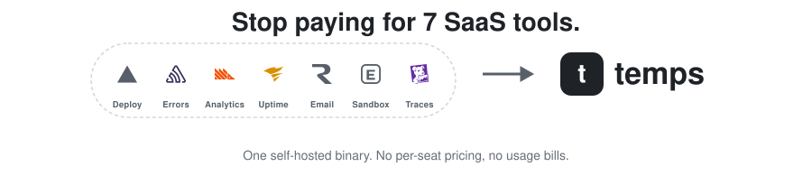
</picture>

[Web Sitesi](https://temps.sh/?utm_source=github&utm_medium=repo&utm_content=header_en) · [Belgeler](https://temps.sh/docs?utm_source=github&utm_medium=repo&utm_content=header_en) · [Tartışmalar](https://github.com/gotempsh/temps/discussions)

</div>

---

Temps, uygulamalarınızı dağıtan ve etrafındaki her şeyi (veritabanları, analitik, hata takibi, izler, günlükler, çalışma süresi izleme, e-posta, yapay zekâ korumalı alanları ve bir yapay zekâ ağ geçidi) çalıştıran, kendi sunucunuzda barındırılan (self-hosted) tek bir ikili dosyadır. Açık kaynaklıdır ve kendi sunucunuzda çalışır.

## Bir VPS'e Kurulum

```bash
curl -fsSL https://temps.sh/deploy.sh | bash
```

Komutu temiz bir Ubuntu 24.04 veya 22.04 sunucusunda çalıştırın. Eksikse Docker'ı kurar, PostgreSQL'i başlatır, Temps'i otomatik HTTPS ile bir servis olarak yapılandırır ve konsol URL'niz ile yönetici parolanızı yazdırır. Henüz bir alan adınız yok mu? `quick` modunu seçin ve `https://console.<server-ip>.sslip.io` adresini alın.

[Hızlı Başlangıç](https://temps.sh/docs/quickstart?utm_source=github&utm_medium=repo&utm_content=install_en) · [Sunucu seçimi](https://temps.sh/docs/choosing-a-server?utm_source=github&utm_medium=repo&utm_content=install_en) · Sunucu yönetmek istemiyor musunuz? [Temps Cloud](https://temps.sh/pricing?utm_source=github&utm_medium=repo&utm_content=cloud_cta_en)

<a href="assets/screenshots/dashboard-light.png">
  <picture>
    <source media="(prefers-color-scheme: dark)" srcset="assets/screenshots/dashboard-dark.png">
    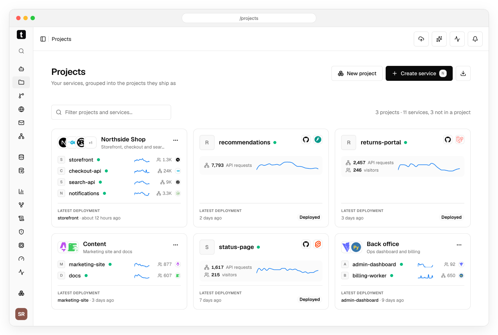
  </picture>
</a><br>
<sub>Tam boyut: <a href="assets/screenshots/dashboard-light.png">açık</a> · <a href="assets/screenshots/dashboard-dark.png">koyu</a></sub>

## Özellikler

<table>
  <tr>
    <td width="50%" valign="top">
      <b>Dağıtım için Git push</b><br>
      Otomatik algılanan ya da Dockerfile veya Docker Compose dosyanızdan oluşturulan, her dil için önizleme URL'leri ve kesintisiz dağıtımlar. <a href="https://temps.sh/docs/deployments">Belgeler</a><br><br>
      <a href="assets/screenshots/deployments-light.png">
        <picture>
          <source media="(prefers-color-scheme: dark)" srcset="assets/screenshots/deployments-dark.png">
          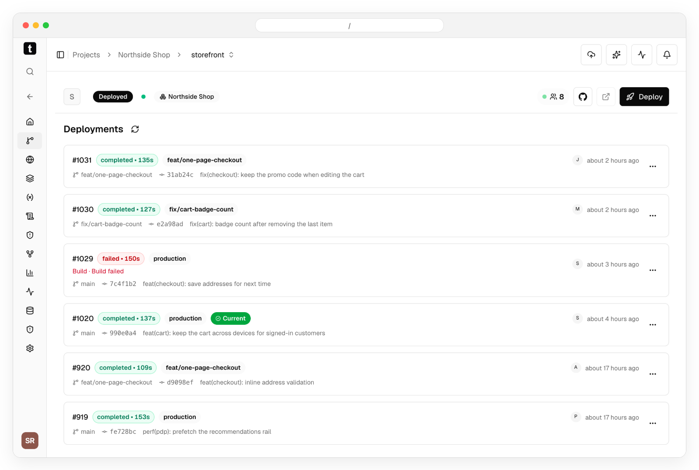
        </picture>
      </a><br>
      <sub>Tam boyut: <a href="assets/screenshots/deployments-light.png">açık</a> · <a href="assets/screenshots/deployments-dark.png">koyu</a></sub>
    </td>
    <td width="50%" valign="top">
      <b>Yönetilen veritabanları</b><br>
      Yedeklemeli PostgreSQL, Redis, MongoDB, MariaDB ve S3 uyumlu depolama. <a href="https://temps.sh/docs/set-up-managed-services">Belgeler</a><br><br>
      <a href="assets/screenshots/databases-light.png">
        <picture>
          <source media="(prefers-color-scheme: dark)" srcset="assets/screenshots/databases-dark.png">
          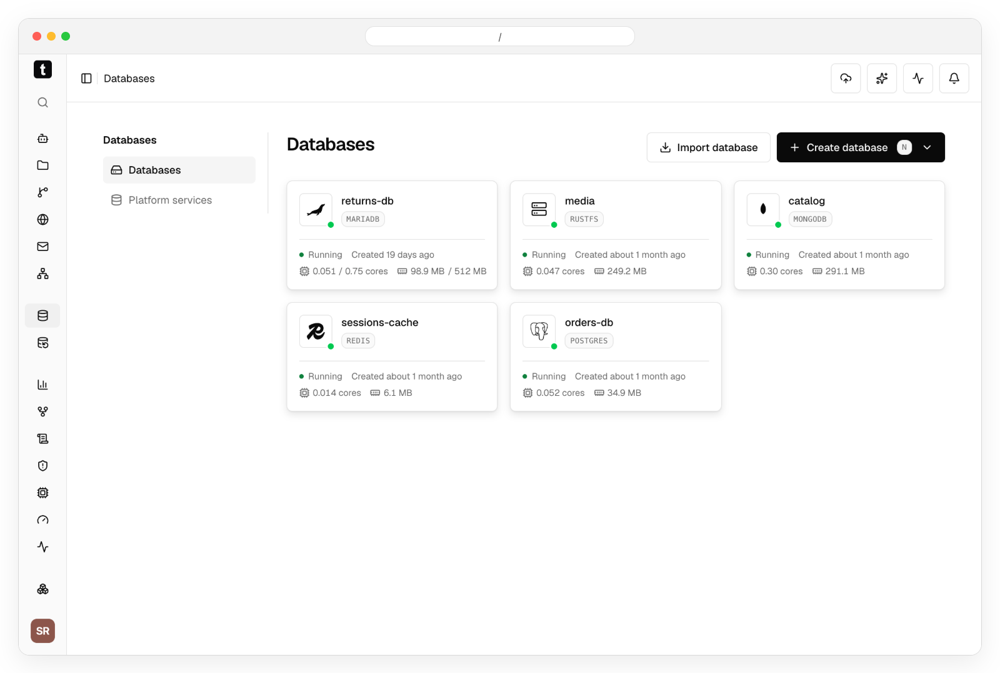
        </picture>
      </a><br>
      <sub>Tam boyut: <a href="assets/screenshots/databases-light.png">açık</a> · <a href="assets/screenshots/databases-dark.png">koyu</a></sub>
    </td>
  </tr>
  <tr>
    <td width="50%" valign="top">
      <b>Alan Adları ve TLS</b><br>
      Otomatik Let's Encrypt sertifikalarıyla özel ve joker (wildcard) alan adları. <a href="https://temps.sh/docs/domains-ssl">Belgeler</a><br><br>
      <a href="assets/screenshots/domains-light.png">
        <picture>
          <source media="(prefers-color-scheme: dark)" srcset="assets/screenshots/domains-dark.png">
          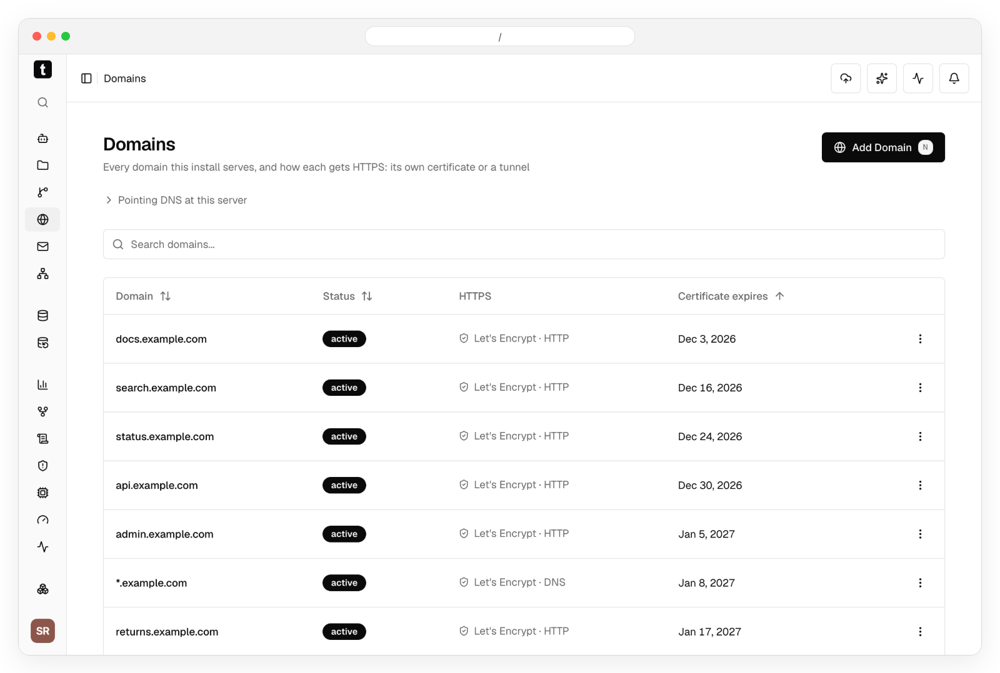
        </picture>
      </a><br>
      <sub>Tam boyut: <a href="assets/screenshots/domains-light.png">açık</a> · <a href="assets/screenshots/domains-dark.png">koyu</a></sub>
    </td>
    <td width="50%" valign="top">
      <b>Web analitiği</b><br>
      Kendi sunucunuz tarafından toplanan ziyaretçiler, sayfalar, kaynaklar, huniler ve web performansı. <a href="https://temps.sh/docs/analytics">Belgeler</a><br><br>
      <a href="assets/screenshots/analytics-light.png">
        <picture>
          <source media="(prefers-color-scheme: dark)" srcset="assets/screenshots/analytics-dark.png">
          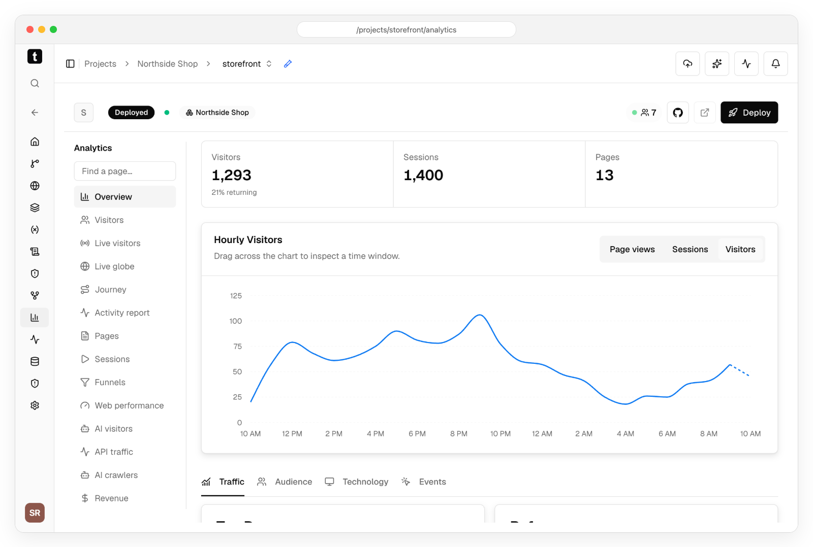
        </picture>
      </a><br>
      <sub>Tam boyut: <a href="assets/screenshots/analytics-light.png">açık</a> · <a href="assets/screenshots/analytics-dark.png">koyu</a></sub>
    </td>
  </tr>
  <tr>
    <td width="50%" valign="top">
      <b>Oturum tekrarı (Session replay)</b><br>
      Form girdileri varsayılan olarak maskelenmiş şekilde bir ziyareti gerçekleştiği gibi izleyin. <a href="https://temps.sh/docs/session-replay">Belgeler</a><br><br>
      <a href="assets/screenshots/session-replay-light.png">
        <picture>
          <source media="(prefers-color-scheme: dark)" srcset="assets/screenshots/session-replay-dark.png">
          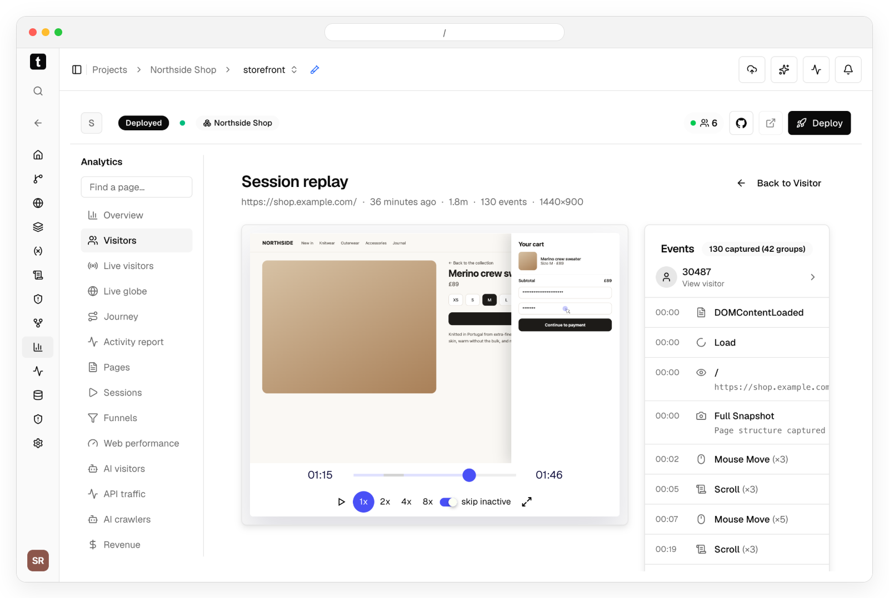
        </picture>
      </a><br>
      <sub>Tam boyut: <a href="assets/screenshots/session-replay-light.png">açık</a> · <a href="assets/screenshots/session-replay-dark.png">koyu</a></sub>
    </td>
    <td width="50%" valign="top">
      <b>Hata takibi</b><br>
      Sentry uyumlu: mevcut Sentry SDK'nızı Temps'e yönlendirin, ardından bir sorunu kodlama ajanınıza devredin. <a href="https://temps.sh/docs/error-tracking">Belgeler</a><br><br>
      <a href="assets/screenshots/errors-light.png">
        <picture>
          <source media="(prefers-color-scheme: dark)" srcset="assets/screenshots/errors-dark.png">
          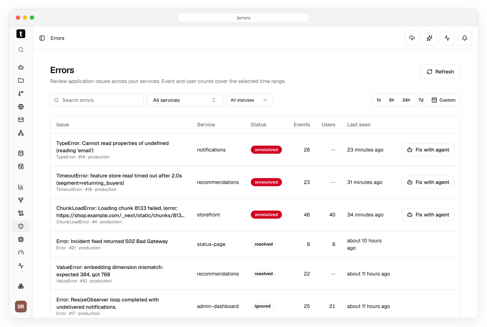
        </picture>
      </a><br>
      <sub>Tam boyut: <a href="assets/screenshots/errors-light.png">açık</a> · <a href="assets/screenshots/errors-dark.png">koyu</a></sub>
    </td>
  </tr>
  <tr>
    <td width="50%" valign="top">
      <b>Dağıtık izler (Distributed traces)</b><br>
      Tek bir isteği servisler boyunca başarısız olan span'a kadar takip eden izlerle OpenTelemetry veri alımı. <a href="https://temps.sh/docs/opentelemetry">Belgeler</a><br><br>
      <a href="assets/screenshots/traces-light.png">
        <picture>
          <source media="(prefers-color-scheme: dark)" srcset="assets/screenshots/traces-dark.png">
          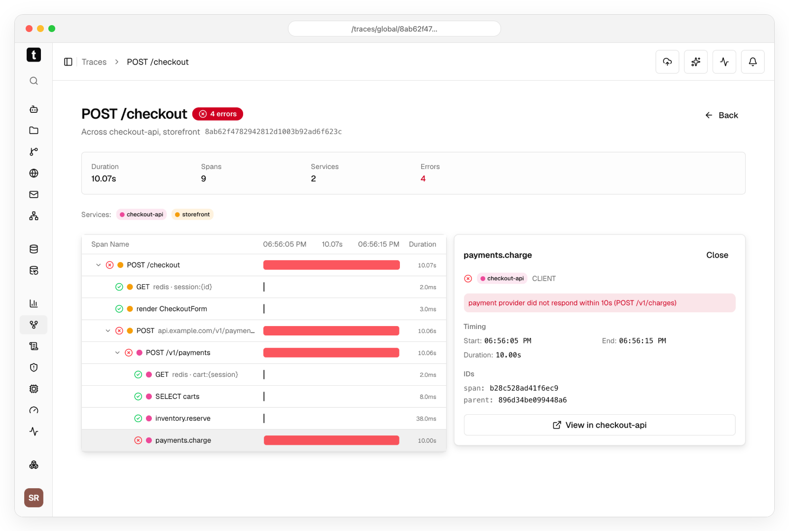
        </picture>
      </a><br>
      <sub>Tam boyut: <a href="assets/screenshots/traces-light.png">açık</a> · <a href="assets/screenshots/traces-dark.png">koyu</a></sub>
    </td>
    <td width="50%" valign="top">
      <b>Günlükler (Logs)</b><br>
      Düzeye göre hacim bilgisiyle her servisten gelen konteyner ve istek günlükleri tek bir aranabilir görünümde. <a href="https://temps.sh/docs/logs">Belgeler</a><br><br>
      <a href="assets/screenshots/logs-light.png">
        <picture>
          <source media="(prefers-color-scheme: dark)" srcset="assets/screenshots/logs-dark.png">
          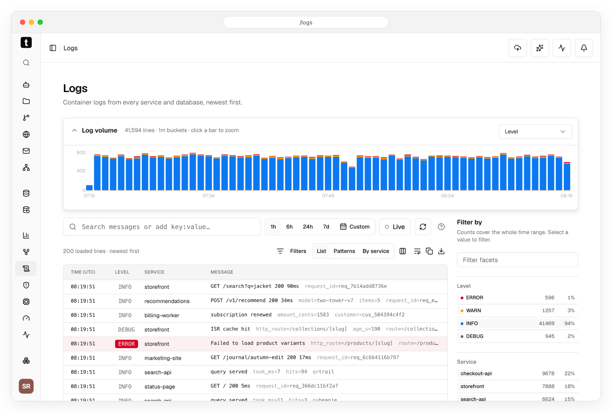
        </picture>
      </a><br>
      <sub>Tam boyut: <a href="assets/screenshots/logs-light.png">açık</a> · <a href="assets/screenshots/logs-dark.png">koyu</a></sub>
    </td>
  </tr>
  <tr>
    <td width="50%" valign="top">
      <b>Çalışma süresi ve uyarılar</b><br>
      Sağlık kontrolleri, durum sayfaları ve uyarı kuralları. <a href="https://temps.sh/docs/monitoring">Belgeler</a><br><br>
      <a href="assets/screenshots/uptime-light.png">
        <picture>
          <source media="(prefers-color-scheme: dark)" srcset="assets/screenshots/uptime-dark.png">
          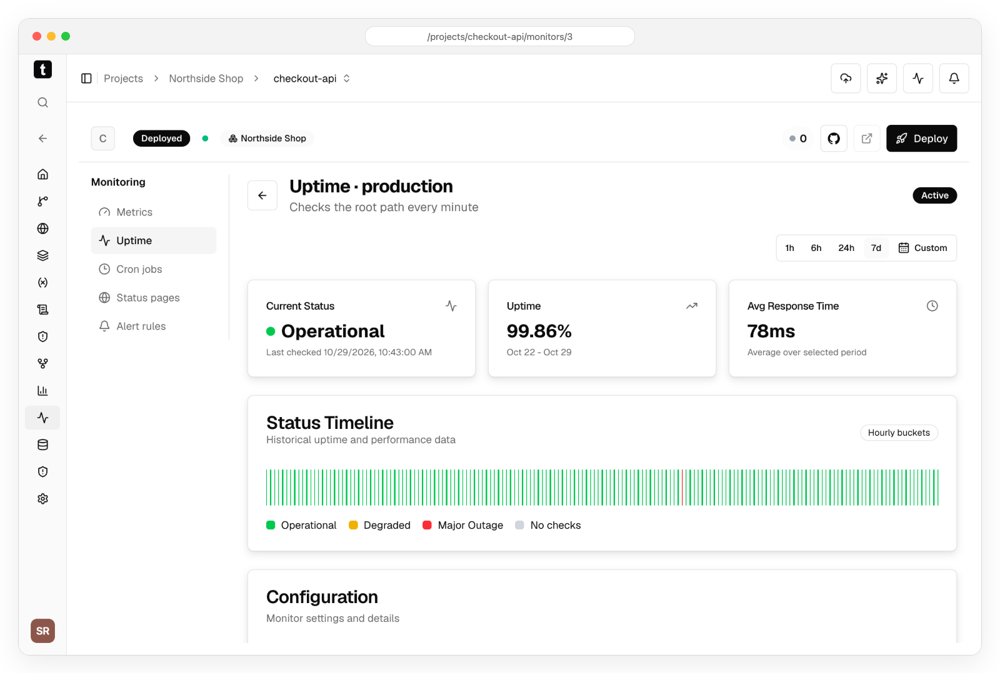
        </picture>
      </a><br>
      <sub>Tam boyut: <a href="assets/screenshots/uptime-light.png">açık</a> · <a href="assets/screenshots/uptime-dark.png">koyu</a></sub>
    </td>
    <td width="50%" valign="top">
      <b>İşlemsel e-posta</b><br>
      DKIM ile SMTP veya SES üzerinden gönderim yapın ve her iletiyi teslimat, açılma ve tıklama bilgileriyle görün. <a href="https://temps.sh/docs/transactional-email">Belgeler</a><br><br>
      <a href="assets/screenshots/email-light.png">
        <picture>
          <source media="(prefers-color-scheme: dark)" srcset="assets/screenshots/email-dark.png">
          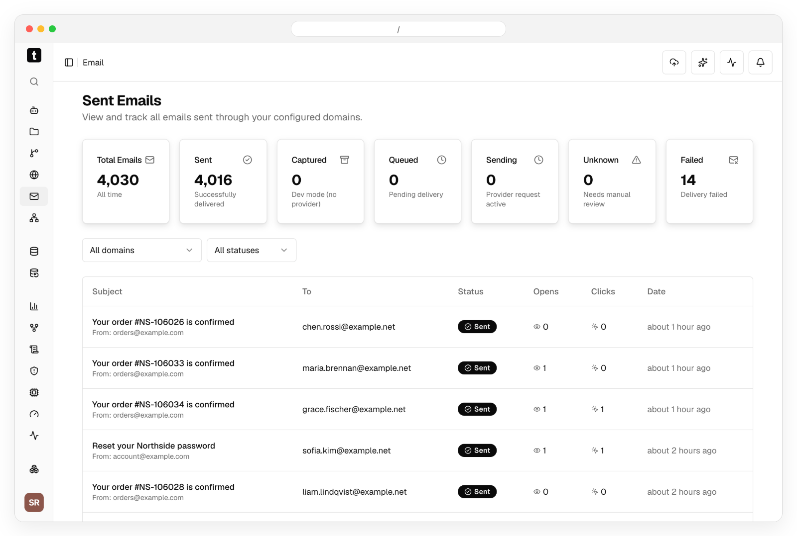
        </picture>
      </a><br>
      <sub>Tam boyut: <a href="assets/screenshots/email-light.png">açık</a> · <a href="assets/screenshots/email-dark.png">koyu</a></sub>
    </td>
  </tr>
  <tr>
    <td width="50%" valign="top">
      <b>Yapay zekâ korumalı alanları (AI sandboxes)</b><br>
      Bir terminal ve önizleme URL'leri ile kod çalıştırmak için izole Docker veya Firecracker korumalı alanları. <a href="https://temps.sh/docs/sandboxes">Belgeler</a><br><br>
      <a href="assets/screenshots/sandbox-detail-light.png">
        <picture>
          <source media="(prefers-color-scheme: dark)" srcset="assets/screenshots/sandbox-detail-dark.png">
          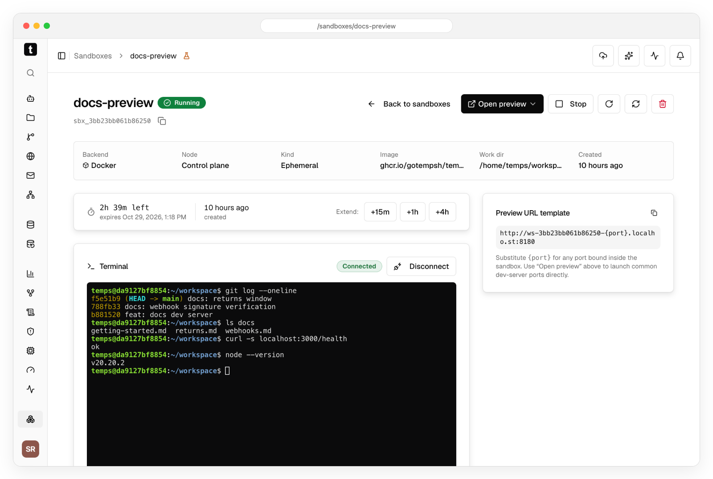
        </picture>
      </a><br>
      <sub>Tam boyut: <a href="assets/screenshots/sandbox-detail-light.png">açık</a> · <a href="assets/screenshots/sandbox-detail-dark.png">koyu</a></sub>
    </td>
    <td width="50%" valign="top">
      <b>Yapay zekâ ağ geçidi (AI gateway)</b><br>
      Model başına kullanım ve maliyet takibiyle kendi sağlayıcı anahtarlarınız için OpenAI uyumlu tek bir uç nokta. <a href="https://temps.sh/docs/ai-gateway">Belgeler</a><br><br>
      <a href="assets/screenshots/ai-usage-light.png">
        <picture>
          <source media="(prefers-color-scheme: dark)" srcset="assets/screenshots/ai-usage-dark.png">
          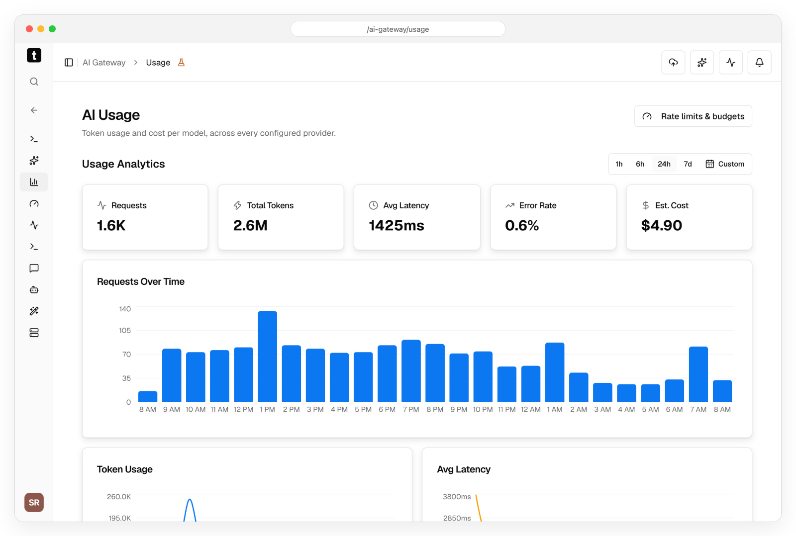
        </picture>
      </a><br>
      <sub>Tam boyut: <a href="assets/screenshots/ai-usage-light.png">açık</a> · <a href="assets/screenshots/ai-usage-dark.png">koyu</a></sub>
    </td>
  </tr>
  <tr>
    <td width="50%" valign="top">
      <b>Yapay zekâ sohbeti (AI chat)</b><br>
      Bir proje hakkında sorular sorun ve yanıtları projenin kendi hatalarından, günlüklerinden ve izlerinden alın. Değişikliklere izin vermediğiniz sürece salt okunurdur.<br><br>
      <a href="assets/screenshots/ai-chat-light.png">
        <picture>
          <source media="(prefers-color-scheme: dark)" srcset="assets/screenshots/ai-chat-dark.png">
          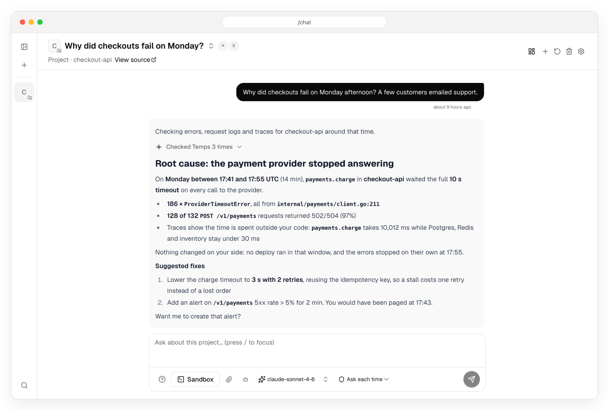
        </picture>
      </a><br>
      <sub>Tam boyut: <a href="assets/screenshots/ai-chat-light.png">açık</a> · <a href="assets/screenshots/ai-chat-dark.png">koyu</a></sub>
    </td>
    <td width="50%" valign="top">
      <b>İçe Aktarma</b><br>
      Kubernetes, Coolify, Dokploy, CapRover, Portainer, Kamal veya düz Docker konteynerlerinden uygulamaları, verileriyle birlikte veritabanlarını, alan adlarını ve ortam değişkenlerini; ayrıca <code>temps migrate</code> ile Vercel'den projeleri getirin. <a href="https://temps.sh/docs/import-existing-platform">Belgeler</a><br><br>
      <a href="assets/screenshots/import-light.png">
        <picture>
          <source media="(prefers-color-scheme: dark)" srcset="assets/screenshots/import-dark.png">
          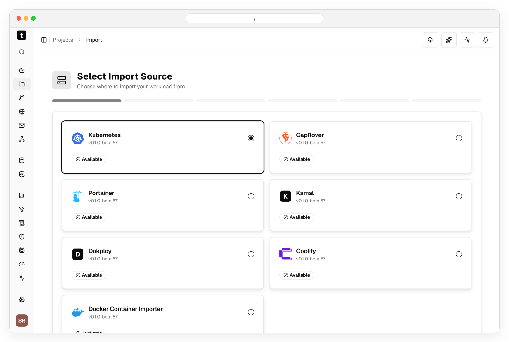
        </picture>
      </a><br>
      <sub>Tam boyut: <a href="assets/screenshots/import-light.png">açık</a> · <a href="assets/screenshots/import-dark.png">koyu</a></sub>
    </td>
  </tr>
</table>

## Yapay Zekâ ile Başlayın

Temps, kodlama ajanlarına (Claude Code, Codex, Cursor, OpenCode ve diğerleri) bir sunucuya Temps kurmayı, ona bağlanmayı ve her konsol işlemini CLI üzerinden yürütmeyi öğreten beceriler (skills) sunar. Bunları ajanınıza ekleyin:

```bash
bunx skills add gotempsh/temps --skill temps temps-platform-setup
```

**Henüz sunucunuz yok mu?** Ajanınıza SSH üzerinden erişebileceği temiz bir Ubuntu sunucusu verin ve şunu isteyin:

> Use the Temps skills to install Temps on root@203.0.113.10 in quick mode, connect the CLI to it, then deploy this repository and tell me its URL when it is live.

Ajan resmi kurucuyu SSH üzerinden çalıştırır, oluşturulan yönetici parolasını ve API anahtarını sunucuda bırakır ve CLI oturumunu onaylamanız için size bir tarayıcı bağlantısı verir; böylece hiçbir kimlik bilgisi sohbetten geçmez.

**Zaten Temps çalıştırıyor musunuz?** CLI'ı sunucunuza bağlayın, ardından ajanınızdan isteyin:

```bash
bunx @temps-sdk/cli@0.1.38 login https://console.your-server.example
```

> Use the Temps skill to verify my connection and list the services on this instance. Do not make any changes.

> Use the Temps skill to deploy this repository to Temps and tell me its URL when it is live.

Gözetimsiz çalışan bir ajan için konsolda **Connect your coding agent** (`/setup/ai`) bölümünü açın: özel bir API anahtarı oluşturur ve ajanın ilk isteğinin ulaştığını doğrular.

[Beceriler](https://temps.sh/docs/skills) · [CLI](https://temps.sh/docs/cli) · [MCP sunucuları](https://temps.sh/docs/mcp-servers)

## Belgeler

Diğer her şey **[temps.sh/docs](https://temps.sh/docs?utm_source=github&utm_medium=repo&utm_content=docs_en)** adresindeki belgelerde yer alır:

- [Temps neler destekler?](https://temps.sh/docs/capabilities) — platformlar ve CPU mimarileri, worker ve builder düğümleri, yükseltmeler, yedeklemeler
- [İlk dağıtımınız](https://temps.sh/docs/your-first-deployment)
- [Başka bir platformdan içe aktarma](https://temps.sh/docs/import-existing-platform)
- [SDK'lar](https://temps.sh/docs/sdks) — analitik, hata takibi, KV ve blob depolama
- [Üretim kontrol listesi](https://temps.sh/docs/production-checklist) ve [yükseltme](https://temps.sh/docs/upgrade-temps)
- [Temps karşılaştırması](https://temps.sh/compare?utm_source=github&utm_medium=repo&utm_content=compare_en) — Vercel, Coolify, Dokploy ve diğerleriyle kıyaslama

## Telemetri

Temps, geliştiricilerin kendi sunucusunda barındırılan kurulumların çalışıp çalışmadığını görebilmesi için anonim kullanım olayları (rastgele bir örnek kimliği, `deploy_succeeded` gibi olay adları ve sayımlar) gönderir. Asla e-posta adresi, IP, depo adı, alan adı veya yazdığınız herhangi bir şeyi göndermez ve uygulama verileriniz hiçbir zaman sunucunuzdan dışarı çıkmaz. Bunu **Settings › Telemetry** bölümünden veya tüm ana makine için `TEMPS_TELEMETRY=0` ile kapatabilirsiniz. [Ayrıntılar](https://temps.sh/docs/data-ownership-and-privacy#anonymous-telemetry)

## Topluluk ve Katkıda Bulunma

Sorular ve fikirler için [Discussions](https://github.com/gotempsh/temps/discussions), hatalar için [Issues](https://github.com/gotempsh/temps/issues). Katkılarınızı bekleriz: bkz. [CONTRIBUTING.md](CONTRIBUTING.md).

## Lisans

[MIT](LICENSE-MIT) veya [Apache 2.0](LICENSE) altında çift lisanslıdır. Seçilen lisansın gerektirdiği telif hakkı, lisans ve atıf bildirimlerini koruduğunuz sürece yeniden markalanmış ve ticari dağıtımlar dahil çatallamalar ve türev çalışmalar memnuniyetle karşılanır. Bkz. [NOTICE](NOTICE).

---

<div align="center">

[temps.sh](https://temps.sh/?utm_source=github&utm_medium=repo&utm_content=footer_en) | [Belgeler](https://temps.sh/docs?utm_source=github&utm_medium=repo&utm_content=footer_en) | [GitHub](https://github.com/gotempsh/temps)

[English](README.md) | [简体中文](README.zh-CN.md) | [Español](README.es.md) | [Français](README.fr.md) | [Deutsch](README.de.md) | [日本語](README.ja.md) | [Português](README.pt-BR.md) | Türkçe

</div>
