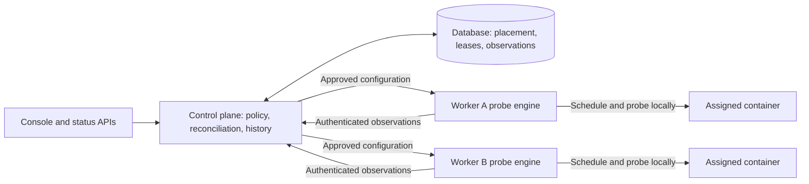

# ADR-053: Distributed Runtime Health and Worker Uptime

**Status:** In progress; engine foundations implemented, periodic monitoring not enabled
**Date:** 2026-10-17
**Builds on:** [ADR-052](./052-pluggable-health-probes-for-workers.md),
[multi-node hardening](./020-multi-node-deployment-hardening.md),
[host Docker socket grants](./045-host-docker-socket-grant.md), and
[control-plane enrollment and ingress](./048-control-plane-enrollment-hubs-and-ingress.md)

## Context

ADR-052 Phase 1 gates deployments with HTTP, TCP, process or exec probes and
records the result at deployment time. A successful gate is not evidence of
continued health. A Redis subscriber can remain running while its connection
to Redis is broken.

The uptime UI still assumes an HTTP monitor. A portless worker can therefore
appear as a running WEB monitor with 0% uptime and unknown observations. This
confuses three different facts: deployment readiness, container lifecycle,
and application availability.

Runtime monitoring must work when every application container runs on remote
workers. A control plane may have no Docker installation, no Docker socket,
no local runtime, no application deployments and no public application
ingress. Its database, identity services and authenticated management
connectivity to workers are sufficient. It must also start with zero
deployments anywhere in the cluster and discover later deployments without
a process restart.

Single-host installations are equally first-class. The control plane and
workload execution role can share a machine and a process, or run as separate
`temps serve` and `temps agent` processes on the same machine. A physical node
is not the same thing as a process or a control-plane/agent role. Requiring a
separate host, self-enrollment or a loopback management connection would be an
unnecessary regression for the combined single-host install.

The initial implementation has two seams to preserve and improve:

- `ContainerRuntimeResolver` in
  `crates/temps-monitoring/src/container_health.rs` already resolves remote
  runtimes by node and avoids falling back to local Docker on resolution
  failure. Originally, `ContainerHealthMonitor` required a local deployer in
  its constructor and its startup in
  `crates/temps-cli/src/commands/serve/console.rs` depended on a
  `ContainerDeployer` service being registered. The foundation change below
  removes that dependency.
- Phase 1's remote `/agent/containers/{id}/health-exec` endpoint stops a
  failed deployment candidate on timeout/cancellation. Its local equivalent
  also contains an unfinished command by stopping the candidate. This is
  appropriate for a deployment gate and unsafe for periodic checks of a
  serving application.

This ADR specifies ADR-052 Phase 2. Its runtime rules take precedence over
ADR-052's high-level runtime outline; deployment gate behavior remains
unchanged. Remediation and application heartbeat ingestion remain separate
work.

## Decision

### 1. Separate coordination from execution

The control-plane role owns probe configuration, authorization, placement,
configuration reconciliation, accepted observations, availability history and
alerts. The workload execution role owns recurring scheduling and execution
against its local container runtime. The control plane distributes an approved
revision and execution lease; it does not dispatch every periodic check.
No application port or Docker API is exposed over the network for worker
health checks.

Monitoring services start from database and node-management dependencies,
independently of local runtime construction, placement eligibility, build
services and public proxy listeners. An empty cluster is idle reconciliation,
not a startup error. Stopping local workload placement must not disable
monitoring remote workers.

Extract a shared bounded probe engine with typed assignment, policy and result
interfaces and no database dependency. `temps agent` hosts it for worker
placements; combined `temps serve` embeds it for local placements when a local
runtime is available. Keep database-backed reconciliation and aggregation
separate from this engine. A legacy local placement on a Docker-free control
plane produces
`unknown / runtime_unavailable` with an operator-facing explanation. A remote
resolution failure never selects the embedded local engine.

In split topology, the console/control-plane process owns coordination;
proxy-only processes do not start additional probe engines. The same probe
implementation, safety limits and result validation apply in all topologies:

| Topology                                                | Probe engine owner                              | Control-plane connection                                                               |
| ------------------------------------------------------- | ----------------------------------------------- | -------------------------------------------------------------------------------------- |
| Combined single-host `temps serve` with local workloads | Embedded workload engine                        | Typed in-process calls; no self-enrollment, separate agent process or HTTP round trip  |
| Separate `temps serve` and `temps agent` on one host    | The process assigned to that workload placement | Authenticated management protocol for the agent; being on loopback grants no exemption |
| Docker-free control plane with remote workers           | Each workload's assigned worker agent           | Authenticated management protocol; no local engine required                            |

Execution ownership is explicit per placement, not inferred from shared IPs
or physical co-location. A container is never monitored by both the embedded
engine and a co-located agent. Use one canonical runtime/container assignment
and exclusive ownership, plus a host-owned interprocess lock when multiple
processes can access the same daemon. If ownership cannot be established,
refuse the duplicate engine admission and report unknown. Migrating a local
placement to an agent must reconcile outstanding probes before handover.

Co-location does not widen application privileges. The combined process may
already have host Docker access for deployments, but its probe engine uses
the same restricted assignment checks and runtime operations as the remote
engine. No additional Docker socket is mounted into workloads, no host shell
is exposed, and a container with an unrelated local ID cannot be selected.

### Kubernetes comparison

Kubernetes' kubelet performs periodic probes on its node; its control plane
owns desired Pod configuration and receives status. Startup, readiness and
liveness are distinct policies; readiness failure changes service eligibility,
while liveness can restart a container. Temps adopts node-owned recurring
checks and centrally authorized configuration, without adopting automatic
restart/remediation in this phase. See the official
[probe model](https://kubernetes.io/docs/concepts/workloads/pods/probes/) and
[node authorization model](https://kubernetes.io/docs/reference/access-authn-authz/node/).
These describe Kubernetes; the authorization, cleanup and coverage requirements
in this ADR are explicit Temps design decisions, not guarantees inherited
from that comparison.

### 2. Persist the authorized effective probe

At deployment time, resolve the repository, environment, project and automatic
defaults using ADR-052's existing precedence. Persist an immutable effective
probe revision associated with the deployment and its replica assignments.
Include its source, image digest, probe kind, relevant parameters and a safe
display description. Rollback and promotion resolve and persist their own
authorized effective revision before activation.

Runtime checks use that revision, not the project's latest settings. Editing
defaults affects future deployments. Applying a new runtime probe to an
existing deployment is a separate explicit, authorized and audited operation
that creates a new revision. Never infer the command used by an old
deployment from mutable current settings.

Store runtime policy on the appropriate project/environment records, with
validated interval, timeout, freshness, failure/recovery thresholds and
required healthy replica count. Installation/node resource budgets are
persisted settings. No new environment variables act as runtime policy.

Keep deployment readiness and runtime observations separate. Existing
`health_state`, `health_checked_at` and `health_detail` remain deployment-time
evidence during migration. Add runtime current-state/history storage with a
probe revision and observation source; an old readiness success must never
seed a runtime uptime interval.

### 3. Reconcile restricted assignments and report bounded observations

Remote monitoring uses a versioned runtime-health assignment and reporting
protocol, distinct from both interactive exec and deployment `health-exec`.
Configuration reconciliation installs an authorized probe revision for a
specific placement; the node's engine then schedules it locally. The protocol
does not accept an arbitrary Docker action, host path, execution user,
environment override, privileged mode or target URL.

Required transport is authenticated TLS with verified cluster CA, peer
identity and node-scoped credentials, following the multi-node hardening
model. Mesh/relay transport does not replace application-layer identity
checks. Legacy plaintext agents or agents without the required capability
report monitoring unavailable with an upgrade action. Never silently fall
back to generic exec or an insecure transport.

The embedded single-host engine receives the same typed, service-authorized
assignment and result envelopes in-process. This transport does not require
TLS or an agent token, but it retains all project, container, revision,
ownership, expiry and output checks. A separate co-located agent is a remote
principal and must pass normal transport authentication.

Each assignment binds these fields into its authenticated envelope:

- Cluster and target node identity; project, environment and deployment IDs.
- Placement generation, replica ID and immutable runtime container ID.
- Authorized probe revision and configuration digest.
- Execution-owner identity, fencing epoch, authorization expiry, interval and
  bounded execution/cleanup budgets.

The engine verifies its identity, the control-plane caller's runtime-health
permission, expiry, known assignment and probe revision before accessing
Docker. A container name or caller-supplied label is insufficient proof of
ownership. Maintain an engine-owned assignment record from authenticated
deployment operations and verify it against the resolved immutable ID.
Do not expose the endpoint until this binding is implemented. Reject wrong
nodes, unrelated/retained containers and unknown revisions before execution.

Each locally scheduled attempt has a unique ID and a monotonically increasing
sequence within the assignment epoch. Reports include these identifiers, the
assigned revision, outcome and bounded duration. Delivery retries reuse report
identities; they do not rerun the command. The engine deduplicates assignment
updates and serializes lifecycle/probe operations per container. Authorization
expiry, sequence high-water marks and unresolved execution ownership survive
process restart; ambiguous recovery reports unknown and does not execute a
replacement probe. This is bounded replay protection, not an exactly-once
execution promise.

### 4. Treat probe configuration as code execution authority

An exec probe can read the application's environment, use its credentials and
network access, and modify its files. Its security boundary is the workload's
existing permissions, not a side-effect-free sandbox. Do not describe a
command as harmless because it is called a health check.

All configuration paths, including repository changes, environment overrides,
runtime revision changes, rollback, promotion and clearing overrides, must
apply the applicable deployment/code-execution authority. A low-privilege
monitor editor cannot plant a command that a later privileged deployment or
scheduler executes.

Docker-socket-granted workloads retain instance-admin restrictions and the
applicable sensitive-action verification. A probe inside such a container
inherits its host-root-equivalent socket access; this ADR adds no isolation
to that grant. Bind runtime authorization to the approved configuration and
grant revision, invalidate it on privilege/grant changes, and reauthorize
before resuming. The scheduler acts under a constrained system authority; it
does not reuse an expired interactive session or bypass these approval rules.

Exec arguments are passed directly as an array, using the container's
configured user and existing security profile. No implicit shell, added
mounts, capabilities, socket access or injected secrets are allowed. A shell
is possible only when explicitly part of the authorized argv and image.

Network probes resolve only the assigned container endpoint and declared
port on its workload node. HTTP accepts a validated relative path, not a
user-selected host; redirects must not escape the assigned endpoint. Probes
must not become a scanner for host services, another tenant or metadata
endpoints. Existing externally targeted HTTP monitors remain a separate
feature with their own authorization and network policy. Exec commands
retain the application's existing egress access; this endpoint restriction
does not constrain arbitrary network calls made by authorized application
code.

### 5. Require non-destructive, bounded runtime execution

Inspect-based process checks and bounded HTTP/TCP checks can ship first.
Process health requires continuous Running with an unchanged restart count
for the configured stability window; observations must bind runtime start
identity as well as counters, and any observation gap resets the window.
This detects lifecycle failures, not useful application progress.

Runtime exec is capability-gated until its execution backend demonstrates all
of the following for both local and remote nodes:

- The deadline and cancellation terminate only the probe process and all of
  its descendants, without stopping, restarting, pausing or signaling the
  application process.
- Cleanup survives requester disconnect and agent restart, identifies the
  exact probe process group without PID reuse races, and releases admission
  only after termination is confirmed.
- CPU, memory, process count, output and cleanup work are bounded; a command
  cannot escape its execution boundary by forking or daemonizing.
- Probe infrastructure does not replace the configured container user or
  require mounting the Docker socket into an application.

Dropping a Bollard future, closing an output stream or running `timeout` in
the application image does not establish these guarantees. Specify and
security-review a concrete execution mechanism before enabling the
capability; this ADR does not assume plain Docker exec provides it.

Never reuse Phase 1's stop-on-timeout cleanup or interactive exec's restart
cleanup for runtime monitoring. If non-destructive termination cannot be
guaranteed, runtime exec remains unavailable. Show that limitation and link to
an available process/HTTP/TCP configuration; keep the independent deployment
exec gate available.

If cleanup becomes ambiguous, stop admitting further probes for that
container, keep uncertainty visible and raise an infrastructure diagnostic.
Do not overlap commands, accumulate orphan tasks, or kill the workload to
recover monitoring capacity. Resource reservations survive until cleanup is
confirmed or the isolated execution boundary is proven gone.

### 6. Fence reconciliation, local scheduling and result acceptance

Use database-backed expiring ownership and a monotonically increasing
configuration-owner epoch, supporting one coordinator today and multiple
control-plane processes later. Database time controls coordinator lease
validity. Reconcile assignment changes and lease renewal in bounded batches,
not a database job and control-plane RPC for each probe tick. Agents reject
obsolete configuration epochs and keep a single local due-work scheduler with
bounded execution concurrency.

Approved assignments have a finite renewable execution authorization lease,
proposed default 120 seconds. An engine may continue already approved checks
during a brief control-plane outage only until that lease expires. Establish
expiry with a defined clock-skew budget and a monotonic local deadline;
excessive clock uncertainty rejects admission. Renewal never extends an
expired or revoked authorization based only on cached settings. On expiry,
stop admitting probes, safely contain any outstanding probe within its
existing deadline and leave the application running. The control plane's
observation freshness is independent of this execution lease.

An acknowledged revocation prevents further admission immediately. An
unreachable node cannot receive immediate revocation; the execution lease
bounds that residual authority and the UI must say when acknowledgement is
pending. Grant-sensitive assignments may use a shorter lease. This limitation
also applies to a separately running co-located agent whose management
connection has failed.

Keep at most one active runtime probe per replica across restarts, engine
handover and control-plane failover. A replacement coordinator reconciles
the existing assignment and unresolved execution with its owner; it does not
start a second scheduler or assume a lost management connection cancelled
work. A higher epoch fences new admissions without releasing an unresolved
older execution slot. Ownership cannot transfer until the previous engine is
confirmed quiescent, or its authority has expired and its execution boundary
is proven terminated.

The control plane accepts a report only while its ownership epoch,
node, placement generation, container identity and probe revision still match
the current assignment, its sequence is new and its authorization was valid.
Accept and update state transactionally and idempotently. A late result from
an old container cannot mark a replacement healthy. Nodes cannot submit
observations for another node or write directly to shared monitoring tables.

Report fresh current state in bounded batches or through authenticated
collection, with an authenticated reporting session and short receipt deadline.
Use control-plane receipt times and bounded report age/duration to establish
conservative observation coverage. A queued success from before a disconnect
cannot refresh current state after reconnect. Require a new bounded-age sample
in the new reporting session; agent wall-clock timestamps are diagnostic, not
authority for retroactive uptime. Reject replayed, future, oversized or
malformed reports. Do not backfill disconnected periods with later success.

### 7. Represent uncertainty and uptime honestly

Track runtime `healthy`, `unhealthy` and `unknown` per replica, plus a typed
reason, freshness deadline and the last accepted attempt/revision. Staleness
is evaluated on reads and by indexed expiry work, so a stopped scheduler
cannot leave a green current status indefinitely.

| Observation                                                                                           | Runtime state / presentation                            |
| ----------------------------------------------------------------------------------------------------- | ------------------------------------------------------- |
| Fresh successful applicable probe                                                                     | Healthy                                                 |
| Fresh observed failed probe or application exit                                                       | Unhealthy, with a sanitized reason                      |
| Node disconnected, authorization rejected, no runtime capability, admission exhausted or stale result | Unknown, with the infrastructure reason                 |
| No runtime probe configured                                                                           | Not configured; no uptime percentage                    |
| Sleeping/paused environment                                                                           | Paused coverage, clearly separated from measured uptime |
| Portless deployment's previous HTTP monitor                                                           | HTTP not applicable; preserve its historical web period |

Probe timeout is unhealthy only when the executor confirms a genuine probe
deadline and completed safe cleanup. Transport timeout or uncertain execution
is unknown. Deployment gate rules remain fail-closed for either outcome.

For an environment with required healthy replica count K: healthy means at
least K fresh healthy replicas; unhealthy means even all unknown replicas
recovering could not reach K; otherwise the result is unknown. Display
healthy/unhealthy/unknown counts alongside the aggregate. Desired replica
count, K and intentional scale-to-zero are versioned policy; failed/surplus
rollout candidates do not enter the serving set. Desired replica slots without
an assigned fresh observation count as unknown, rather than disappearing from
the denominator or making an empty set healthy.

Calculate availability over applicable, enabled runtime-monitoring periods:

- Measured availability = healthy duration / (healthy + unhealthy duration).
- Coverage = (healthy + unhealthy duration) / eligible duration.
- Show unknown duration explicitly; zero observed duration has no percentage.

A sampled observation is valid only until the next accepted observation or
its freshness deadline, whichever comes first. The remaining time is unknown.
Freshness defaults to three probe intervals plus the attempt timeout and is
validated as part of policy. Keep configuration/deployment boundaries so a
new service cannot inherit the old deployment's availability. Label these
figures as sampled probe availability; node-local HTTP/TCP checks do not prove
public ingress availability or successful processing of every queue message.

Failure/recovery thresholds debounce alerts independently of raw observations
and availability accounting. Unknown can trigger a separate monitoring-loss
alert after a grace period; it must not create a false application-recovery
event. Emit deduplicated transitions through the existing alarm/status event
pipeline. No probe failure triggers automatic restart, rollback or reschedule.

### 8. Keep results and probe details safe and discoverable

Ordinary health responses contain a typed outcome, exit code where applicable,
bounded duration, timestamps and allowlisted reason codes. Do not persist raw
stdout/stderr, HTTP response bodies, arbitrary transport errors or exception
strings in health details, uptime history, status pages or alarm payloads.
Periodic output is discarded by default; any diagnostic capture is separately
authorized, audited, bounded to 4 KiB and subject to log/secret access controls.
Never log command arguments or credential-bearing request bodies by default.

Show the effective probe kind, source revision, interval, timeout and last
checked time in the workload health view. For exec, display a safe command
description; full argv access must honor source-configuration permissions and
mask secret-bearing arguments. Ordinary monitoring reads show the executable
and redact arguments by default; revealing sensitive configuration requires
the existing secret-reveal authorization and audit path. Prefer application
environment references over literal credentials; sensitive stored configuration
uses `EncryptionService` and never appears in audit payloads. Public status
pages never expose commands, paths,
infrastructure identities or diagnostic output. Add typed, permission-checked
API fields and regenerate the SDKs when implementing this UI.

In Phase 1, the uptime screen must say HTTP monitoring is not applicable to
a portless worker, omit the percentage and web timeline for that period, and
show deploy-time health separately. Runtime monitoring remains visible as an
onboarding state explaining what is missing and linking directly to probe
settings or the relevant worker upgrade page. Independent user-created web
monitors are not deleted simply because the project also has a worker.

## Resource budget and saturation

This is background management work: policy/history on the control plane and
probe scheduling/execution on each workload node. No probe execution, database
access or locks are added to the proxy request path. On a combined host both
roles share its CPU/memory budget rather than receiving independent allowances.

Proposed initial defaults are a 30-second runtime interval, 5-second attempt
budget and 4 concurrent probes per workload node, shared by all embedded and
separate engine processes on that node. Enforce node and project fairness as
well as per-container exclusion. The control plane bounds configuration/report
processing to 16 concurrent operations; these are not 16 remote probe ticks.
Validate policy against hard implementation limits; operators cannot configure
unbounded work through record settings.

Use indexed reconciliation/expiry queries of at most 100 records and local
due-work structures bounded by assigned placements. Reports contain at most
100 observations and 64 KiB per envelope, with a one-second maximum flush age
while connected. Batch current-state/history writes to the same record bound.
Keep caches bounded and evict inactive placements; do not spawn a task or
timer for every container or scan the entire deployment table every tick.
Reuse existing reconciliation infrastructure, with change notifications plus
indexed catch-up after restart. A disconnected engine retains only bounded
current state and uncertainty markers; it never builds an unbounded report
spool or replays offline samples as fresh coverage.

At 1,000 replicas on 20 workers, a 30-second interval schedules about 33 checks
per second cluster-wide. With 100 ms mean completion this requires about four
concurrent checks across those nodes, not four control-plane execution slots.
At 50 replicas per node, a 5-second failure storm requires about nine concurrent
checks per node and exceeds its four-slot budget: defer due work fairly,
suppress overlapping retries and expire freshness to unknown. On a single
host the same four-slot limit applies to all local workloads. Do not grow an
in-memory backlog or block deployment/lifecycle operations.

Record bounded current state and transitions, and compact availability into
per-minute buckets containing healthy, unhealthy, unknown and eligible
durations. Batch persistence and configure retention; avoid retaining one raw
row for every successful observation indefinitely. Account for replica-policy
changes when aggregating environment buckets. Target under 16 MiB additional
control-plane working memory at the reference load, including in-flight
buffers, plus a measured bounded per-node engine footprint. Measure the total
combined-host footprint and database write volume before rollout on
3 vCPU / 4 GiB hosts.

## Trust limits

The control plane is trusted to authorize application execution. A compromised
worker already controls its local Docker daemon and can falsify its own
health; mTLS proves origin, not honest execution. Constrain that identity to
its assigned observations and prevent it from changing another node's state.
This ADR does not claim protection for workloads sharing a compromised host,
or undo isolation intentionally removed by a Docker socket grant.

An application can return exit 0 while doing no useful work. Process and probe
availability are signals, not proof of business progress. Application
heartbeats and remediation need their own design and authorization review.

## Alternatives considered

- **Poll from the control plane's Docker client:** fails on Docker-free
  control planes and risks checking a different local container. Rejected.
- **Use public HTTP uptime for every workload:** requires a dummy listener and
  cannot inspect private worker dependencies. Keep public availability as a
  separate signal for web applications.
- **Reuse deployment or interactive exec:** their stop/restart cleanup can
  destroy application availability. Rejected for runtime checks.
- **Let agents choose arbitrary commands and push health:** expands trust and
  makes configuration provenance, replay and failover ambiguous. Agents may
  report health only for authenticated assigned revisions. Agent-owned
  scheduling/reporting is selected; agent-selected commands and arbitrary
  application heartbeat ingestion are not.
- **Dispatch every runtime probe from the control plane:** centralizes timer
  load and makes local monitoring dependent on a management round trip.
  Rejected in favor of one bounded engine on the workload node.
- **Require a separate agent process for single-host installs:** adds
  enrollment and network dependencies without improving an in-process trust
  boundary. Use the same engine embedded in combined `temps serve` instead.
- **Enable runtime exec with only a client timeout:** abandons commands and
  permits resource exhaustion. Rejected until safe containment is demonstrated.

## Rollout and acceptance criteria

### Implementation progress

The first implementation adds `crates/temps-runtime-health`, a database-free
library with a bounded node-local scheduler and a read-only runtime inspector
interface. It supports process stability, HTTP and TCP checks, owner/container
identity validation, explicit in-process lease renewal, project round-robin,
four concurrent attempts, a 1,000-assignment bound, cancellation guards and
sanitized observations. HTTP follows no redirects, reads at most a 128-byte
status line and discards bodies. Exec is not representable in the probe
contract; unknown kinds and address-bearing payloads are rejected.

The existing lifecycle/resource monitor now requires a placement-aware
resolver instead of a local deployer. It can process an initially empty
cluster and later remote containers without constructing a local runtime.
Local and remote placement failures remain explicit and never select another
runtime as a fallback.

The engine is not yet hosted by `temps agent` or embedded `temps serve`.
Its inspector contract is an internal trusted-host interface, not an exposed
agent API or a substitute for authentication. In-process lease/ownership state
does not provide restart-safe fencing or co-located interprocess exclusion.
Those durable controls, authorized effective-revision persistence,
authenticated assignment/report transport, availability storage, UI and alarms
remain required before periodic monitoring is enabled. No capability is
advertised and no new probe endpoint is registered by this foundation.

Tests cover the library's concurrency, cancellation, ownership, validation,
process stability/restarts, lease expiry and HTTP/TCP failure paths. A real
Docker fixture exercises process/HTTP/TCP checks and verifies the application
stays running until the fixture driver stops it. Resolver tests cover an empty
Docker-free monitor discovering a remote container. These are component tests,
not evidence of completed multi-node runtime monitoring E2E.

### Remaining rollout

1. Correct the portless uptime presentation and expose safe effective probe
   metadata without claiming runtime coverage. Preserve historical HTTP data.
2. Extract the shared node-local probe engine, embed it for combined
   single-host workloads and host it in agents for assigned worker workloads.
   Decouple control-plane monitoring startup from local deployments/Docker.
   Add versioned capabilities, assignment validation, fenced reconciliation,
   execution leases and separate runtime storage. Ship process/HTTP/TCP
   monitoring and coverage reporting.
3. Enable sustained-failure and monitoring-loss alerts after transition and
   deduplication tests pass. Keep automatic remediation out of scope.
4. Enable runtime exec only after the non-destructive execution mechanism has
   its own concrete design, threat review and passing adversarial tests on
   local and remote executors. Unsupported agents stay explicitly unavailable.

Required tests next to the implementing code include:

- A control plane starts without Docker, without a registered local deployer
  and with no local workloads; remote probes, history and alerts work. An
  initially empty cluster discovers a later remote deployment without restart.
- Real multi-node E2E uses a Docker-free application control-plane process and
  at least two worker agents. Workers run application containers; the control
  plane receives no Docker socket. Exercise separate replicas and node loss.
- Combined single-host E2E probes local workloads without a separate agent,
  self-enrollment or loopback HTTP. Separate co-located control-plane/agent
  processes exercise authenticated reporting and the same probe semantics.
- A co-located embedded engine and agent sharing Docker cannot execute a
  duplicate probe or exceed the host budget. Test ownership handover, process
  restart and ambiguous cleanup without selecting a different local container.
- Missing/expired/revoked credentials, wrong CA/node identity, plaintext and
  old-capability agents fail closed without execution or insecure fallback.
- Wrong project/container/node, changed assignment, retained candidates,
  stale revisions, expired/replayed attempts and late replaced-container
  results are rejected; replay protection survives agent restart.
- Concurrent coordinators, lease expiry, clock skew, reconnect and restart
  cannot overlap an unresolved probe or let stale owners update current state.
  Authorized local checks continue only within the bounded execution lease;
  expiry stops admission without stopping the application. Delayed/offline
  reports cannot restore fresh health or retroactively fill coverage gaps.
- Unauthorized exec configuration and override removal, including granted
  projects and reuse paths, fail before persistence or execution. Revoking a
  grant/config authorization prevents subsequent checks once acknowledged;
  disconnected execution cannot continue beyond its existing lease.
- HTTP redirect/target escape and cross-tenant address attempts are rejected;
  process stability restarts after observation gaps or runtime identity changes.
- Runtime exec timeout, cancellation, descendants, agent crash and cleanup
  failure never stop/restart the application, leak processes or release an
  uncertain execution slot. Deployment exec retains its separate cleanup rules.
- Secret-bearing output and command arguments cannot leak through logs, health
  reads, uptime APIs, public status pages or alarm details.
- Saturation keeps queues/memory bounded, maintains project fairness and ages
  observations to unknown. No-Docker and unavailable-node paths never fall
  back to local execution.
- Replica aggregation, missing coverage, pause/resume, scale-to-zero,
  deployment/revision boundaries and HTTP-to-worker transitions preserve
  correct percentages, history and deduplicated alert semantics.
- Migrations preserve readiness evidence and old HTTP history; rollback cannot
  relabel that evidence as runtime observations. SDKs and console tests cover
  unavailable capabilities and safe effective-probe display.

Compose service healthchecks are unchanged by this ADR. Mapping them into
runtime availability requires a separate compatibility decision. The engine
foundation does not enable Phase 2 monitoring or establish that live multi-node
runtime verification has passed.

## Open implementation decisions

- The concrete contained-exec mechanism and supported runtime/platform matrix.
  This blocks runtime exec enablement, not process/HTTP/TCP monitoring.
- Exact migration and history-store layout, retention defaults and public
  status-page mapping for unknown and insufficient coverage. Preserve the
  state/coverage semantics above regardless of storage choice.
- Final policy bounds and default replica threshold, validated with the
  resource benchmark and operational feedback before enabling alarms.
