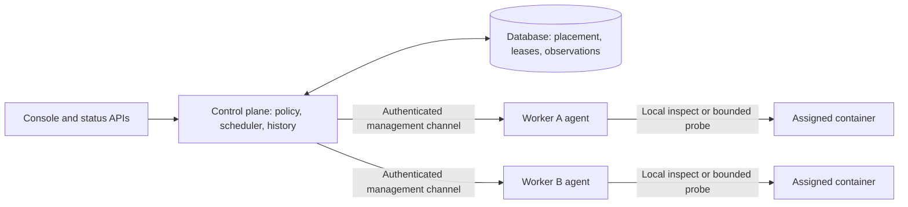

# ADR-053: Distributed Runtime Health and Worker Uptime

**Status:** Proposed; no runtime probing is enabled by this document
**Date:** 2026-10-17
**Builds on:** [ADR-052](./052-pluggable-health-probes-for-workers.md),
[multi-node hardening](./020-multi-node-deployment-hardening.md),
[host Docker socket grants](./045-host-docker-socket-grant.md), and
[control-plane enrollment and ingress](./048-control-plane-enrollment-hubs-and-ingress.md)

## Context

ADR-052 Phase 1 gates deployments with HTTP, TCP, process or exec probes and
records the result at deployment time. A successful gate is not evidence of
continued health. A Redis subscriber can remain running while its connection
to Redis is broken.

The uptime UI still assumes an HTTP monitor. A portless worker can therefore
appear as a running WEB monitor with 0% uptime and unknown observations. This
confuses three different facts: deployment readiness, container lifecycle,
and application availability.

Runtime monitoring must work when every application container runs on remote
workers. A control plane may have no Docker installation, no Docker socket,
no local runtime, no application deployments and no public application
ingress. Its database, identity services and authenticated management
connectivity to workers are sufficient. It must also start with zero
deployments anywhere in the cluster and discover later deployments without
a process restart.

There are two existing seams to preserve and improve:

- `ContainerRuntimeResolver` in
  `crates/temps-monitoring/src/container_health.rs` already resolves remote
  runtimes by node and avoids falling back to local Docker on resolution
  failure. However, `ContainerHealthMonitor` requires a local deployer in its
  constructor, and its startup in
  `crates/temps-cli/src/commands/serve/console.rs` is conditional on a
  `ContainerDeployer` service being registered.
- Phase 1's remote `/agent/containers/{id}/health-exec` endpoint stops a
  failed deployment candidate on timeout/cancellation. Its local equivalent
  also contains an unfinished command by stopping the candidate. This is
  appropriate for a deployment gate and unsafe for periodic checks of a
  serving application.

This ADR specifies ADR-052 Phase 2. Its runtime rules take precedence over
ADR-052's high-level runtime outline; deployment gate behavior remains
unchanged. Remediation and application heartbeat ingestion remain separate
work.

## Decision

### 1. Separate coordination from execution

The control plane owns probe configuration, authorization, scheduling,
accepted observations, availability history and alerts. The workload node
owns execution against its local container runtime. No application port or
Docker API is exposed to the control plane for worker health checks.

Monitoring services start from database and node-management dependencies,
independently of local runtime construction, placement eligibility, build
services and public proxy listeners. An empty cluster is an idle scheduler,
not a startup error. Stopping local workload placement must not disable
monitoring remote workers.

Replace the required local deployer dependency with a placement-aware probe
executor interface. Its local adapter is registered only when local execution
is available; its remote adapter uses registered worker identities and
endpoints. A legacy local placement on a Docker-free control plane produces
`unknown / runtime_unavailable` with an operator-facing explanation. A remote
resolution failure never selects the local adapter.

In split topology, the console/control-plane process owns coordination;
proxy-only processes do not start additional schedulers. A combined
single-node install uses the same contracts through the local adapter.

### 2. Persist the authorized effective probe

At deployment time, resolve the repository, environment, project and automatic
defaults using ADR-052's existing precedence. Persist an immutable effective
probe revision associated with the deployment and its replica assignments.
Include its source, image digest, probe kind, relevant parameters and a safe
display description. Rollback and promotion resolve and persist their own
authorized effective revision before activation.

Runtime checks use that revision, not the project's latest settings. Editing
defaults affects future deployments. Applying a new runtime probe to an
existing deployment is a separate explicit, authorized and audited operation
that creates a new revision. Never infer the command used by an old
deployment from mutable current settings.

Store runtime policy on the appropriate project/environment records, with
validated interval, timeout, freshness, failure/recovery thresholds and
required healthy replica count. Installation/node resource budgets are
persisted settings. No new environment variables act as runtime policy.

Keep deployment readiness and runtime observations separate. Existing
`health_state`, `health_checked_at` and `health_detail` remain deployment-time
evidence during migration. Add runtime current-state/history storage with a
probe revision and observation source; an old readiness success must never
seed a runtime uptime interval.

### 3. Use a restricted authenticated agent operation

Periodic checks use a versioned runtime-health operation, distinct from both
interactive exec and deployment `health-exec`. The operation accepts a typed
probe request; it does not accept an arbitrary Docker action, host path,
execution user, environment override, privileged mode or target URL.

Required transport is authenticated TLS with verified cluster CA, peer
identity and node-scoped credentials, following the multi-node hardening
model. Mesh/relay transport does not replace application-layer identity
checks. Legacy plaintext agents or agents without the required capability
report monitoring unavailable with an upgrade action. Never silently fall
back to generic exec or an insecure transport.

Each request binds these fields into its authenticated envelope:

- Cluster and target node identity; project, environment and deployment IDs.
- Placement generation, replica ID and immutable runtime container ID.
- Authorized probe revision and configuration digest.
- Unique attempt ID, scheduler fencing epoch, admission expiry and bounded
  execution budget.

The agent verifies its identity, the control-plane caller's runtime-health
permission, expiry, known assignment and probe revision before accessing
Docker. A container name or caller-supplied label is insufficient proof of
ownership. Maintain an agent-owned assignment record from authenticated
deployment operations and verify it against the resolved immutable ID.
Do not expose the endpoint until this binding is implemented. Reject wrong
nodes, unrelated/retained containers and unknown revisions before execution.

Retries reuse an attempt ID. The agent deduplicates admitted attempts and
serializes lifecycle/probe operations per container. Admission expiry and
replay state must survive agent restart; if the previous outcome cannot be
established, return unknown rather than executing the attempt again. This
provides bounded replay protection, not an exactly-once execution promise.

### 4. Treat probe configuration as code execution authority

An exec probe can read the application's environment, use its credentials and
network access, and modify its files. Its security boundary is the workload's
existing permissions, not a side-effect-free sandbox. Do not describe a
command as harmless because it is called a health check.

All configuration paths, including repository changes, environment overrides,
runtime revision changes, rollback, promotion and clearing overrides, must
apply the applicable deployment/code-execution authority. A low-privilege
monitor editor cannot plant a command that a later privileged deployment or
scheduler executes.

Docker-socket-granted workloads retain instance-admin restrictions and the
applicable sensitive-action verification. A probe inside such a container
inherits its host-root-equivalent socket access; this ADR adds no isolation
to that grant. Bind runtime authorization to the approved configuration and
grant revision, invalidate it on privilege/grant changes, and reauthorize
before resuming. The scheduler acts under a constrained system authority; it
does not reuse an expired interactive session or bypass these approval rules.

Exec arguments are passed directly as an array, using the container's
configured user and existing security profile. No implicit shell, added
mounts, capabilities, socket access or injected secrets are allowed. A shell
is possible only when explicitly part of the authorized argv and image.

Network probes resolve only the assigned container endpoint and declared
port on its workload node. HTTP accepts a validated relative path, not a
user-selected host; redirects must not escape the assigned endpoint. Probes
must not become a scanner for host services, another tenant or metadata
endpoints. Existing externally targeted HTTP monitors remain a separate
feature with their own authorization and network policy. Exec commands
retain the application's existing egress access; this endpoint restriction
does not constrain arbitrary network calls made by authorized application
code.

### 5. Require non-destructive, bounded runtime execution

Inspect-based process checks and bounded HTTP/TCP checks can ship first.
Process health requires continuous Running with an unchanged restart count
for the configured stability window; observations must bind runtime start
identity as well as counters, and any observation gap resets the window.
This detects lifecycle failures, not useful application progress.

Runtime exec is capability-gated until its execution backend demonstrates all
of the following for both local and remote nodes:

- The deadline and cancellation terminate only the probe process and all of
  its descendants, without stopping, restarting, pausing or signaling the
  application process.
- Cleanup survives requester disconnect and agent restart, identifies the
  exact probe process group without PID reuse races, and releases admission
  only after termination is confirmed.
- CPU, memory, process count, output and cleanup work are bounded; a command
  cannot escape its execution boundary by forking or daemonizing.
- Probe infrastructure does not replace the configured container user or
  require mounting the Docker socket into an application.

Dropping a Bollard future, closing an output stream or running `timeout` in
the application image does not establish these guarantees. Specify and
security-review a concrete execution mechanism before enabling the
capability; this ADR does not assume plain Docker exec provides it.

Never reuse Phase 1's stop-on-timeout cleanup or interactive exec's restart
cleanup for runtime monitoring. If non-destructive termination cannot be
guaranteed, runtime exec remains unavailable. Show that limitation and link to
an available process/HTTP/TCP configuration; keep the independent deployment
exec gate available.

If cleanup becomes ambiguous, stop admitting further probes for that
container, keep uncertainty visible and raise an infrastructure diagnostic.
Do not overlap commands, accumulate orphan tasks, or kill the workload to
recover monitoring capacity. Resource reservations survive until cleanup is
confirmed or the isolated execution boundary is proven gone.

### 6. Fence scheduling and accept results conditionally

Use database-backed expiring ownership and a monotonically increasing
scheduler epoch, supporting a single coordinator today and multiple control
plane processes later. Database time controls lease validity; agents enforce
short admission expiry with a defined clock-skew budget and monotonic local
execution deadlines. Excessive clock uncertainty rejects admission.

Claim indexed due work in bounded batches. Keep at most one active runtime
probe per replica, including across control-plane failover. A replacement
scheduler reconciles an outstanding attempt with the worker rather than
assuming the old HTTP request was cancelled. Agents reject obsolete epochs
and do not admit a replacement while the earlier probe owns the container.

The control plane accepts a result only while its attempt, ownership epoch,
node, placement generation, container identity and probe revision still match
the current assignment. Accept and update state transactionally and
idempotently. A late result from an old container cannot mark a replacement
healthy. Nodes cannot submit observations for another node or write directly
to shared monitoring tables.

Use control-plane dispatch/receipt times and bounded measured duration to
establish observation coverage. Agent wall-clock timestamps are diagnostic,
not an authority for retroactive uptime. Reject replayed, future, oversized
or malformed results. Do not backfill disconnected periods with later success.

### 7. Represent uncertainty and uptime honestly

Track runtime `healthy`, `unhealthy` and `unknown` per replica, plus a typed
reason, freshness deadline and the last accepted attempt/revision. Staleness
is evaluated on reads and by indexed expiry work, so a stopped scheduler
cannot leave a green current status indefinitely.

| Observation                                                                                           | Runtime state / presentation                            |
| ----------------------------------------------------------------------------------------------------- | ------------------------------------------------------- |
| Fresh successful applicable probe                                                                     | Healthy                                                 |
| Fresh observed failed probe or application exit                                                       | Unhealthy, with a sanitized reason                      |
| Node disconnected, authorization rejected, no runtime capability, admission exhausted or stale result | Unknown, with the infrastructure reason                 |
| No runtime probe configured                                                                           | Not configured; no uptime percentage                    |
| Sleeping/paused environment                                                                           | Paused coverage, clearly separated from measured uptime |
| Portless deployment's previous HTTP monitor                                                           | HTTP not applicable; preserve its historical web period |

Probe timeout is unhealthy only when the executor confirms a genuine probe
deadline and completed safe cleanup. Transport timeout or uncertain execution
is unknown. Deployment gate rules remain fail-closed for either outcome.

For an environment with required healthy replica count K: healthy means at
least K fresh healthy replicas; unhealthy means even all unknown replicas
recovering could not reach K; otherwise the result is unknown. Display
healthy/unhealthy/unknown counts alongside the aggregate. Desired replica
count, K and intentional scale-to-zero are versioned policy; failed/surplus
rollout candidates do not enter the serving set. Desired replica slots without
an assigned fresh observation count as unknown, rather than disappearing from
the denominator or making an empty set healthy.

Calculate availability over applicable, enabled runtime-monitoring periods:

- Measured availability = healthy duration / (healthy + unhealthy duration).
- Coverage = (healthy + unhealthy duration) / eligible duration.
- Show unknown duration explicitly; zero observed duration has no percentage.

A sampled observation is valid only until the next accepted observation or
its freshness deadline, whichever comes first. The remaining time is unknown.
Freshness defaults to three probe intervals plus the attempt timeout and is
validated as part of policy. Keep configuration/deployment boundaries so a
new service cannot inherit the old deployment's availability. Label these
figures as sampled probe availability; node-local HTTP/TCP checks do not prove
public ingress availability or successful processing of every queue message.

Failure/recovery thresholds debounce alerts independently of raw observations
and availability accounting. Unknown can trigger a separate monitoring-loss
alert after a grace period; it must not create a false application-recovery
event. Emit deduplicated transitions through the existing alarm/status event
pipeline. No probe failure triggers automatic restart, rollback or reschedule.

### 8. Keep results and probe details safe and discoverable

Ordinary health responses contain a typed outcome, exit code where applicable,
bounded duration, timestamps and allowlisted reason codes. Do not persist raw
stdout/stderr, HTTP response bodies, arbitrary transport errors or exception
strings in health details, uptime history, status pages or alarm payloads.
Periodic output is discarded by default; any diagnostic capture is separately
authorized, audited, bounded to 4 KiB and subject to log/secret access controls.
Never log command arguments or credential-bearing request bodies by default.

Show the effective probe kind, source revision, interval, timeout and last
checked time in the workload health view. For exec, display a safe command
description; full argv access must honor source-configuration permissions and
mask secret-bearing arguments. Ordinary monitoring reads show the executable
and redact arguments by default; revealing sensitive configuration requires
the existing secret-reveal authorization and audit path. Prefer application
environment references over literal credentials; sensitive stored configuration
uses `EncryptionService` and never appears in audit payloads. Public status
pages never expose commands, paths,
infrastructure identities or diagnostic output. Add typed, permission-checked
API fields and regenerate the SDKs when implementing this UI.

In Phase 1, the uptime screen must say HTTP monitoring is not applicable to
a portless worker, omit the percentage and web timeline for that period, and
show deploy-time health separately. Runtime monitoring remains visible as an
onboarding state explaining what is missing and linking directly to probe
settings or the relevant worker upgrade page. Independent user-created web
monitors are not deleted simply because the project also has a worker.

## Resource budget and saturation

This is control-plane work. No probe execution, database access or locks are
added to the proxy request path.

Proposed initial defaults are a 30-second runtime interval, 5-second attempt
budget, 4 concurrent probes per node and 16 per coordinator. Enforce global,
node and project fairness as well as per-container exclusion. Validate policy
against hard implementation limits; operators cannot configure unbounded
work through record settings.

Use indexed due/expiry queries of at most 100 records, bounded response
envelopes of at most 64 KiB per attempt, and batches of at most 100 current-state
or history updates flushed within one second. Keep caches bounded and evict
inactive placements; do not spawn a task or timer for every container or scan
the entire deployment table every tick. Reuse existing reconciliation
infrastructure, with change notifications plus indexed catch-up after restart.

At 1,000 replicas on 20 workers, a 30-second interval schedules about 33 checks
per second. With 100 ms mean completion this requires about four concurrent
checks. A 5-second failure storm exceeds the default capacity: defer due work
fairly, suppress overlapping retries and expire freshness to unknown. Do not
grow an in-memory backlog or block deployment/lifecycle operations.

Record bounded current state and transitions, and compact availability into
per-minute buckets containing healthy, unhealthy, unknown and eligible
durations. Batch persistence and configure retention; avoid retaining one raw
row for every successful observation indefinitely. Account for replica-policy
changes when aggregating environment buckets. Target under 16 MiB additional
scheduler working memory at the reference load, including in-flight buffers;
measure this and database write volume before rollout on 3 vCPU / 4 GiB hosts.

## Trust limits

The control plane is trusted to authorize application execution. A compromised
worker already controls its local Docker daemon and can falsify its own
health; mTLS proves origin, not honest execution. Constrain that identity to
its assigned observations and prevent it from changing another node's state.
This ADR does not claim protection for workloads sharing a compromised host,
or undo isolation intentionally removed by a Docker socket grant.

An application can return exit 0 while doing no useful work. Process and probe
availability are signals, not proof of business progress. Application
heartbeats and remediation need their own design and authorization review.

## Alternatives considered

- **Poll from the control plane's Docker client:** fails on Docker-free
  control planes and risks checking a different local container. Rejected.
- **Use public HTTP uptime for every workload:** requires a dummy listener and
  cannot inspect private worker dependencies. Keep public availability as a
  separate signal for web applications.
- **Reuse deployment or interactive exec:** their stop/restart cleanup can
  destroy application availability. Rejected for runtime checks.
- **Let agents choose arbitrary commands and push health:** expands trust and
  makes configuration provenance, replay and failover ambiguous. Agents may
  execute only authenticated assigned revisions; heartbeat ingestion is
  deferred.
- **Enable runtime exec with only a client timeout:** abandons commands and
  permits resource exhaustion. Rejected until safe containment is demonstrated.

## Rollout and acceptance criteria

1. Correct the portless uptime presentation and expose safe effective probe
   metadata without claiming runtime coverage. Preserve historical HTTP data.
2. Decouple monitoring startup from local deployments/Docker and add versioned
   remote capabilities, assignment validation, fenced scheduling and separate
   runtime storage. Ship process/HTTP/TCP monitoring and coverage reporting.
3. Enable sustained-failure and monitoring-loss alerts after transition and
   deduplication tests pass. Keep automatic remediation out of scope.
4. Enable runtime exec only after the non-destructive execution mechanism has
   its own concrete design, threat review and passing adversarial tests on
   local and remote executors. Unsupported agents stay explicitly unavailable.

Required tests next to the implementing code include:

- A control plane starts without Docker, without a registered local deployer
  and with no local workloads; remote probes, history and alerts work. An
  initially empty cluster discovers a later remote deployment without restart.
- Real multi-node E2E uses a Docker-free application control-plane process and
  at least two worker agents. Workers run application containers; the control
  plane receives no Docker socket. Exercise separate replicas and node loss.
- Missing/expired/revoked credentials, wrong CA/node identity, plaintext and
  old-capability agents fail closed without execution or insecure fallback.
- Wrong project/container/node, changed assignment, retained candidates,
  stale revisions, expired/replayed attempts and late replaced-container
  results are rejected; replay protection survives agent restart.
- Concurrent coordinators, lease expiry, clock skew, reconnect and restart
  cannot overlap an unresolved probe or let stale owners update current state.
- Unauthorized exec configuration and override removal, including granted
  projects and reuse paths, fail before persistence or execution. Revoking a
  grant/config authorization prevents subsequent checks.
- HTTP redirect/target escape and cross-tenant address attempts are rejected;
  process stability restarts after observation gaps or runtime identity changes.
- Runtime exec timeout, cancellation, descendants, agent crash and cleanup
  failure never stop/restart the application, leak processes or release an
  uncertain execution slot. Deployment exec retains its separate cleanup rules.
- Secret-bearing output and command arguments cannot leak through logs, health
  reads, uptime APIs, public status pages or alarm details.
- Saturation keeps queues/memory bounded, maintains project fairness and ages
  observations to unknown. No-Docker and unavailable-node paths never fall
  back to local execution.
- Replica aggregation, missing coverage, pause/resume, scale-to-zero,
  deployment/revision boundaries and HTTP-to-worker transitions preserve
  correct percentages, history and deduplicated alert semantics.
- Migrations preserve readiness evidence and old HTTP history; rollback cannot
  relabel that evidence as runtime observations. SDKs and console tests cover
  unavailable capabilities and safe effective-probe display.

Compose service healthchecks are unchanged by this ADR. Mapping them into
runtime availability requires a separate compatibility decision. Writing
this proposal does not extend the current Phase 1 implementation or establish
that live multi-node verification has passed.

## Open implementation decisions

- The concrete contained-exec mechanism and supported runtime/platform matrix.
  This blocks runtime exec enablement, not process/HTTP/TCP monitoring.
- Exact migration and history-store layout, retention defaults and public
  status-page mapping for unknown and insufficient coverage. Preserve the
  state/coverage semantics above regardless of storage choice.
- Final policy bounds and default replica threshold, validated with the
  resource benchmark and operational feedback before enabling alarms.
