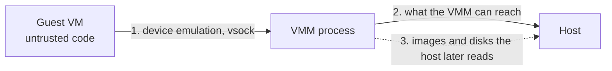

# MicroVM replicas: hardening, logs and metrics

**Status:** Draft for review
**Date:** 2026-10-30
**Builds on:** ADR-029 (Firecracker sandbox backend), ADR-050 (microsandbox backend), ADR-055 (workload plane, `micro_vm` isolation)
**Target:** PR #1677 (`feat/microvm-resolve-image-user`), as phased commits. See [section 9](#9-scope-and-decisions-for-the-reviewer) for what may not fit in one PR.

## 1. Why this document exists

A `micro_vm` deployment now deploys and serves traffic on a Linux KVM host. Three things stand between that and something we can recommend:

1. **Security.** The VMM runs as the server user, with nothing between a VMM escape and the Temps data dir, database credentials and encryption keys.
2. **Logs.** The Containers/logs views now read a replica's last 500 lines on demand, but the History tab (search, retention, live tail) sees nothing from a microVM.
3. **Metrics.** CPU, memory, I/O and network figures are unavailable for a microVM replica, and its I/O and network are not capped.

This document records what the code does today, what we propose, and the decisions we need from a reviewer.

## 2. What the code does today

Statements below were checked against the code on this branch. Anything taken from upstream Firecracker documentation rather than checked here is marked **(upstream)**.

### Security

| Area | Today | Where |
|---|---|---|
| VMM launch | `firecracker --no-api --config-file vm.json`, started directly by the server process, as the server user. No jailer. | `crates/temps-agents/src/sandbox/firecracker.rs` (spawn, ~line 863); module docs say the jailer is deferred |
| Jailer groundwork | `temps firecracker setup` installs the pinned `jailer` binary and stages a collision-checked unprivileged uid/gid range. Nothing uses either. | `crates/temps-cli/src/commands/firecracker.rs` |
| VMM seccomp | Firecracker enables its seccomp filter by default **(upstream)**; Temps passes no flag that disables it. Not independently confirmed on a running host. | |
| Host tools on guest-influenced disk images | `e2fsck`, `resize2fs` and `fuse2fs` run as the server user against VM ext4 images. `bwrap --unshare-all` is used for some rootfs steps. | `firecracker.rs` (~1127, ~1138, ~1563, ~1716) |
| Image extraction | An OCI image is unpacked into a rootfs by the server user, with chroot-style path resolution. | `firecracker.rs` (~755-830, ~2755) |
| Guest network | TAP pool and bridge with NAT. Egress is open. `network_mode: "restricted"` fails closed to no network because the egress proxy (ADR-013) is not implemented. | `firecracker.rs` (~1210) |
| Host/guest channel | One RPC per connection over vsock to `temps-vm-agent`; per-port loopback forwarders into the guest. | `firecracker.rs` (~1067), `workload_vm.rs` |
| Secrets | A VM's environment is stored in `env.json` (0600, same uid as the server). | `firecracker.rs` |

### Logs

- The guest agent runs the app as the VM's main process and writes its output to `/var/log/temps-workload.log`, rotated to a bounded size.
- The host reads it on demand through the agent's `ReadLog { tail_lines }` over vsock. The driver serves that as a non-following stream. This is what the Containers tab and the Logs view use after this PR.
- The History pipeline (`temps-log-aggregator`) collects only from the local Docker daemon (a followed `docker logs` stream) and from worker nodes through the `RemoteContainerLogSource` port. A microVM is in neither, so its output never reaches History, search, retention or the live tail.
- `ReadLog` has no offset, and the guest log has no timestamps, so repeated tail reads cannot be de-duplicated reliably.

### Metrics

- The driver's `stats()` returns an empty `InstanceStats` on purpose: the VMM process's usage is not the workload's (`workload_vm.rs`).
- The plane deployer refuses `get_container_stats` for a microVM, so the container detail metrics are empty.
- The guest agent protocol has no stats request: `Ping`, `Exec`, `WriteFile`, `ReadFile`, `Mkdir`, `Kill`, `Spawn`, `ProcessStatus`, `ReadLog`, `Shutdown`.
- CPU and memory are capped when the VM is created: `vcpu_count` is `ceil(cpu_limit)`, `mem_size_mib` is the memory limit. Block-device and network I/O are not rate-limited, and disk is the fixed-size rootfs.
- `InstanceStats` carries only CPU nanoseconds, memory bytes and pids. There is no field for disk or network I/O.

### microsandbox

- A sandbox backend exists (ADR-050, experimental) but no deployment driver, so `micro_vm` deployments run on Firecracker only.
- Confinement of the `msb` VMM is deferred in ADR-050: a dedicated uid, seccomp/landlock, and host-side secret substitution.

## 3. Goals and non-goals

**Goals**

- A VMM escape reaches as little of the host as we can arrange, without making setup harder than it is now.
- A microVM replica's output appears in History, search and live tail exactly like a container's.
- CPU, memory, disk I/O, network and pid figures for a replica, collected cheaply, and caps on what a replica can consume.
- The same observable behaviour whichever microVM backend runs the replica.

**Non-goals**

- Running hostile multi-tenant code on microsandbox (ADR-050 keeps Firecracker as that recommendation).
- Replacing Docker as the default isolation.
- Memory-snapshot warm boot (ADR-037).

## 4. Security hardening

### 4.1 Threat model

The assumption is that the guest runs code we do not control and can compromise its own kernel. The hardening below is about what happens next.

Each numbered edge is a place to add a barrier:

1. Make the VMM small and filtered (Firecracker's device model and seccomp).
2. Confine the VMM process so a compromise reaches almost nothing (jailer: chroot, namespaces, cgroup, unprivileged uid).
3. Treat everything the guest wrote and the host later parses as hostile input.

### 4.2 Proposed changes, in order of cost

**A. Host-side handling of guest-influenced data (no new privileges).**

- Run `e2fsck`, `resize2fs` and `fuse2fs` only against images the host built itself or inside `bwrap` with no network and no access to the data dir. Treat a snapshot ext4 that a guest wrote as hostile.
- Review image extraction for path traversal, symlink and hard-link handling, and set explicit size and file-count ceilings.
- Add tests with hostile archives: `..` paths, absolute symlinks, links pointing outside the root, device nodes, oversized files.

**B. Guest network reach (no new privileges).**

- Default-deny rules on the VM bridge for traffic to the host's loopback services, the cloud metadata address and other VMs. Allow what a replica needs: its own published ports inbound, internet outbound.
- Verify the current rules before changing them. Section 2 records only that egress is open; whether host-bound traffic is already filtered was not checked.

**C. Guest hardening.**

- Run the app as the image's resolved user (done in this PR) and drop capabilities the workload does not need in the guest agent's spawn.
- Cap guest pids and open files via the agent's spawn (rlimits).

**D. Run Firecracker through the jailer (needs privilege).**

Run `jailer --id --exec-file firecracker --uid --gid --chroot-base-dir` per VM, so the VMM runs in an empty chroot as a per-VM unprivileged identity, with its own namespaces and cgroup **(upstream)**.

What it changes in Temps:

- The VM sees only its chroot, so the kernel, rootfs, config and the vsock socket must be placed inside it. Paths such as `vms/<name>/v.sock` move.
- TAP devices and forwarders likely move into a per-VM network namespace.
- The jailer needs root or capabilities to chroot, create device nodes and set cgroups, and the server runs unprivileged.

Privilege model options:

| Option | Description | Trade-off |
|---|---|---|
| 1. Small privileged launcher | A tiny root helper (socket-activated by systemd) that accepts "launch VM *x*" from the server user, validates it, runs the jailer, and hands back the PID and sockets. | Smallest root surface; new component to write and secure. **Recommended.** |
| 2. systemd transient units | The helper starts each VMM as a systemd unit with sandboxing options. | Reuses systemd; ties Temps to systemd and a polkit rule. |
| 3. Run the server with ambient capabilities | Give the server the capabilities the jailer needs. | Puts the capabilities on the process we are trying to protect. Not recommended. |

**E. microsandbox confinement (ADR-050 section 6).**

Wrap the `msb` launch (the SDK resolves `msb` from `<home>/bin/msb`) in a launcher that drops to a dedicated uid and applies landlock and seccomp, then moves credential handling to host-side substitution. Not verified: how the SDK passes paths and descriptors to `msb`, so a spike comes first.

### 4.3 What we will not claim

Until D and E exist, the documentation must say that a VMM escape lands as the server user. A and B reduce the chance and the blast radius; they do not remove it.

## 5. Logs

### 5.1 Goal

A microVM replica's output is searchable in History, tailed live and retained like a container's, with the same ingest budget and labels.

### 5.2 Design

1. **Incremental read in the guest agent.** Extend `ReadLog` with a byte offset and return the new data, the next offset and a rotation marker. A VM whose agent predates the extension keeps tail-only behaviour; the host detects that from the agent's error, as it already does for `ReadLog` itself.
2. **A microVM log source in the host.** A second implementation of the `RemoteContainerLogSource` port (`temps-log-aggregator`, `remote_collector.rs`), living with the other control-plane code in `temps-deployments`:
   - `list_remote_containers` returns the running microVM replicas, with the same labels (project, environment, service, deployment) the collector expects.
   - `open_log_stream` polls the guest every 1-2 seconds per running replica, emits `<rfc3339> <message>` lines, and stamps each line with its arrival time.
3. **Everything downstream is unchanged.** Reconnect and backoff, the ingest budget, the chunk store, search and live tail.

### 5.3 Properties

- **Timestamps** are host arrival times, accurate to the poll interval, not the instant the app wrote the line. We state this where the logs are shown.
- **Cost** is one small vsock call per running replica per interval, transferring only new bytes. Memory is bounded by the per-poll byte cap.
- **Failure mode** if the VM or agent is unreachable: the poll backs off and resumes from the stored offset; lines written while the agent is unreachable are still in the guest log until it rotates them away.
- **Retention in the guest** is bounded by the rotation settings the spec already carries. A replica that writes faster than the poll interval times the retained size can lose lines; this is a documented limit, with a counter exposed so it is visible.

### 5.4 Node placement

A microVM runs on the control plane, so the node fields on `RemoteContainerInfo` need a defined value for "control plane". Decide whether to reuse the existing node concept or add an explicit local variant. Open question 3.

## 6. Metrics and resource limits

### 6.1 What to measure

For each replica, per sample: CPU time, memory in use, memory limit, disk usage and I/O, network bytes in and out, and process count. Plus the cost of the VM itself (the VMM's CPU and resident memory), shown separately so the workload's figure is honest.

### 6.2 Design

1. **Guest agent `ReadStats` request.** The agent reads cumulative counters from `/proc` in the guest:
   - CPU: the workload process tree's `utime + stime`, from `/proc/<pid>/stat`.
   - Memory: resident set of that tree, and `MemTotal` and `MemAvailable` for the VM.
   - Disk: `/proc/diskstats` for the rootfs device, plus `statfs` for space used.
   - Network: `/proc/net/dev` for the guest's interface.
   - Pids: the count in the tree.

   Counters are cumulative, so the host computes rates from deltas, the same way the metrics scraper already handles counter baselines.
2. **Host-side VMM cost.** Read `/proc/<firecracker pid>/stat` and `status` for CPU and resident memory. No guest involvement.
3. **Extend `InstanceStats`.** Add disk read/write bytes and network rx/tx bytes (all optional, so existing drivers are unaffected), and implement `stats()` in the Firecracker driver from the above. Then allow `get_container_stats` for a microVM through the plane, so the Containers detail page works.
4. **Collection cadence.** Pull on request for the detail page, and at a fixed interval for any stored series. One call per running replica per interval; the sample is a few hundred bytes. Bounded concurrency; a replica that does not answer is skipped for that interval, not retried in a tight loop.

### 6.3 Limits

| Resource | Today | Proposed |
|---|---|---|
| vCPU | `ceil(cpu_limit)` | Keep; cap CPU time through the VMM's cgroup once it runs under the jailer (4.2 D) |
| Memory | `mem_size_mib` | Keep; evaluate a balloon device later to return idle memory |
| Disk | Fixed-size rootfs | Keep; report usage (6.2) and warn near full |
| Block I/O | None | Firecracker's block rate limiter (bandwidth and operations) **(upstream)** |
| Network | None | Firecracker's network rate limiter **(upstream)** |
| Pids, files | None | Guest rlimits from the agent's spawn (4.2 C) |

The limits above must be expressible in the workload spec; where a field does not exist yet, the driver refuses with the field named, as it does today for what a microVM cannot carry.

### 6.4 Where the numbers appear

The Containers detail view and any stored series, with the same labels and units as Docker replicas so charts do not need a second code path. How container metrics history is stored today was not checked for this draft. Open question 4.

## 7. microsandbox parity

A microsandbox driver would implement the same `micro_vm` behaviour on the SDK: OCI pull, detached sandbox, `.port(host, guest)` publishing, exec, logs and metrics. It is additive: Firecracker stays the Linux default and microsandbox is the fallback and the macOS path (Apple Silicon only).

Requirements before it is offered:

- Process supervision with restart backoff (built by the guest agent for Firecracker; to be built or verified on the SDK).
- The same log and metric surfaces as sections 5 and 6, so the History source and `stats()` work for either backend.
- The ADR-050 confinement items (4.2 E).
- A comparison on a Linux KVM host (boot time, memory per VM, forwarding throughput, restart behaviour) before it is recommended anywhere.

The release build of the server is glibc and links the SDK. The musl build used for CI artifacts does not.

## 8. Phasing and tests

| Phase | Content | Needs |
|---|---|---|
| 1 | `ReadStats`, `InstanceStats` extension, `stats()` and `get_container_stats` for microVMs | Guest agent change, API and generated-client regeneration |
| 2 | Incremental `ReadLog`, microVM log source for the History pipeline | Guest agent change, aggregator wiring |
| 3 | Host-side handling (4.2 A), network rules (4.2 B), guest hardening (4.2 C), I/O rate limits | No new privileges |
| 4 | Jailer and the privileged launcher (4.2 D) | Design approval, a root component |
| 5 | microsandbox driver and confinement (sections 7, 4.2 E) | Decision on scope |

Tests per phase:

- **Unit tests** with a fake driver and fake guest, as already done for the Containers/logs reads in this PR.
- **Hostile-input tests** for phase 3: archives and filesystem images designed to break extraction.
- **Real-VM tests** on a Linux KVM host (skip gracefully where `/dev/kvm` is unavailable, per the repository's rule for Docker-dependent tests). These cover log offsets across rotation, stats against a workload with a known load, and rate limits.
- Compatibility tests: a new host against a VM with an old guest agent, for both new requests.

## 9. Scope and decisions for the reviewer

This is more than one pull request's worth. Phases 1 and 2 fit this PR as separate commits, since they finish what the PR already starts (a microVM replica you can see and read). Phases 3 to 5 each change security posture, privileges or add a backend, and will be easier to review separately. The project prefers fewer PRs, so this is a call for the reviewer.

Decisions needed:

1. **PR scope.** Phases 1-2 here, phases 3-5 as follow-ups, or everything here?
2. **Privilege model for the jailer** (4.2 D): the small privileged launcher, systemd units, or something else?
3. **Control-plane node identity** for microVM log sources (5.4): reuse the existing node fields or add an explicit local variant?
4. **Metrics storage and API surface** (6.4): which existing series and endpoints should microVM stats feed, and is extending `InstanceStats` and the OpenAPI spec acceptable in this PR?
5. **Log timestamps** (5.3): is host arrival time acceptable, or should the guest agent timestamp lines at write time (a larger guest change)?
6. **microsandbox** (7): build it now alongside, or after the Firecracker work is hardened?

## 10. Risks

- **Guest agent compatibility.** New requests only work in VMs booted with a new agent. Existing VMs keep working with the old behaviour; the document of record for this is the fallback path in section 5.2 and the compatibility tests in 8.
- **Moving paths under the jailer** touches rootfs build, vsock access, TAP and the forwarders at once, and is the riskiest change here. It deserves its own PR and a real-VM test pass.
- **Rate limits** set too low can look like application slowness. Defaults must be generous and the limits visible in the UI.
- **Unverified items.** The ones named above (current guest firewall rules, Firecracker's default seccomp on a running host, how the SDK launches `msb`) must be checked before the designs that depend on them are committed to.
