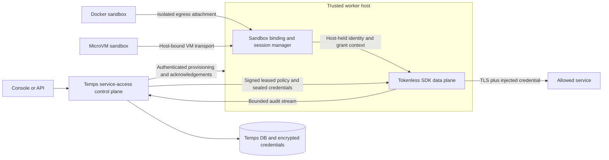

<!--
SPDX-FileCopyrightText: 2024-2026 Temps Contributors
SPDX-License-Identifier: MIT OR Apache-2.0
-->

# Time-limited service access for sandboxes through Tokenless

Status: proposal for review, 2026-11-08. This expands the sandbox Git credential work into a reusable service-access feature. It does not claim that the integration is implemented or approved for release.

Companion: [Tokenless SDK requirements](./tokenless-sdk-requirements.md).

## Implemented control-plane increment

The branch now contains a first increment in `temps-service-access`. It saves configuration and consent records only; it does not implement the proxy described below.

- `sandbox_access_services` stores a project-owned HTTPS origin, segment-boundary path prefixes, HTTP methods, a maximum lifetime, an enabled flag, an optional encrypted bearer credential, and a monotonically increasing version.
- `sandbox_service_grants` stores a sandbox reference, project and service references, requested service version, immutable policy snapshot, requester, absolute expiry, revocation timestamp, and write version. The API exposes only the sandbox's public identifier. A composite foreign key prevents linking a service from another project.
- Project-scoped APIs expose capability, paginated service and request lists, service creation/update, request creation, and revocation of never-provisioned requests. Writes require project write permission; sandbox operations also require sandbox permission and ownership (or administrator access). Deployment tokens cannot manage this feature.
- The sandbox detail page exposes these controls next to Terminal, including missing-project, missing-integration, loading and failure states. A request is always shown as not connected, expired, revoked, service-disabled, or policy-changed. Saving a request never calls a provisioning operation.
- `ServiceAccessBroker` and `UnavailableTokenlessBroker` define the integration seam. Both provision and revoke return a typed unavailable error. There are no background reconcilers, per-sandbox processes, new runtime environment variables, or network changes in this increment.

The initial credential form supports a static bearer value. Git smart HTTP, Basic and named-header authentication, provider-minted credentials, broker worker bindings, incarnation identity, runtime acknowledgements, connection termination, quotas and protocol conformance remain implementation work. Stored requests are **not an activation queue**: installing Tokenless must require fresh authorization, not replay these old records. Future broker activation needs a separate generation-bound runtime binding model and revoke/ack state machine; a database-only revoke in this increment is safe solely because these requests have never been provisioned.

No credentials enter the sandbox, image, snapshot, API response or audit payload through this feature. Responses expose `has_credential`; credential writes use `EncryptionService`. Policy validation here is structural; it makes no upstream connection and does not assert DNS or egress safety. The eventual broker must still validate resolved destinations and enforce the policy before any forwarding.

Updates require the caller's expected version. Any service update (including rotation or disabling) changes the version, so an older request cannot silently inherit broader permissions. Lifetimes are 60–86400 seconds, bounded further by the service maximum; expiry starts at request creation even while the integration is unavailable. Extending sandbox lifetime never changes an access request.

Upgrade: the migration only adds tables and indexes; old binaries tolerate them. Downgrade refuses to discard populated service-access tables. The control plane performs bounded, paginated database work; grant lists join service metadata without N+1 queries. It adds no request-forwarding hot path, worker sidecar, or polling task. Runtime load budgets below apply to the future proxy.

## Outcome

An operator configures a service once, including its credential and maximum allowed operations. An authorized user connects a Docker or microVM sandbox to that service for a chosen duration. Commands in Terminal, agent processes, and background jobs can use the service during that window without receiving its real credentials. Expiry and revocation are enforced outside the sandbox, including on already-open connections.

Example: connect a sandbox to one Git repository with fetch access for 30 minutes and to a model API for 10 minutes. Expiring the model grant must not interrupt authorized Git access or be extended by Git session renewal. Starting an agent conversation is never a prerequisite.

The implementation belongs in the general Temps sandbox lifecycle and worker infrastructure. The workspace plugin may request grants through the same authorized service APIs, but does not own credential-daemon startup or access renewal.

## Scope and boundaries

| Service or transport | Scope of this feature |
|---|---|
| HTTPS APIs with bearer, Basic, or named-header credentials | Required first release; bounded host/path/method policies |
| Git smart HTTP | Required first release; repository-scoped fetch and explicit push grants |
| Docker and microVM sandboxes | Required first release; same grant and revocation semantics |
| Streamable HTTP MCP | Subsequent increment using Tokenless's existing gateway; requires the same host-held identity and expiry guarantees |
| Git LFS and provider-specific redirected downloads | Explicit capabilities, enabled only after separate destination and credential-forwarding tests |
| PostgreSQL, Redis, SSH Git, arbitrary TCP, SigV4 | Not provided by an HTTPS injection proxy; later protocol adapters or existing scoped-credential mechanisms |
| Network access to existing Temps-managed databases | Preserve existing service links; do not silently convert them or imply their credentials are hidden |

The UI calls these **service access grants**. A broker service is a credential-backed upstream integration, distinct from an existing Temps managed-service row or project-service link. Raw TCP services remain visibly unsupported by the broker until their adapters exist.

## Verified starting point

Tokenless was inspected at commit `641a02d63c267b32b0a787cd38de8c99fd500cd3`. Its [architecture ADR](https://github.com/gotempsh/tokenless/blob/641a02d63c267b32b0a787cd38de8c99fd500cd3/docs/adr/0001-architecture.md) explicitly plans a Temps-native adapter and one credential-injecting data plane per host. The Rust libraries and store abstractions already exist; a stable, published SDK and the Temps integration do not follow automatically from that ADR. The companion requirements distinguish reuse from changes.

In Temps today:

- `crates/temps-sandbox-providers/src/docker/egress.rs` configures a sandbox egress proxy and proxy environment variables. Reuse its isolation boundary and preserve its network policy.
- `crates/temps-sandbox/src/services/sandbox_service/links.rs` issues runtime variables for linked managed services. That API can return credentials and is not the new broker contract.
- `crates/temps-sandbox-providers/src/firecracker.rs` currently rejects restricted-egress configurations on create and restore. MicroVM parity therefore needs real host-enforced networking work, not just proxy variables in the guest.
- The Git helper and uid-1001 daemon currently return scoped provider credentials to Git inside the sandbox. The new path injects them after traffic leaves it.

## Architecture



### Control plane

Add a proposed `temps-service-access` feature crate using the Tokenless SDK. It owns service definitions, credential references, grants, policy compilation, authorization, lifecycle reconciliation, and typed capability/status responses. Its plugin registers required dependencies with `require_service`. Implementation must follow the handler, migration/entity, plugin, and design-system recipes.

Implement Tokenless's control-plane persistence, authorization, and audit abstractions on Temps services. Use Temps project permissions and PostgreSQL rather than embedding the standalone Tokenless SQLite database, account system, or management UI. Encryption uses an explicitly designed adapter to `EncryptionService`; do not stack undocumented encryption formats or expose a plaintext read API. Credential materialization for trusted broker nodes is internal, never an HTTP response to the sandbox or console.

All configuration is persisted per integration, project, or grant. Credentials, OAuth refresh tokens, private CA material, and enrollment secrets are encrypted at rest. No new runtime environment-variable configuration is introduced. Proxy and trust environment variables supplied to workloads are derived output, contain no secrets, and are not the authoritative configuration store.

### Worker data plane and identity

Run one supervised Tokenless data plane per worker/trust domain. A bounded host-side binding table associates each sandbox with `(sandbox_id, lifecycle_generation, worker_id)` and its authorized grants. Reuse the existing Docker egress relay where practical; do not add a full broker process per sandbox. Supporting a per-sandbox lightweight relay is acceptable if measured within the resource budget.

The sandbox receives a proxy address, public trust bundle, and optional nonsecret placeholders. It receives no provider credential, broker session token, issuer key, or interception private key. The host owns session renewal and authenticates the binding. Broker requests cannot select another sandbox identity by sending a header, arbitrary sandbox ID, or session label.

Docker isolation must prevent reaching another sandbox's relay or the shared authenticated broker listener. Bindings must derive from host-controlled network attachments rather than an IP observed after shared NAT. The host-held session must not be stored in sandbox-readable mounts, container labels, argv, or sandbox environment.

MicroVM adapters must bind the proxy stream to the actual VM instance, for example through an authenticated host-side vsock attachment, or a network endpoint isolated by the VM's tap/namespace. Do not trust a guest-reported CID or header alone. Inventory both Firecracker and microsandbox-backed paths; each advertised backend must pass the same conformance suite. Unsupported drivers return a typed capability reason, never a weaker fallback.

Use authenticated worker/control-plane transport and preserve remote worker routing. Neither a public proxy port nor possession of the sandbox's ordinary API identifier grants access.

### TLS and egress

Intercept TLS only for configured service destinations. Install the public broker CA into supported sandbox trust stores and Git's trust configuration. Scope that trust to workloads; never distribute the private CA key or install sandbox interception trust globally on the host. Certificate-pinned clients must receive an explicit unsupported-capability explanation rather than disabled TLS verification.

Effective permission is the intersection of the service's maximum scope, project policy, grant scope, current credential validity, and sandbox egress policy. Connecting a service does not silently widen network policy. If a destination is blocked, return a conflict with the specific required policy change.

Enforce IPv4 and IPv6 network restrictions outside the guest. Removing `HTTPS_PROXY`, using `NO_PROXY`, changing DNS, direct IP dialing, alternate ports, or UDP/QUIC must not bypass the configured isolation policy. This does not prevent a user using their own credentials on destinations that the operator explicitly permits through ordinary egress.

Preserve existing behavior for unrelated traffic. A broker outage may disable credential-backed service access without disabling already-authorized unrelated egress. A configured service destination with a denied or expired grant must not fall through to a credentialed default route. Explicit private upstreams require validated, narrow destination policy; prevent metadata-service and management-plane pivots.

## Product model

Proposed entities, with typed IDs and normal timestamps:

| Entity | Required fields and behavior |
|---|---|
| Service definition | Project/organization ownership, name, protocol/template version, host/port restrictions, operation profiles, enabled state, default/max grant duration, upstream trust policy |
| Credential binding | Service ID, provider-connection reference or encrypted secret reference, credential generation, health/expiry metadata; responses expose only configured flags |
| Sandbox service grant | Sandbox ID, service ID, immutable granted-scope snapshot, grant generation, creator, starts_at, expires_at, revoked_at, desired state, policy version, idempotency key |
| Worker access binding | Sandbox lifecycle generation, worker placement, installed policy version, observed state, acknowledgement time, lease deadline; never a public token field |
| Access event | Grant/service/sandbox IDs, operation class, outcome/reason code, timestamps and bounded counters; no authorization headers, bodies, URL query secrets, or provider tokens |

An access bundle is a reusable selection of service profiles. Attaching a bundle creates separately visible grants with independently enforced deadlines. Editing a bundle must not silently broaden existing grants. Widening scope, extending duration, changing a credential binding, or re-enabling a disabled service requires fresh authorization and audit.

Default proposal: 15-minute grants, minimum 1 minute, maximum 24 hours unless a service's persisted policy is stricter. These are proposed product defaults, not hardcoded Tokenless assumptions. Duration starts when the control plane accepts the grant; failed provisioning does not secretly move its deadline. Persist all times in UTC and expose ISO 8601 `Z` values.

## What “for X minutes” means

The durable grant's `expires_at` is the authority. Short-lived worker sessions are transport mechanisms; renewal can never extend the grant. Each request must match a currently valid grant, and an open stream must stop at its effective deadline.

```text
effective_deadline = min(grant.expires_at,
                         broker_session.expires_at,
                         upstream_credential.expires_at,
                         active_policy_lease.expires_at)
```

Omit a credential expiry term only for a genuinely non-expiring credential. A long stream may be interrupted earlier by transport-session expiry; clients must receive a clear failure and may retry only when the operation is safely retryable. Broker refresh must not blindly replay a push or other write.

Proposed operating bounds: worker sessions of at most 60 seconds, policy leases of at most 30 seconds, and connected revocation applied within 5 seconds. Disconnected workers lose credential-backed access within the remaining lease, at most 30 seconds. Measure these bounds under load before promising them in the UI. Expiry itself has no positive grace period; reject unsafe clock skew and use monotonic timers after validating signed wall-clock deadlines.

Revocation closes active HTTP streams, tunnels, and MCP sessions associated with that grant. It cannot undo an upstream side effect already accepted or bytes already delivered. Renewal, restore, and migration must use compare-and-set generations so late responses cannot resurrect expired, revoked, or superseded access.

A sandbox may hold grants with different deadlines. A single session containing several rule IDs is not sufficient unless the broker independently validates each matched grant's deadline and generation. Ambiguous overlapping rules using different credentials must be rejected at attachment or deterministically denied; never choose an arbitrary credential.

## Lifecycle and failure semantics

| Event | Required outcome |
|---|---|
| Attach service | Authorize sandbox and service scope, transactionally record grant plus durable security event/outbox, provision asynchronously; report `provisioning` until worker acknowledges the exact version |
| Start/restart | Reauthorize unexpired grants and create a fresh binding generation before enabling credential access |
| Terminal attach | Read and display status; no token minting tied to an agent message and no automatic grant extension |
| Expiry/revoke | Deny new requests and close active grant traffic; show `revoking` until acknowledgement or enforceable lease deadline, then `revoked` |
| Pause/stop | Disable binding and revoke transport sessions; grant wall-clock duration continues to elapse |
| Snapshot | Exclude all broker sessions, credentials, and binding state. Public CA material may persist but must be reconciled on restore |
| Restore same sandbox | Recheck current authorization and original deadline; never replay serialized credentials or reset duration |
| Clone snapshot into new sandbox | Copy no grants by default; attaching services requires explicit authorization for the new sandbox |
| Move to another worker | Fence old binding, wait for revocation acknowledgement or lease expiry, then activate new generation; do not allow stale worker renewal |
| Worker/control-plane restart | Reconcile desired state; deny until current policy and binding are validated. Rebuild from durable grant records, not sandbox env files |
| Disable/delete service or revoke provider connection | Revoke all dependent grants and cached credentials with the same bounded propagation semantics |
| Concurrent extend/revoke | Versioned compare-and-set; an extension must not overwrite revocation. Public retry keys return the original mutation result |
| Provisioning timeout/cancellation | Revoke partial sessions and detach only task-owned bindings; retain a truthful failed state and retryable reason |

The control-plane audit integration distinguishes a durable security event/outbox from downstream audit-log delivery. Failure to deliver the latter must not undo a successful mutation. In the proxy, inability to admit an access event into its bounded audit pipeline denies credential injection; an unbounded queue is prohibited. SDK audit durability and shutdown behavior must be explicit.

## API and console contract

Proposed routes are design targets, not existing endpoints:

- Project-scoped service list/create/update and credential-configuration operations under `/v1/projects/{project_id}/access-services`.
- Sandbox grant list/attach under `/v1/sandboxes/{id}/service-grants`; explicit extend and revoke operations on a grant.
- Typed `/v1/sandboxes/{id}/service-access` status, including backend capability, per-service state, granted operations, absolute expiry, remaining seconds, reason code, safe explanation, and setup path.

Every route requires authentication, action permission, and project/sandbox scope checks. Sandbox ownership alone must not authorize use of a service owned by another project. Worker acknowledgement APIs use authenticated worker identity and validate placement/generation. Writes are audited, lists default to 20 and cap at 100, and mutations use idempotency/version checks. Never expose session tokens, raw credentials, or private broker keys in any response. Regenerate both OpenAPI clients when implemented.

Typed states: `not_configured`, `unsupported`, `provisioning`, `ready`, `degraded`, `denied`, `expired`, `revoking`, `revoked`, `failed`. `ready` means authorized policy and a fresh usable credential binding are installed; it does not promise upstream availability. Status includes desired and observed policy versions so a stale acknowledgement cannot masquerade as readiness.

A sandbox's Services panel is the main surface: select a service, choose its allowed profile and duration, review the absolute expiry, connect, extend, or revoke. Terminal shows a compact service-status strip with expiry and actionable errors. An unconfigured broker stays visible with a setup link and a concrete example. Provider outage, missing credentials, unsupported transport, and denied access have different explanations. No raw implementation keys appear in user flows.

## Git migration

Add dedicated Git HTTPS templates. The current Tokenless GitHub template covers API hosts, not `github.com` Git transport. Match a canonical repository, discovery service query, and Git RPC endpoint. Clone/fetch permit `git-upload-pack`; push separately permits `git-receive-pack`. Both use POST, so method alone cannot express read versus write. Branch restrictions remain upstream provider policy unless a future Git-aware adapter explicitly supports them.

Mint short-lived, repository-scoped installation credentials through a control-plane issuer adapter where available. Never exchange a broad provider credential for a broad wildcard rule merely to get cloning working. Refresh and issuance are bounded, serialized per credential, and outside the request hot path. Private or self-hosted Git origins require explicit supported templates and trust policy.

Keep the current fail-fast Git change during migration. Once a sandbox opts into brokered Git access, remove the legacy credential helper configuration, uid-1001 daemon, and daemon env provisioning for that sandbox. Do not silently fall back to exporting tokens when the broker fails. Existing images/snapshots require runtime protocol capability checks and either a supported upgrade or recreation; report this before attachment.

## Resource and security acceptance targets

The feature must work within Temps's 1 vCPU / 2 GB external-database target and remain comfortable on 2 vCPU / 4 GB with the database colocated. Proposed initial broker budget: at most 128 MiB incremental RSS for 32 sandbox bindings and 128 concurrent active upstream connections, with 64 KiB maximum queued payload per connection. These are acceptance targets to benchmark, not measurements. Additional protocol buffers, certificate caches, snapshot size, and audit queues must be included in the measured bound.

Use shared node infrastructure, bounded per-sandbox fairness quotas, and bounded key/cardinality caches. Preserve Tokenless's no-DB/no-secret-refresh/no-disk hot path. Evaluate policy lookup at 100k decisions/second separately from end-to-end network throughput; do not imply the small reference machine can sustain 100k TLS requests/second. At saturation, refuse new work with typed retryable errors, preserve existing authorized streams within their deadlines, and expose counters without secret-bearing labels.

Credentials can still be exposed by a compromised trusted broker host or a malicious permitted upstream that reflects authentication material. Keep the broker per trust domain and restrict injection to trusted service endpoints. This design prevents sandbox possession of credentials; it does not make authorized service actions harmless or provide general data-loss prevention.

## Delivery and acceptance

| Increment | Deliverable and release gate |
|---|---|
| 1. SDK contract | Tokenless embedding, grants, transport identity, expiry, acknowledgements and conformance requirements agreed; pinned dependency and compatibility checks |
| 2. Temps control plane | Entities/migrations, authorization, encrypted references, audit/outbox, typed API and generated clients; no fake-ready status |
| 3. Worker integration | Shared broker, Docker binding and each supported microVM driver, fencing/recovery, host-held sessions and trust provisioning |
| 4. Product and Git | Services panel and Terminal status; Git fetch/push templates and installation-token adapter; legacy migration path |
| 5. End-to-end release gate | Both backends pass isolation, time-limited access, restore, revoke, concurrency, outage, and resource tests |

The larger PR should describe the final service-access feature and its Git consequence. The current fail-fast commit remains useful but is not completion of this scope. No merge is implied by this document.

Required tests include two sandboxes on one worker and on separate workers; differing service expiry times; attempts to forge identities and reach another relay; encoded-path/query ambiguity; provider credential never appearing in sandbox env/files/processes/snapshots/errors; expiry and revocation during Git and long streams; concurrent extend/revoke; worker loss and clock skew; snapshot clone/restore; credential rotation; audit saturation; DNS rebinding, redirects, IPv6 and direct-egress bypass; and bounded large Git transfers. Prove both positive authorized access and negative unauthorized access. Docker tests runtime-skip without Docker; actual Docker and Linux microVM CI runs are release requirements, not replaceable by mocks.

## Decisions to confirm during review

1. Accept HTTPS services and Git as the first release, with raw database protocols explicitly separate?
2. Accept 15-minute default / 24-hour maximum grants, narrowed per service, and no implicit extension on restart?
3. Accept the proposed 5-second connected / 30-second partitioned revocation bounds and termination of in-flight streams at expiry?
4. Prefer native embedding with Temps-owned persistence and RBAC; standalone Tokenless-server integration can remain a later deployment option?
5. Treat every advertised Docker/microVM driver as a release gate, with unsupported capabilities shown explicitly until implemented?
