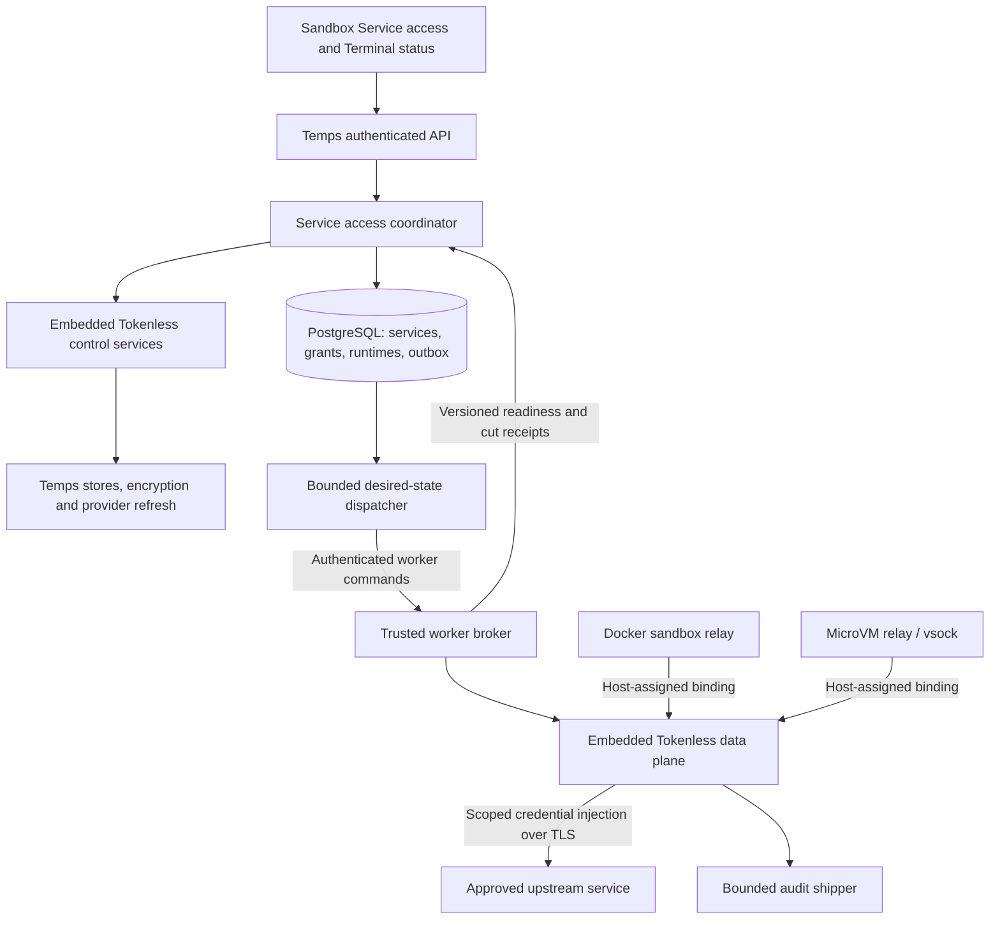

<!--
SPDX-FileCopyrightText: 2024-2026 Temps Contributors
SPDX-License-Identifier: MIT OR Apache-2.0
-->

# Tokenless integration in Temps: architecture and delivery plan

Status: proposed implementation plan, not a release-readiness claim. Prepared 2026-11-08.

## Decision and scope

Continue building the Temps integration while Tokenless closes the remaining validation questions. Deliver a working Docker path first, then remote workers and microVM parity. Keep live access unavailable until enforcement, identity and lifecycle tests pass; a successful policy compilation is not a connection.

The outcome is: an authorized user connects one sandbox to selected services for a fixed duration. Commands in Terminal and agent sessions use those services without receiving provider credentials. Expiry and revocation stop ongoing traffic as well as new requests. Starting an agent message is not required.

Initial service types: generic HTTPS bearer authentication, then explicit Git clone/fetch and separately authorized push. LFS, SSH Git, WebSockets, raw databases/TCP, QUIC and arbitrary protocol tunnelling are outside this release. A future service type needs its own enforcement and acceptance tests.

This plan builds on [the architecture](sandbox-service-access.md) and [SDK requirements](tokenless-sdk-requirements.md). It supersedes the old readiness assessment's statements that there is no SDK dependency and that strict expiry and binding updates have not been implemented upstream.

## Verified baseline

Initial assessment: Temps `4639de9464e5305831c57203a56a07b079d0aa54`, Tokenless PR #1 at `20a09ff034ec004ec3872b238fd8ffdaab0acb68`. Implementation work now starts from Temps `6c0dba0de105964d23263681a70264e71b4cbdd7` and upgrades the SDK pin to [`88b66cb0dc00c5262525f9ba7d8b881066e60718`](https://github.com/gotempsh/tokenless/pull/1). The validation results below describe the initial upstream assessment, not a full validation of the newer SDK revision.

Already implemented in Temps:

- Project-scoped service definitions, encrypted write-only bearer credentials, versioned policy edits, paginated grant-intent records and audit events.
- Eight authenticated API operations, generated clients, Service access panel, routed service editor and validation summaries.
- SDK compilation of bounded HTTPS host/path/method policy and unsigned project/node/incarnation-bound session preparation.
- Fail-fast legacy Terminal Git behavior and actionable missing-daemon diagnostics.

Not integrated into the running Temps server: a broker, signed sessions, durable runtime state or acknowledgements, sandbox transport, credential injection, lifecycle enforcement or fresh activation. `ServiceAccessPlugin` registers `UnavailableTokenlessBroker`; its provision/revoke methods return typed unavailable errors. Existing saved intents must never become live automatically.

### Implementation in progress

The working tree now includes strict grouped-session preparation with independent grant deadlines and a new `temps-service-access-runtime` library. Its worker wrapper verifies signed snapshots, caps their lease at 30 seconds, denies unmatched destinations, bounds connections and bindings, and validates strict sessions both when binding and updating. An owned Unix-socket attachment forwards guest byte streams under one host-assigned identity and cuts access on drop. The worker starts without authority and requires policy delivery before a binding becomes ready.

These are library components, not a completed product path. They are not yet wired to node-agent commands, provider lifecycle, database reconciliation, guest networking or the console. Unit fixtures use the upstream in-memory control store; production durable stores are still required. The Docker cluster, microVM and approval-flow acceptance gates below remain outstanding. The sandbox-initiated request flow is included in the Docker preview scope, not available in the current API yet.

### Latest Tokenless changes and remaining caveats

The new SDK implements strict sessions, per-rule deadlines, version-fenced binding updates, whole-session/binding revocation receipts, Git smart-HTTP scopes, secret-safe Debug implementations, credential rotation generations/idempotency and capability checks. These materially unblock implementation.

Validation during the initial upstream assessment:

- GitHub reported seven passing CI jobs and one skipped review check.
- Local library run: 99 core and 56 control tests passed; data plane had 70 passes and one failure in `proxy::tests::git_rules_allow_a_fetch_refuse_a_push_and_stream_a_large_pack` after about 60 seconds. The newer real-Git-client test passed. An isolated rerun was started, but no completed result was recovered; do not count it as passing.
- All 12 in-memory conformance integration tests passed. The conformance library itself has no unit tests; the integration suite is the relevant execution.
- A temporary deterministic clock probe failed: after observing a wall-clock jump forward beyond expiry, correcting the clock backwards can return a time before that already-observed expiry. `clock.rs` uses the maximum of current wall time and a fixed initial monotonic anchor, not a high-water mark of observed time. This is an arithmetic reproduction, not a system-clock or sandbox exploit test. The probe was removed; upstream source was not changed.
- No Docker/microVM integration, SQLite conformance, resource benchmark or full independent security review was performed in this assessment.

The newer SDK revision changes clock handling and expiry selection; rerun the clock probe and Git regression before treating those concerns as resolved. Before enabling live access, resolve any remaining failure with upstream. Also settle per-grant revocation acknowledgement: removing one rule with `Binding::update` is synchronous; `session_cut` and `revoke_and_wait` acknowledge a whole session/binding. They do not directly acknowledge one removed rule while unrelated rules in that session keep streaming. Require a bounded rule/update enforcement receipt, or a proven equivalent, before reporting an individual grant as revoked. Do not revoke the entire shared session and pretend other services were unaffected.

Dependency gate: the pinned SDK and PR #1 head `c966497d88e5570b9154d6d6a8a69a785a850c81` still make `tokenless-core` depend on unmaintained `serde_yaml` / `unsafe-libyaml`. Temps' `workspace_does_not_depend_on_unmaintained_serde_yaml` regression test rejects this; the existing exception is only for an unused Pingora configuration parser. Upstream must replace its YAML parser with the maintained `yaml_serde` package (Temps uses the `0.10` series), preserving template parsing and validation tests. A workspace dependency alias can retain the existing Rust import name without retaining the old package in the dependency graph. Acceptance: Tokenless template tests pass, its core dependency tree contains no `serde_yaml` or `unsafe-libyaml`, and the Temps lockfile guard passes after repinning. Do not extend the exception or suppress the test to accept this SDK dependency.

## Architecture

### Control plane: authorization and durable intent

Keep `temps-service-access` responsible for policy, fresh consent, lifecycle orchestration and typed status. Handlers authorize and audit; they never access the database directly. Implement Tokenless store traits against Temps data access, with project-to-SDK scope mapping. Do not introduce a second identity system or an unrelated standalone Tokenless database/server.

A fresh Connect request checks effective project and sandbox permissions, sandbox ownership, current service version, runtime incarnation, backend capability and requested duration. It writes the grant and a versioned outbox command in one transaction. The absolute expiry is fixed at authorization; provisioning delay consumes its duration. Expired pending work is discarded, not given a new lifetime.

Outbox delivery is at least once. Commands are idempotent and fenced by runtime incarnation, worker identity and monotonically increasing desired version. Durable desired state and acknowledgements, not an RPC returning successfully, determine status. Recheck relevant policy before publishing; disabling a service, deleting it or revoking permission invalidates affected access through versioned reconciliation.

### Worker: trusted enforcement

Proposed `temps-service-access-runtime` crate: SDK data plane, bounded binding registry, authenticated command handler, snapshot installer, capability reporting and audit shipper. Integrate into the existing trusted worker process, with the same interface available for a local worker. Avoid one credential-holding sidecar per sandbox.

One data-plane instance per worker is the initial design. Project-scoped, node-sealed snapshots limit distribution. The worker is part of the trusted computing base; a sandbox is not. Snapshot signing keys stay in the control plane; node sealing/CA private keys and session tokens stay outside guest files, environment, arguments and snapshots. Durable private keys use existing encryption/key storage mechanisms, never new runtime environment variables.

Require SDK capabilities before binding: strict expiry, rule deadlines, binding generations/updates, credential expiry, revocation acknowledgement, and Git scope for Git services. Remote worker advertisements must be authenticated and fenced; a local SDK capability constant alone does not establish a remote worker's behavior.

### Grant compilation and sessions

Maintain one SDK rule identity per grant. Group same-authority grants into one strict session with separate `rule_not_after` deadlines; overlapping hosts cannot be placed into separate sessions on a binding. Preserve per-rule credentials and policy. A session expiry may be shorter than the longest grant and renewed, but renewal must retain every original absolute deadline and omit expired grants.

Change current `PreparedSession` into a prepared binding plan containing grouped sessions and explicit rule-to-grant mappings. Require `strict: true`; add `git: None` for ordinary HTTPS scopes after the SDK upgrade, and typed `GitScope` for Git. The new SDK `RuleScope.git` field makes a dependency-only revision bump insufficient.

Initially bound a sandbox to at most 16 active grants and 16 sessions, with lower configurable operator limits. Reject excess before allocation; expose the limit in capability/UI responses. Grouping must never select the longest deadline for every rule, borrow another grant's credential, or widen policy to avoid ambiguity.

### Docker and microVM transport

Docker: reuse the existing network isolation and egress-policy infrastructure, adding a host-owned per-incarnation endpoint/relay routed to `Binding::serve`. Choose the concrete socket or namespace endpoint after a transport spike. Endpoint identity comes from trusted container/network setup, not source IP alone, a header or a guest-provided sandbox ID. Guests receive only the proxy address and public CA trust material.

MicroVM: add a dedicated guest relay and host-bound stream channel, using the actual launched VM/vsock attachment to identify the incarnation. Firecracker currently does not provide the required restricted-egress path; guest proxy variables do not fix that. Implement host-side tap/namespace/firewall enforcement and test each supported driver separately, including microsandbox. Unsupported drivers remain visibly unavailable.

Apply existing egress restrictions in addition to credential policy. An access grant cannot silently broaden network access. Prevent alternate proxy routes, cross-sandbox endpoints, metadata access, disallowed private destinations and DNS rebinding. Do not claim all egress is mediated on an unrestricted sandbox; require a supported isolation mode for this feature's enforcement contract.

### Lifecycle and receipts

New start/restore/move creates a new incarnation. Stop/delete/snapshot fences and drains or cuts the old binding before completing the transition. Persist tombstones/outbox work before cascaded deletion so cleanup survives database row removal. Restores require a fresh Connect request; no credentials or active authorization are restored from filesystem state.

Worker restart drops bindings and fails closed. Reconciliation may reconstruct only still-authorized, unexpired active grants for the same verified running sandbox incarnation; unknown or changed runtime identity requires fresh consent. Leases bound a disconnected worker to at most 30 seconds; target connected revocation within 5 seconds. Never display enforced revocation on timeout: show pending confirmation and its lease bound.

## Sandbox-initiated requests and human approval

A sandbox may discover requestable project services and ask for access, but cannot grant itself access. Example: a workload sees a Stripe service, requests its configured read-only profile for 30 minutes with a short reason, and waits for an authorized user to approve or deny it in the console. Discovery reveals only explicitly published service names, descriptions, permitted profiles and maximum duration—not credentials, other projects, internal addresses or unrestricted provider configuration.

The guest calls a host-mediated request API through the same trusted sandbox transport. The host derives project, sandbox and incarnation from the actual attachment; guest-supplied identities are never authoritative. This request channel is available before any upstream service grant and cannot mint sessions or call the operator administration API. A sandbox credential, if needed for a local client, authorizes only its own catalogue/request/status operations, never approvals.

Workflow:

1. Discover requestable services and configured permission profiles.
2. Submit service/profile, requested duration, bounded reason and idempotency key. A persisted approval request enters `pending`; no credential or forwarding permission is provisioned.
3. Show the request in the sandbox's Service access panel and a visible pending-approvals surface. The approver sees the sandbox, service, exact profile, requested duration and reason. Treat the reason as untrusted text; it cannot change the action or policy.
4. An authorized human approves or denies. Approval rechecks project/sandbox permissions, service version, runtime incarnation, request version and request expiry in one transaction. It may narrow scope/duration, never widen the submitted request implicitly. Denial changes no runtime access.
5. Approval creates a new grant plus delivery outbox work. Its absolute deadline starts at approval; delivery delay consumes the duration. Worker acknowledgement changes `provisioning` to `connected`. The sandbox can watch or poll its own typed status and begin work only when connected.
6. Expiry/revocation ends access normally. Extension requires a new explicit approval; polling, retries and repeat requests cannot extend it.

Store approval requests separately from active grants and the legacy never-activated intent records: requester sandbox/incarnation, service/profile version, requested duration, bounded reason, idempotency key, request version, created/expiry timestamps, decision actor/time, approved duration and resulting grant ID. Initial request expiry: 15 minutes; this is separate from the requested 30-minute access lifetime. Enforce one pending request per sandbox/service/profile and a configurable bounded pending-request/rate limit. Cancel on stop/restore/move, service policy change or loss of eligibility; stale approval returns a typed conflict. A request cannot survive restart and authorize the new incarnation.

Permissions are separate: being allowed to request does not imply being allowed to approve. Initially approvals are manual, by a user with effective project and sandbox write permission and the right to administer service access; sandbox-origin credentials and deployment tokens cannot approve. Future autoapproval requires an explicit audited operator policy, not an SDK default.

Additional acceptance tests: another sandbox cannot list/watch/approve the request; requests alone never reach upstream; approve/deny races have one winner; duplicate submissions create one request; stale service versions/incarnations and expired requests are rejected; queue saturation is bounded; an approved 30-minute request expires from approval even if delivery is delayed; UI displays pending, denied, provisioning, connected and expired distinctly.

Implementation extends tasks B (approval entity/state machine), D/E (host-mediated request channel), and F (catalogue/request/decision APIs and approval UI). Budget an additional **3–5 engineer-days**, before contingency; implement it in the Docker preview milestone rather than retrofitting guest authorization later.

## Data model and API work

Proposed schema (final names and mapping to existing node identities decided in task B):

| Record | Required additions and invariants |
|---|---|
| Service definition | Typed HTTPS/Git policy, credential/provider reference, credential generation/expiry; encrypted secret storage; preserve optimistic version checks |
| Runtime binding | Project/sandbox IDs, incarnation UUID, assigned worker and SDK node ID, binding identity, desired/installed version, lease deadline, last receipt, typed failure; unique current runtime per sandbox |
| Grant | Explicit activation origin/consent, runtime binding, immutable policy version/deadline, desired vs observed state, rule mapping, revocation request/enforcement timestamps; historical intent records remain never-activated |
| Runtime session mapping | Group identity, SDK session/rule IDs, binding version and expiry; no retrievable guest-facing token column |
| Delivery outbox | Aggregate ID, incarnation, desired version, operation/idempotency key, attempts and next attempt; bounded dispatch; no raw secret payload |
| Worker crypto/config | Encrypted key references, validated lease/connection/audit limits and capability version; configuration persisted and audit-logged |

Add scoped constraints/indexes and idempotent migrations. Test partial upgrades, repeated DDL and safe downgrade. Preserve existing API behavior for historical intents; introduce explicit activation semantics rather than making an old request endpoint silently connect after upgrade.

Proposed states: never activated, provisioning, connected, degraded, expired, revocation pending, revoked, failed. Keep requested state separate from observed enforcement. Connected requires a receipt matching current incarnation and desired policy version, plus a valid lease/deadline. Receipt staleness must remove the connected indication.

Expose capability per sandbox/backend, Connect, grant status and Revoke. Extending access is fresh authorization with an expected version, not silent renewal. Provide actionable reason/setup links and absolute expiry in the panel and Terminal status strip. Regenerate both clients for API changes. No UI response contains credentials or session tokens.

## Implementation subtasks and estimates

Effort is focused engineer-days including task tests, not elapsed autonomous-agent runtime. Ranges assume familiarity with this repository, usable Linux/KVM test capacity and no major upstream redesign. Workstreams may overlap with separate owners; no delegation is being started by this document.

| ID | Deliverable and acceptance | Depends on | Effort |
|---|---|---|---|
| A | Upgrade/pin SDK, fix compilation, strict grouped-plan tests, capability gate; resolve clock/test/individual-revoke contract with upstream | Upstream candidate | 1–2 days, excluding upstream wait |
| B | Runtime/grant/outbox schema, typed state machine, migrations, consent and expiry invariants; stale/version/concurrent-write tests | A contract | 3–5 days |
| C | Tokenless stores, encrypted key management, signing and sealed snapshots, mutation audits; store conformance against real isolated PostgreSQL | B | 3–5 days |
| D | Embedded worker runtime, command/receipt protocol, bounded queues, readiness, leases and capability checks; local fake-transport conformance | A, C | 3–5 days |
| E | Docker transport/CA/egress composition and lifecycle hooks; two-sandbox spoofing, stop/restore and direct-bypass tests | B, D | 3–5 days |
| F | Connect/revoke/status APIs, client regeneration and UI states; stale saves, timeout, expiry and onboarding browser tests | B; D/E for live acceptance | 2–4 days |
| G | Typed Git policies and provider issuance/refresh; local clone/fetch/push, rotation/outage and cross-repository denial | C, E | 2–3 days |
| H | Remote-worker delivery, incarnation fencing, recovery and partitions; restart and stale-message tests | D, E | 4–7 days |
| I | Firecracker plus advertised microsandbox adapters, guest relay and host egress restrictions; Linux/KVM conformance per driver | D, E; H for remote parity | 4–7 days |
| J | End-to-end failure matrix, resource/load budgets, upgrade rehearsal, independent review and fixes | All release features | 3–5 days |

**Total baseline: 31–53 engineer-days**, including the sandbox-initiated approval flow. Allow roughly 20% contingency for networking, review and upstream integration: **37–64 engineer-days**. This is an estimate, not a calendar commitment; re-estimate after A and the first Docker transport spike.

## Milestones and ETA

| Milestone | What is demonstrable | Indicative elapsed time, one full-time owner |
|---|---|---|
| M0: SDK contract | Updated pure adapter, strict grouping, agreed receipt semantics; still no live connection | 1–2 working days plus upstream wait |
| M1: embedded test harness | Signing/stores/runtime with local trusted streams and conformance | About 2–3 weeks |
| M2: Docker preview | Real Terminal HTTPS access with fixed expiry and revoke, visible live status; single worker | About 4–6 weeks |
| M3: complete advertised scope | Git, remote workers, Docker and supported microVM drivers, lifecycle/partition tests and reviewed rollout | About 8–13 weeks including contingency |

With two experienced owners after the contract/schema milestone, control-plane/UI work and runtime/provider work can overlap: approximately **5–8 calendar weeks** for M3, subject to integration and Linux/KVM access. More agents alone do not remove shared schema, networking or review dependencies. Upstream waiting time is additional. If only one microVM driver passes, ship an explicit capability limitation rather than claiming generic microVM support.

The first next increment should be A plus B, followed by C/D's in-process harness. Keep each increment reviewable in the existing draft PR or a clearly stacked follow-up; agree packaging before merge. Do not broaden the original PR by adding an untested runtime all at once.

## Release gates and operating budget

Every milestone keeps required repository checks green. API changes regenerate both clients; every behavior change has adjacent success/failure regressions; migrations use real isolated PostgreSQL tests. Run independent review on the final intended code snapshot, fix confirmed findings and report excluded/unrun checks. Documentation approval is not deployment or merge authorization.

Mandatory live acceptance:

- Terminal-only Docker and each advertised microVM backend can connect without agent-plugin startup; no guest can retrieve provider/session credentials or impersonate another binding.
- Two same-host grants with different credentials/deadlines remain independent through expiry, removal, renewal and credential rotation. Individual revocation has an enforceable acknowledgement.
- Idle tunnels, slow uploads and streaming downloads stop at the deadline under fresh snapshots; clock corrections cannot reactivate observed-expired grants.
- Service edits/disabling, stop/delete/restore, worker loss/restart and delayed messages cannot revive old access. Failed provisioning cleans up owned resources on every path.
- Real Git clone/fetch succeeds; unauthorized push discovery/RPC, cross-repository access and redirect credential leakage fail. No automatic replay of writes.
- Outbox retries and refresh concurrency are idempotent; audit delivery failure, saturated queues and expired leases fail according to documented policy.

Proposed starting limits to measure, not measured performance claims: 32 concurrent connections per sandbox, 256 per worker, 16 active grants per sandbox, 4096 bounded audit events with capped metadata and batch size, and bounded control-plane delivery concurrency of 8. Bound SDK caches, certificate counts, pending handshakes, HTTP headers and buffer sizes as well as connection count. Store operator limits in the database and validate safe ranges.

Stream bodies without full buffering; no per-request database/provider calls. On saturation reject new connections/injection explicitly, never silently drop authorization work. Target an incremental idle worker footprint below 100 MiB and steady workload footprint below 256 MiB at the stated limits, verified on the 1-vCPU/2-GiB external-database target and 2-vCPU/4-GiB all-in-one target. Reduce limits or redesign if measured overhead cannot fit. Do not claim 100k requests/s for the new interception path without measurement.

## Responsibility boundary

Tokenless owns correct local policy enforcement, strict deadlines, Git scope, credential rotation fencing and meaningful cut receipts. Temps owns authorization, consent, encrypted durable state, provider issuance, authenticated worker delivery, sandbox network identity/isolation, lifecycle reconciliation and UI truthfulness. The existing external workspace Git plugin remains necessary for the legacy daemon path until brokered Git passes these gates; the new path must not inherit its agent-message startup dependency.
