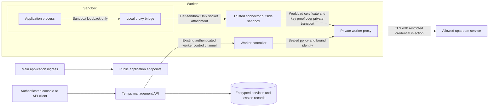

# Vault sessions and a private service proxy

Status: proposal for review. This document defines the intended security boundary; it is not a claim that every control or test below has shipped.

## Decision

The Vault service proxy must never be exposed through Temps' main ingress. It has no public domain, ingress route, published host port, or general-purpose management API forwarding endpoint. This remains true when projects become consumers later.

The first supported consumer is a specific sandbox. Any authorized project can use the feature for its own sandboxes; knowing a session ID, being signed into Temps, or being able to reach an application does not confer proxy access. Cross-project sharing and human/API-client proxy access are separate future designs, not implicit permissions.

## Product model

| Resource | Responsibility |
|---|---|
| Vault | Project-scoped owner of services, access bundles, and sessions. |
| Service | Provider identity/logo, encrypted credential or project credential source, allowed destinations, methods and paths, maximum TTL. |
| Access bundle | Reusable selection of services and a maximum session lifetime. Saving a bundle grants nothing. |
| Session | Immutable authorization for one identified consumer and the reviewed bundle/service versions, with a hard expiry and revocation state. |
| Worker binding | Internal attachment to a particular running workload incarnation. It is not a user-retrievable session credential. |

Vault navigation is **Services / Access bundles / Sessions**. Bundle cards open a detail page. Session creation is a separate approval screen. Session detail shows the consumer, restrictions, expiry, and per-service enforcement evidence. Sandbox detail shows its own sessions and links back to Vault. Creating a session is not reported as “Connected” until the worker acknowledges the exact policy.

## Network architecture

There is deliberately no edge from main ingress to the service proxy.

### Sandbox attachment

Each sandbox receives only its own socket directory through a read-only attachment. The containing host directory, other sandbox sockets, policy-signing keys, and decrypted upstream credentials are not mounted into the sandbox. The worker verifies the actual container, node, boot identity, and workload incarnation before enabling access. A guessed sandbox name or client-supplied header is insufficient.

Where tools need an HTTP proxy, a small bridge listens on loopback **inside the sandbox network namespace** and forwards to the attached Unix socket. The loopback port is not published, registered for preview routing, or placed on a shared project bridge. The host-side enforcement engine may use an internal loopback listener, but it must not accept unauthenticated use from arbitrary host processes; transport isolation and binding authentication are both required.

Do not enable a bind-mount transport just because Temps runs on Linux. In containerized control planes and remote Docker deployments, verify that the daemon can mount the same private directory. If that cannot be established, report transport unavailable; never fall back to a network-exposed proxy or relax mount confinement.

### Management plane

Authenticated management endpoints may create, inspect, and revoke session records. They do not accept CONNECT, tunnel arbitrary bytes, fetch user-specified URLs with stored credentials, or return internal proxy tokens. Management endpoints retain project permissions, sandbox ownership checks, request limits, and audit logging.

Use the existing authenticated worker protocol for policy delivery. No new public worker-control route is introduced by this proposal. The worker accepts policy only from the configured authority and verifies signature, intended node, boot identity, incarnation, version, and lease. Delivery retries cannot reinstall older policy or extend the original session expiry.

## Identity: who plus proof of possession

The required check is **verified workload identity + possession of its private key + an authorized, unexpired session**. A workload ID or hostname supplied by a caller is only a claim. An ID and a shared bearer secret are not two independent authentication factors: anyone who copies the secret can impersonate that identity.

Use a distinct identity for each workload incarnation. For example, the identity binds project, sandbox, worker, and incarnation; it never accepts these fields from unverified HTTP headers. A public certificate names this identity, while a private key proves possession through a mutually authenticated TLS handshake. A session must name the same identity and bind to the certificate/public-key fingerprint. Possessing a session identifier alone authorizes nothing, and a certificate for another workload cannot consume the session.

This is a proposed strengthening: the existing sandbox attachment is an isolation/capability mechanism backed by worker-resolved identity. It is not yet a complete end-to-end workload certificate proof-of-possession protocol. Mount isolation alone must not be described as fulfilling the new “who + key” requirement.

### Enrollment and trust chain

1. An operator enrolls a worker using a short-lived, single-use bootstrap credential delivered through a trusted administrative channel. Bind enrollment to the intended worker and permitted scope; successful enrollment consumes the credential.
2. The worker generates its private key locally and submits a certificate request. The control plane signs only after validating enrollment. Never put one permanent bootstrap credential in an image or shared environment variable.
3. When Temps creates a sandbox, the trusted worker verifies its actual provider identity and incarnation. It provisions a workload-specific key and short-lived certificate to a protected local connector, outside application-visible mounts and the LLM/tool environment.
4. The connector and worker proxy authenticate each other over the private socket transport. The proxy checks certificate chain, intended use, expiry, workload identity and key binding, then intersects that identity with the session's consumer and service restrictions.
5. The application uses the sandbox-local bridge. Authorization is at sandbox granularity: any process permitted to use that bridge acts as that sandbox. Distinguishing agents/processes within one sandbox would require another identity/isolation boundary.

The trusted worker is the attester in this first design. This does not protect against a compromised worker impersonating its own hosted workloads. Authority issuance must be constrained to that worker's assigned workloads; the worker must never be able to enroll arbitrary project identities merely by sending their IDs.

Bootstrap must authenticate the authority as well: install its trust root through the trusted provisioning channel and validate it before sending enrollment material. A certificate request proves possession of a key, not entitlement to a workload name; the issuer resolves that entitlement from its own worker/workload assignments. A stolen bootstrap credential can race legitimate enrollment, so keep it single-use, short-lived, narrowly scoped, and explicitly revocable.

The application-facing bridge contains no workload private key. The protected connector runs outside the sandbox's process and filesystem isolation boundary, maps each private attachment to exactly one attested identity, and holds that identity's key. A bounded connector process may serve multiple isolated bindings; a full process per sandbox is not required. It must never let a caller choose a different identity through a header or session ID. Requests on the resulting authenticated channel are still checked against the current session and policy on every request, with deadlines enforced on open streams. TLS authentication alone is not authorization.

This prevents taking a session identifier to another workload and using it there. It does not stop a compromised authorized application from using its own connector as an oracle during its allowed TTL, or from relaying requests from outside. The application remains responsible for its own public endpoints, and restrictions must assume all code within a sandbox can act as that sandbox.

### Key lifetimes and revocation

Separate worker identity certificates, workload certificates, session TTLs, and short policy leases. Renewing a certificate must not extend the session. During authorized key rotation, register the replacement key through the authenticated control channel, keep overlap explicitly bounded, and remove the previous binding. A recreated workload gets a new incarnation and key, not the old session.

Revocation disables the session and its grant rules even if its certificate remains valid. Revoking an identity blocks new sessions and lease renewal for that identity. Revoking a worker retires its authority and hosted bindings. In every case, in-flight access ends on confirmed removal or the last signed lease deadline; do not promise instantaneous global revocation during a partition.

### How HashiCorp Vault and Infisical establish machine identity

| System/method | Identity and proof | Result and limitation |
|---|---|---|
| HashiCorp Vault AppRole | RoleID plus SecretID, subject to configured role constraints | Returns a Vault token with the role's policies. The pair authenticates possession of issued credentials; it does not inherently attest the physical server. |
| Infisical Universal Auth | Client ID plus Client Secret for a machine identity | Returns an access token for Infisical API calls. A copied secret can impersonate the identity within its configured constraints. |
| Kubernetes authentication in both products | Kubernetes service-account token, validated against Kubernetes and configured account/namespace restrictions | Uses the platform as the identity authority instead of inventing a machine identity from a hostname. A bearer token remains sensitive. |
| AWS IAM authentication in both products | Signed STS `GetCallerIdentity` request, verified through AWS and matched to configured principal constraints | Trust comes from AWS IAM credentials and the allowed principal, not a caller-supplied server name. |

Sources: [Vault AppRole](https://developer.hashicorp.com/vault/docs/auth/approle), [Vault Kubernetes auth](https://developer.hashicorp.com/vault/docs/auth/kubernetes), [Infisical Universal Auth](https://infisical.com/docs/documentation/platform/identities/universal-auth), [Infisical Kubernetes auth](https://infisical.com/docs/documentation/platform/identities/kubernetes-auth).

AWS sources: [Vault AWS auth](https://developer.hashicorp.com/vault/docs/auth/aws), [Infisical AWS auth](https://infisical.com/docs/documentation/platform/identities/aws-auth). An agent automates authentication and renewal using this trust material; installing an agent does not itself establish identity. Platform validation identifies the principal represented by the credential, not an uncopyable physical machine.

Our recommendation is to borrow the identity/authentication separation, while binding proxy sessions to a workload key. An upstream provider key is a third, different credential: it stays behind the proxy and is never the workload's authentication secret. These products' authentication mechanisms are references, not evidence that our proxy already implements equivalent controls.

## Proxy deployment and unauthorized-access prevention

Deploy one bounded proxy runtime per worker, with isolated bindings per sandbox. Do not create an internet-facing proxy project or register proxy ports with automatic ingress discovery. The worker supervisor starts the runtime, verifies its version/readiness, and owns its cleanup. A separate least-privilege process is the target deployment: only the orchestration worker needs access to container management; the proxy process should not inherit the Docker socket or host-administration privileges. The current embedded runtime is a transitional implementation, not that process-isolation boundary.

Each sandbox gets a lightweight connector and its own private socket attachment, not a full secret store. Bind the application-facing bridge only to sandbox loopback. Do not mount workload private keys into application-readable locations. The proxy's control endpoint accepts only the authenticated supervisor/authority, and its data endpoint requires the workload proof described above. A local or network connection by itself is never sufficient.

On a single-node installation, run the same worker-side components locally; main ingress still has no connection to them. On multi-node installations, keep application traffic local to its assigned worker and send only authenticated control-plane updates across nodes. Upgrade workers by draining bindings and requiring fresh incarnation checks; fail closed on incompatible protocol versions. Do not kill unrelated workloads or silently reduce isolation to make an attachment work.

For future external servers, use an explicitly configured private network plus mutual TLS and enrolled machine identity. No automatic fallback to main ingress, a public hostname, or an unauthenticated TCP proxy is allowed. This external transport is not part of the initial sandbox implementation.

Acceptance tests must additionally prove that a copied session token without its bound key fails; a valid key for a different workload fails; an expired or untrusted certificate fails; direct access to the enforcement engine cannot bypass connector authentication; and spoofed identity headers do not alter the authenticated principal.

## Session lifecycle

1. An authorized operator selects a bundle and one running sandbox in the same project. The UI displays the exact services, scopes, and maximum lifetime being approved.
2. The server checks project and sandbox permissions, ownership, credential-source permissions, bundle membership, and every reviewed service version. It resolves the workload through the provider rather than trusting request metadata.
3. Persist the session and all selected service authorizations in one transaction. A stale version, unavailable credential, invalid consumer, or quota failure rolls back the whole approval.
4. Assign one fixed deadline: creation time plus the requested TTL, bounded by the bundle and every service maximum. Retries with the same request ID return the original authorization; they do not renew it.
5. Queue policy delivery. Report **Issued / awaiting worker confirmation**. The worker establishes the private binding and acknowledges the exact installed version before the UI reports active enforcement.
6. Reconciliation renews short worker policy leases only while the original authorization remains valid. It never renews the session itself. A lost controller connection causes the worker lease to expire and access to stop.
7. Revoking a session marks all its authorizations revoked and durably queues removal. Report **Revocation requested** until removal is acknowledged or the last signed lease expires. Other independent sessions retain their own permissions.
8. Hard expiry applies to existing streams as well as new connections. Creating another session requires another explicit approval. Workload restart or replacement must not inherit an old incarnation's access automatically.

Current runtime constants cap policy leases at 30 seconds, bindings at 128 per worker, total connections at 256 per worker, connections at 32 per sandbox, policy snapshots at 4 MiB, and active grants at 16 per binding. These are implementation bounds, not a promise that the maximum simultaneous workload fits the smallest machine. Measure total connection buffers and policy memory before raising limits.

## Restrictions and secrets

- Default deny unmatched destinations. Validate scheme, hostname, port, method, and normalized path against the approved service policy.
- Reject private, loopback, link-local, metadata, and other prohibited addresses at connection time, including after DNS resolution. Re-resolve and reauthorize redirects; credentials must never follow a redirect to another origin.
- Match HTTP authority, CONNECT target, and TLS destination consistently. Reject malformed requests, ambiguous encodings, and conflicting framing rather than letting upstream parsers interpret a broader request.
- Credentials are decrypted only in the trusted worker enforcement path and injected only after the destination and request are authorized. A sandbox never receives the provider token. Scrub conflicting client authorization headers under a defined per-service authentication policy.
- For HTTPS APIs, the workload trusts only the scoped interception CA needed by this proxy path. Never globally disable certificate validation. The proxy verifies the upstream certificate normally.
- Bind authority to workload identity and its current incarnation, not source IP alone. Source IP and arbitrary forwarded headers are not consumer credentials.
- Enforce each rule's deadline even when multiple sessions share one workload binding. Revoking one session removes only its grants; another overlapping authorization may still permit the same request, which the UI must explain.
- Keep credentials, internal tokens, request/response bodies, and sensitive URL query strings out of logs and audits. Record session IDs, scoped resource IDs, operations, timing, and sanitized denial categories.

## Threats and boundaries

| Threat | Required response |
|---|---|
| Public caller probes proxy paths or sends CONNECT through ingress | No proxy route exists; ordinary ingress rejects the request. |
| Another sandbox tries to borrow access | It lacks the private attachment and cannot satisfy the original binding identity. |
| A container is replaced using the same name | The incarnation differs; old authorization cannot attach. |
| Credentials used against internal infrastructure | Destination/IP restrictions and DNS-rebinding protection reject the request before credential injection. |
| Controller or worker restarts during revocation | Durable desired state plus short signed leases prevent indefinite authorization. |
| Captured older delivery is replayed | Authority/version/incarnation checks reject rollback; expiry is absolute. |
| Compromised authorized sandbox | It can exercise its allowed scope until removal or expiry; tight scopes and TTLs limit exposure but do not make the workload trustworthy. |
| Compromised worker host/root | Outside the isolation guarantee of a worker-local proxy. Treat the worker as trusted infrastructure, retire its authority, and rotate affected upstream credentials. |
| Connection or policy exhaustion | Fixed admission limits, bounded buffers, timeouts, and explicit rejection; no unbounded queue or silent fallback. |

## Future project workload support

Keep the public consumer model explicitly typed. Initially it accepts only `sandbox`. Later, a project workload consumer should identify project, environment, deployment, and workload incarnation; “project” alone is too broad to identify a process.

The deployment orchestrator would install an equivalent private socket attachment and issue a narrowly scoped workload identity. Use the same session and lease enforcement path. Main ingress, project domains, and preview routes remain unrelated to proxy access. Do not enable this consumer type until attachment isolation, restart behavior, authorization, and cross-workload negative tests exist.

Human/API-client use would need a separate authenticated private-network transport design. This document does not authorize opening a public proxy endpoint to accommodate it.

## Delivery and acceptance criteria

Ship behind typed capability reporting per actual provider/worker support. Unsupported deployments must explain what is missing without claiming a working attachment. Existing individual sandbox grants need an explicit management/migration path; do not silently convert them into new approvals or hide live access that still needs revocation.

Before declaring the workflow ready, verify:

1. No public ingress route, preview registration, host-published port, or wildcard proxy listener exists; test from outside the worker and from a sibling sandbox.
2. Real sandbox traffic is denied before approval, allowed only for the approved service/path/method after worker acknowledgment, and denied after revocation and hard TTL expiry.
3. Existing connections terminate by their enforced deadline. Controller loss cannot renew leases, and delayed delivery cannot extend expiry.
4. Replay, stale bundle/service versions, duplicate approval retries, wrong owner/project, and wrong incarnation fail without partial access or secret disclosure.
5. An overlapping second session remains independently observable: revoking one cannot falsely promise that all equivalent access ended.
6. Native and containerized Linux deployments validate daemon-visible paths; unsupported filesystems remain unavailable without breaking ordinary sandbox creation.
7. Session creation, read-only detail, expiry, revocation, loading/error states, pagination, mobile layout, provider logos, and breadcrumbs work in the console.
8. Measure memory and concurrency under the stated small-host requirements; record saturation behavior and cleanup of sockets, streams, tasks, and retired policies.

## Implementation reference and current status

The current branch already contains private Unix attachments in `crates/temps-service-access-runtime/src/attachment.rs`, persistent mount validation in `crates/temps-service-access-runtime/src/mount.rs`, bounded worker control in `crates/temps-service-access-runtime/src/control.rs`, and per-rule expiry in `crates/temps-service-access/src/tokenless/binding.rs`. Vault session persistence and UI are in progress.

Those source references are evidence of existing mechanisms, not proof that all acceptance tests above passed. The UI clients have been regenerated from the rebuilt backend and both TypeScript clients typecheck. The branch now has an embedded TLS 1.3 workload-key transport prototype with host-held per-binding credentials and bounded admission; 41 runtime tests pass, including traffic, expiry, revocation, and wrong-key rejection. Its connector and enforcement engine still share the worker process. This is transport groundwork, not the proposed independent least-privilege proxy deployment; process separation, production enrollment/rotation integration, and end-to-end deployment acceptance remain unfinished. The running development backend does not yet include this new TLS prototype. Independent review remains outstanding. No deployment, merge, public proxy exposure, or change to workload isolation is authorized by this document.
